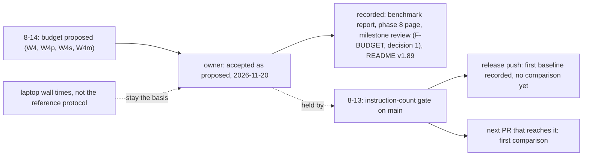

# Review 8-45: the 3D benchmark budget accepted

Task: 8-45. Class 1 (documentation only). Ordinary card into `develop`. Owner decision of 2026-11-20: "I accept 3D performance budget", read as option (a) of the phase 8 milestone review (O9 (a)): accept the budget of card 8-14 as proposed.

## What changed

Four documentation places say the budget is accepted and keep the caveats; no number was changed and no gate file was touched.

## Evidence

- The state of the gate was read from the hosted run of the release push on `main` (run 44605816554, 2026-11-19): the job "Physics 3D instruction count" recorded 1462423829 instructions twice (two runs agree), as a first baseline, with "no baseline, recorded only" because the base tree had no benchmark tool; the jobs "D2 golden hashes, 3D scenes" were equal on Linux and Windows x86-64 (5 scenes, 97 hashes).
- My first draft said the gate would first run in the release pull request; that was stale (the release had already happened) and was corrected after reading the run.
- Wiki lint and the local gates, see the PR.

## Not verified

- The accepted figures are the laptop figures from card 8-14, not the reference protocol; no reference machine has been named. The report still says a first run on one should confirm or tighten them.
- The accepted wall times are not gated; the instruction-count gate has not yet compared anything, so the budget is held in practice only from its first comparison.
- "Read as option (a)": the owner's words did not name the option; it is the only one that accepts.

## R1 to R8

| phase | result |
|---|---|
| R1 self | a stale claim about the first hosted run found and corrected from the run's log |
| R2 automated | local gates (wiki lint among them) |
| R3 independent | none: documentation of the owner's decision, no new claim of substance beyond the gate state above |
| R4 to R8 | not applicable to a record of a decision |

## Loops

None.
