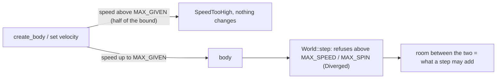

# Review 8-46: headroom for given speeds

Task: 8-46. Class 2 (public rule and two new public constants of the shared physics core, 2D and 3D). Ordinary card into `develop`. Owner choice of 2026-11-20 among three options: "Headroom at create/set".

## Decisions

1. Two constants, `MAX_GIVEN_SPEED = MAX_SPEED / 2` (5000 m/s) and `MAX_GIVEN_SPIN = MAX_SPIN / 2` (1000 rad/s), used by `create_body` and both setters; the step still enforces the bounds the owner adopted in 8-41.
2. Rejected: a tolerance in the step (keeps the edge fuzzy) and documentation only (keeps the trap).
3. Half, not a smaller fraction: the largest healthy scene of the scan (a 1000 m/s bullet, 521 rad/s) stays inside, and the room is large against what gravity, damping or a force adds in a step. It is **not** enough for every collision: see Loops, finding 1.

## Evidence

- Tests first: the create/set tests (`d3_divergence.rs`, 3D and 2D) say the largest given speed is accepted and the bound itself and anything above the new limit is `SpeedTooHigh` (they failed to compile before the constants existed); `a_body_given_the_largest_allowed_speed_can_be_stepped` gives a body the largest speed and spin and steps it 600 times in 3D and in 2D; **red** with the headroom removed: "3D step 12: Err(Diverged)"; green after.
- A unit test of the new check in `body.rs` (limits, the bounds themselves, NaN, overflow).
- Tests that gave exactly the bound were moved to the largest given speed (`generic_core.rs`, `stability/properties.rs`, two unit tests in `world.rs`, the spin tests of the two scan files), with their step lengths scaled so the overflow arithmetic in their comments still holds.
- `cargo test -p physics` (34 test groups ok), clippy `-D warnings` and fmt on the crate; workspace gates see the PR.

## Not verified

- Collisions: two elastic balls (restitution 1) of very different mass meeting head-on, each given the largest speed, are refused as `Diverged` (the light one can leave at up to three times the given speed, the headroom is two times), in 2D (the core is shared; 3D not tried). Card 8-47.
- The spin tests of the two scan files now spin at the largest given spin (1000 rad/s), a smaller case than the 2000 they had; the case at the bound can no longer be given.

- No other crate or sample gives a speed above half the bounds (a workspace search found none and the workspace tests are the evidence); an external game that does gets `SpeedTooHigh`.
- The golden hashes: the physics suite's golden and replay tests pass; the D2 checker with the feature on runs in the release CI.
- Mutation and Miri were not run (they run in CI).

## R1 to R8

| phase | result |
|---|---|
| R1 self | my reproducer test gave a vector (-5000, 2) that was itself a hair over the limit; made horizontal |
| R2 automated | physics tests, clippy, fmt, local gates |
| R3 independent | see Loops |
| R4 QA | red first for the new rule and the reproducer |
| R5 architecture | the limit is in the shared core, so 2D and 3D agree |
| R6 security | rejects absurd input earlier, no new input path |
| R7 performance | one more squared-length comparison at create and set, not in the step |
| R8 product fit | removes the trap found in 8-40 |

## Loops

| loop | finding | handling |
|---|---|---|
| 1 | major: the claim "every speed that is given can be stepped" is false for collisions (light body, much heavier body, elastic, head-on: refused as `Diverged`); free fall, bounces off static bodies, a joint swing, a heavy body hitting a stack and equal bodies all passed | the docs (`core/mod.rs`, `error.rs`), the wiki, the README entry and this review reworded to what holds; card 8-47 for the collision case |
| 1 | minor: the reproducer tests only free fall | stated; the claim is now limited to that |
| 1 | minor: the spin scan tests lost the case at the bound | stated in Not verified |
| 1 | minor: long rustdoc lines | accepted, cosmetic |
| 1 | note: the check logic, the call sites, no other reliance on the bound, the step arithmetic in the rewired tests and the diagram were checked and are right | stated |
| 1 | note: the loop-1 fixes were not seen by a second reviewer | stated |
