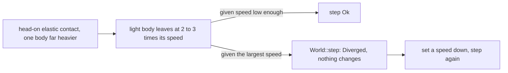

# Review 8-47: the collision edge of the speed bounds

Task: 8-47 (follow-up of 8-46). Class 1 (a new test file and documentation; no engine code, constant or rule changes). Ordinary card into `develop`. Owner choice of 2026-11-20 among three options: "Document and pin it".

## Decisions

1. No engine change. The bound stays a ceiling on what a step may leave; the headroom of 8-46 stays at half.
2. The behaviour is pinned by `engine/physics/tests/collision_speed_edge.rs` (5 tests, 2D and 3D) and written in `wiki/spikes/speed-bounds-scan.md` section 7 and in the wiki README v1.92.
3. Rejected by the owner's choice: a quarter instead of a half; clamping the contact result.

## Evidence

- The review of 8-46 reported the refusal; my first scan did **not** reproduce it, because the bodies started 10 m and then 1.1 m apart and a body travels about 80 m a step, so they never touched (velocities unchanged after 120 steps; the engine has no continuous collision detection). Starting the bodies overlapping reproduced it: at the largest given speed with a partner 10, 1000 and 1e6 times denser the first step returns `Diverged`, in 2D and 3D; equal masses are `Ok`; at 1000 m/s with a 1000 times denser partner the light body leaves at about three times its speed.
- Tests are characterization of existing behaviour, so they pass at once. Proof that they can fail: with the step's bound check switched off temporarily (`motion_is_bounded` returning true) 3 of the 5 fail (both refusal tests and the way-out test); restored, 5 pass.
- The test file also asserts the world is unchanged by the refused step (state hash, step count), that equal masses are fine, that the collision at a lower speed is fine with the 2 to 3 times result, and that setting the speeds down lets the step run.

## Not verified

- Only head-on spheres and circles; other shapes, three-body chains and spin were not tried (card 8-48). Whether a chain of collisions can pass a quarter-headroom too is a hypothesis, not a result.
- Destroying a body as the way out is the documented rule of `Diverged` and is not tested here.
- Mutation, Miri, golden hashes and the hosted run: no engine code changed, so they cannot move; they run in the release PR's CI.
- Mermaid read by the author, not rendered.

## R1 to R8

| phase | result |
|---|---|
| R1 self | the first scan was invalid (bodies tunnelled); caught by printing the velocities, redone |
| R2 automated | physics tests, clippy, fmt, local gates |
| R3 independent | see Loops |
| R4 QA | characterization tests with a demonstrated failure |
| R5 architecture | no code change |
| R6 security | none |
| R7 performance | none |
| R8 product fit | a game author learns the edge from the docs and a test instead of from a refusal |

## Loops

| loop | finding | handling |
|---|---|---|
| 1 | major: the doc and the test header stated as fact that chains of collisions amplify a speed; nothing shows it | reworded as not tried in the test header, the wiki and Not verified; card 8-48 |
| 1 | minor: "destroy a body (tested)" was not tested | wording and both diagrams corrected |
| 1 | minor: the rustdoc "says the same" overstated | reworded to what each doc says |
| 1 | minor: rejection reasons looked like the owner's | marked as mine |
| 1 | minor: the 2-to-3 check was loose | now above 2.9 and below 3 (measured 2.996) |
| 1 | note: the 3 times at the refused speed is inferred, not observed | stated in the wiki |
| 1 | note: the loop-1 fixes were not seen by a second reviewer | stated |
