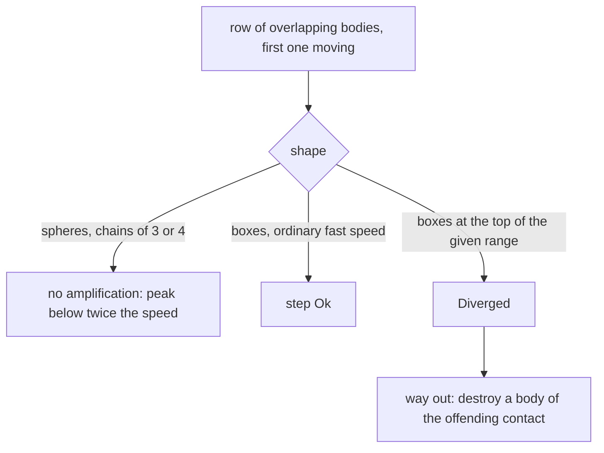

# Review 8-48: collision scenes at the top of the given range

Task: 8-48 (follow-up of 8-47). Class 1 (a new test file, one more test, a report and one rustdoc sentence; no rule, constant or behaviour changes). Ordinary card into `develop`.

## Findings of the scan (all in `wiki/spikes/speed-bounds-scan.md` section 8)

1. Chains of spheres do not amplify (peak up to about 1.8 times the start for ratio 10, 1.4 for ratio 3): the hypothesis behind rejecting a quarter headroom in 8-47 is **not supported**; no change of the owner's decision is needed.
2. Boxes are refused only at the top of the given range: a short chain at the largest given speed, a heavy box at the largest given spin hitting a light one at rest (pinned); in a head-on scan with counter-spinning boxes also at 500 m/s in 3D (not pinned). Ordinary speeds, half the largest spin, and a light spinner into a heavy body are fine.
3. Destroying the body that carries the speed does not cure a refusal; a body of the offending contact does. `Diverged` names no body (card 8-49).

## Evidence

- Eight tests in `collision_scenes_edge.rs` (2D and 3D each) and one in `collision_speed_edge.rs`, written after a scan printed the numbers, as characterization. Two of my first drafts were wrong (the row helper moves only the first, heavy body, so it is not the head-on scene of 8-47; and "destroy the fast body" was assumed to be the cure) and the failing runs showed it; both were corrected from the measurements, not by loosening a test.
- With the step's bound check switched off temporarily (`motion_is_bounded` returning true) 4 of the 8 fail (the refusal and way-out tests); restored, all pass.
- Clippy `-D warnings`, fmt, the crate's own `disallowed-methods` (the first draft used `powi`, banned in the physics crate; replaced by a fold).

## Not verified

- Only spheres, circles and boxes; hulls, capsules, angled hits, longer rows and non-default friction were not tried.
- The half-speed box chain refused in 2D at 2500 m/s is a scan result that is not pinned.
- Mutation, Miri, golden hashes and the hosted run (no engine code changed); Mermaid read by the author, not rendered.

## R1 to R8

| phase | result |
|---|---|
| R1 self | two wrong first drafts of tests, fixed from the numbers; banned `powi`; nesting limit met by helpers |
| R2 automated | physics tests, clippy, fmt, local gates |
| R3 independent | see Loops |
| R4 QA | characterization with a demonstrated failure (4 of 8 fail with the check off) |
| R5 architecture | no code change besides one doc sentence |
| R6 security | none |
| R7 performance | none |
| R8 product fit | the edge of the speed bounds is now known by shape and spin, with a way out that works |

## Loops

| loop | finding | handling |
|---|---|---|
| 1 | major: in the spin tests the spinning box was the heavy one, the opposite of the names and texts ("meets a far heavier one") | tests renamed, a test added for the real case (light spinner into heavy at rest: steps), header, wiki, README, review and card 8-49 corrected; the head-on counter-spinning scan scene is stated as scan only |
| 1 | minor: the chain test discarded the step index | now asserts the refusal at step 1 |
| 1 | minor: "3D already at 500 m/s" implied 2D steps there, and was not pinned | worded as scan only, with the scene |
| 1 | minor: "about 1.8" not asserted; sphere spin one-sided | the text says "up to, ratio 10"; the spin test now two-sided |
| 1 | minor: section 7 list of untried scenes is stale | pointer added in section 8 |
| 1 | note: near-copies for 2D and 3D; the duplication gate was not run by the reviewer | local gates run it |
| 1 | note: the loop-1 fixes were not seen by a second reviewer | stated |
