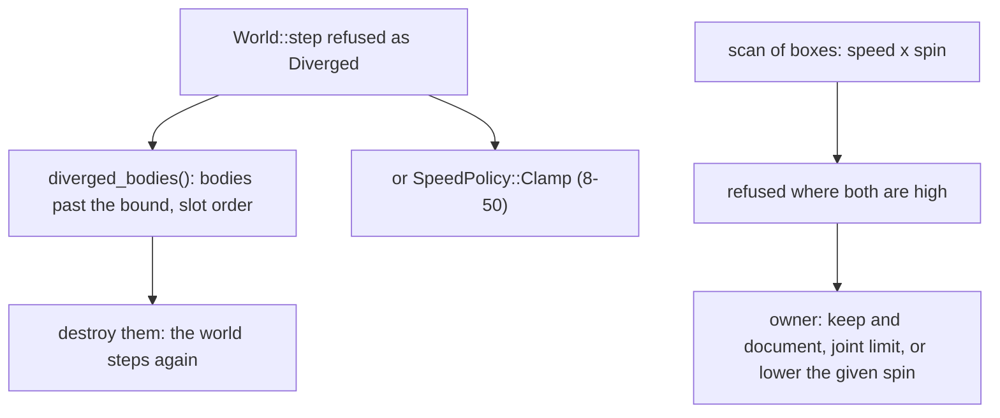

# Review 8-49: which body crossed the bound, and the spin room

Task: 8-49 (follow-up of 8-48). Class 2 (one new public method of the shared physics core, 2D and 3D; no rule, constant or error value changes). Ordinary card into `develop`. Owner, 2026-11-20: "8-49". The card has two parts: a query naming the bodies of a `Diverged` refusal, and a scan of the spin room, a decision for the owner.

## Decisions

1. `World::diverged_bodies() -> &[BodyHandle<D>]`: read-only, no change to `PhysicsError` (the `Diverged` value stays unit), no allocation (a `Vec` with the capacity of the world, filled on a refusal and cleared at the start of the next real step). A time step that is not valid is not a step: it keeps the list, as it keeps everything.
2. `NotFinite` names no body (the list is empty): a value that overflowed is not "a speed past the bound".
3. The spin room is a measurement and a pair of options for the owner, not a change: the refusals depend on speed and spin together, so a cap on spin alone would have to be about 250 rad/s.

## Evidence

- Tests first (compile-red: the method did not exist), then green: `diverged_bodies.rs` (6 tests, 2D and 3D), one in `no_allocation.rs` (the refused steps and the read allocate nothing, counting allocator). With the naming switched off 4 of the 6 fail (the others check emptiness).
- `spin_room_edge.rs` (5 tests) pins the scan at points; the table is in `wiki/spikes/speed-bounds-scan.md` section 10. The scan first run was a scratch file, removed.
- One of my tests was wrong at first (it expected an invalid time step to clear the list; the documented rule is that it changes nothing, so the test and the doc were corrected, not the code).
- Clippy `-D warnings`, fmt, the crate's own bans.

## Not verified

- Only boxes in two scenes for the spin room; hulls, capsules, angled hits, longer rows, non-default friction were not tried (card 8-51).
- Mutation, Miri; the hosted run on Linux and ARM64 (the release PR); Mermaid read by the author, not rendered.

## R1 to R8

| phase | result |
|---|---|
| R1 self | a wrong first test (invalid time step), clippy nesting in the first draft of the filler |
| R2 automated | physics tests, clippy, fmt, local gates |
| R3 independent | see Loops |
| R4 QA | compile-red first; 4 of 6 fail with the naming off; allocation test |
| R5 architecture | additive method on the shared core; no error type change |
| R6 security | none |
| R7 performance | a pass over the bodies only on a refused step; nothing on a good step beyond one `clear()` |
| R8 product fit | a game can find the body that blew up; the owner has the data for the spin decision |

## Loops

| loop | finding | handling |
|---|---|---|
| 1 | major: the slot-order test named one body, so a wrong engine that named every body passed | replaced by tests that assert the exact list (two pairs, 2D and 3D: the two light balls, in slot order, not the heavy ones) and that the fast body of the chain is not named |
| 1 | minor: "sure way out" over-promised | "enough in the chains tested" in the rustdoc and the wiki |
| 1 | minor: stale handles and policy change not documented or tested | documented; test added |
| 1 | minor: the clamp claim untested | test added (a clamping world names nobody) |
| 1 | minor: the 1000 m/s table row said 850 to 950 (a ratio of 100 I had scanned, not in the file's grid) | 850 to 925, as the file measures |
| 1 | minor: the rows for 200 m/s and 250 rad/s rest on single test points | worded as such |
| 1 | minor: "a spin cap about 250 removes every refusal" was unscoped | scoped to this scan; the refusals of 8-47 happen with no spin |
| 1 | note: mutation score not run (the gate runs in CI); the reviewer believed the first test set would have scored low, the second set catches naming every body or only slot 0 | stated |
| 1 | note: the loop-1 fixes were not seen by a second reviewer | stated |
