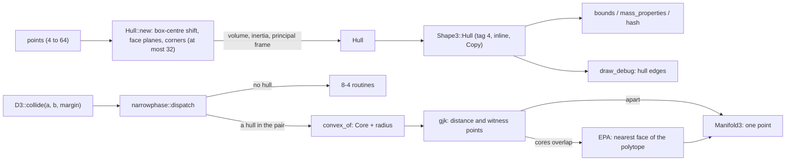

# Review 8-5: `physics::d3` convex hull, GJK and EPA

Task: 8-5. Class 2 (public API of `physics::d3`: `Hull`, `Shape3::Hull`; no `unsafe`, no new dependency, no governance file). Ordinary card into `develop`. Loops: 3 fix loops (2 independent reviews; the third loop's fixes were checked by tests and mutation only). Open blocker/major: 0, with the known limit on thin hulls stated below.

Delivers: a convex hull shape for 3D bodies (builder, mass, bounds, hash, debug draw) and contacts for every pair that involves a hull, found by GJK and EPA, with ONE contact point per pair. Up to four points by clipping is the follow-up card 8-18. The 3D solver is still `FreeSolver` (card 8-6). README v1.66.

## Decisions

1. **Shapes are seen as a convex core plus a radius.** Point, segment, box or hull, and a radius: a sphere is a point with a radius, a capsule a segment with a radius. One GJK/EPA path serves every pair with a hull and needs only a support function per shape.
2. **One contact point per pair that involves a hull** (owner, two PRs). The point is the midpoint of the two surfaces. A manifold of up to four points by clipping is card 8-18.
3. **Hulls are stored inline, at most 32 corners (owner).** `Shape3` stays `Copy` and `HashBits`, no heap, no handle. The cost: `Shape3` is now about 448 bytes, so `Shape3` is passed by reference and `clippy::large_enum_variant` carries a scoped `#[expect]` naming this decision.
4. **The hull is stored in its principal frame about the centre of mass** (`origin()`, `orientation()`: input = origin + orientation times vertex). Mass comes from tetrahedra, the inertia tensor is diagonalised with a Jacobi sweep (no trigonometry) and the rotation to a quaternion with Shepperd's method.
5. **Faces from planes, not from a dynamic hull algorithm.** Brute force over point triples (inputs are at most 64 points, the build is not a hot path: 5 to 10 ms in release for 64 points), corners on three or more face planes. Planes that are one face are merged: two planes facing the same way that share three or more points not on one line are one face, and the one with more points is kept. Faces that do not close up (area vectors do not cancel) are refused with `InvalidShape`.
6. **Input is shifted to the centre of its bounding box before the planes are built**, so a hull far from the origin keeps its precision (found as a blocker in loop 1).
7. **No heap allocation in GJK, EPA or the build**: fixed arrays (polytope 64 vertices and 128 faces, hull build in arrays). EPA refuses to grow before it changes the polytope, so a full polytope returns the nearest face it has.

Known limits:
- **Thin hulls.** The planes are good to about 2e-5 of the hull size, so volume and inertia of a plate are good to about 2e-5 divided by the thickness over the size: 0.1% at a tenth, 0.3% at a hundredth, a few percent at a thousandth. At a thousandth, about a third of random point sets are refused with `InvalidShape` (the faces do not close within the check). Refusal is the safe result; wrong mass is not returned silently. Use a `Box` for plates. Documented in the design note.
- One contact point only for a pair with a hull (card 8-18), so a hull resting on a face is less stable until then.
- Contacts against a hull are not cross-checked against the 8-4 box routine near the diagonal limits already documented for boxes.

## Evidence

- Tests written first. Red evidence: the first runs did not compile (`Hull`, `Shape3::Hull` absent), then each behaviour was added and its test went green. Bug regressions were made red first: the far-from-origin hull (builds only with the shift: fails at scale 1, offset 100 without it, passes with it), and the thin-plate volume tests (the order test failed 6 of 117 plates before the merge rule and the closed-surface check).
- `engine/physics/tests/d3_hull.rs`: 20 tests (mass and inertia of box, tetrahedron, square pyramid and heptagonal prism against exact values, centring, refusal of invalid and over-limit input, vertex limit, bounds, hash, many rotations, scattered points, order independence, scale and offset, far from the origin, thin plates against an exact prism volume, thin plates in any point order). `d3_narrowphase.rs`: hull analytic cases and an independent oracle (support-function numerical check in `f64`) over hull against sphere, capsule, box and hull, plus a hull-against-box comparison. `d3_debug_draw.rs`: hull edges. `d3_no_allocation.rs`: a hull in the counting-allocator test. Unit tests in `gjk.rs` (flat simplex, push weight, flatness by angle, polytope capacity) and `hull.rs` (rotation to quaternion in every branch, hull validity, collinear points). `cargo test -p physics`: all pass (lib 306, every test file ok, 0 failed).
- `cargo clippy -p physics --all-targets -- -D warnings`: clean. `cargo fmt -p physics -- --check`: clean.
- Mutation (`cargo mutants -p physics -j1`, per file and in small batches because large runs were stopped by low memory, twice). Files: `gjk.rs`, `hull.rs`, and the hull wiring in `narrowphase.rs`, `shape.rs`, `debug_draw.rs`. Earlier rounds led to new tests until the survivors were judged equivalent or benign (exact counts of those rounds are in the session log, not recorded here). Rounds after the review loops: `is_flat` and `Polytope::expand` 27 mutants, 0 missed; loop 3: `same_face`, `shared_points`, `members` 21 mutants, 1 missed; `add_plane` and the closed-surface code 41 mutants, 11 missed, of which 8 (all in `spans_a_plane`) were killed by two new direct tests (17 mutants rerun, 11 caught, 6 unviable, 0 missed). Output in `target/mut-*` was deleted (not committed).
- Survivors judged equivalent (reasoned, not proven): `&&` against `||` in `same_face` (fewer than three shared points never span a plane, so the second operand is false anyway); `*` against `/` and `+=` against `-=` in `add_area` (every vector scales by the same factor, or flips sign, and only the length ratio is read); `>` against `>=` in `keep_the_fuller` (two planes of the same face with the same member count give the same hull). Other survivors from earlier rounds, listed in the session log, were tolerance values, ties on exact floats, and duplicates of a check done one level up.
- Independent review probes (release build, scratch copy, repository untouched): 3000 and 4000 random hulls (cubes, thick and thin plates, slivers, sphere surfaces, duplicated points, offsets up to 1e4): no panic, no non-finite value, contact normals unit length, frame check within f32 error, volume against an independent f64 reference.
- Local gates (`python tools/local-gates/local_gates.py --base origin/develop`): exit 0 (the `FAIL` lines are the tools' own negative cases). Wiki lint: 70 pages, 0 violations. Output `target/local-gates-8-5.txt` (not committed).

## Not verified

No Linux or ARM64 run; no D2 cross-platform golden hash for the 3D narrowphase (card 8-13); no multi-thread run; no branch-coverage or new-line gate run; no benchmark (cards 8-12 and 8-14); the build time of 5 to 10 ms is a reviewer measurement in release, not a gate; contact depth and position against a hull were checked by my oracle and analytic cases, but the reviewer only probed finiteness and unit normals; hulls of inputs quantised to a few ulps (scale 1e-3 at offset 1e4) showed 3 to 20% volume differences in about 25 cases that were not diagnosed; some mutation survivors are reasoned and not proven; the Mermaid view was read by the author, not rendered; the third loop's fix was reviewed by tests and mutation, not by a fourth independent review (the limit is three loops).

## R1 to R8

| phase | result |
|---|---|
| R1 self | read the code against the 8-4 patterns; extracted helpers for nesting and argument limits; test values chosen so mutants cannot hide |
| R2 automated | tests, clippy, fmt, mutation, local gates, wiki lint, diff hash |
| R3 independent | read-only reviewer, two passes: loop 1 one blocker and one major, three minor, two nit; loop 2 one major, one minor, one nit on the fixes; loop 3 fixes applied and not independently reviewed (table below) |
| R4 QA | analytic cases, independent numerical oracle, exact prism and pyramid volumes, order independence, far-from-origin and thin-plate regressions |
| R5 architecture | `d3` only; `Dim` and `core` unchanged; `Shape3` grew by an owner decision (inline hull, 32 corners) with a scoped `#[expect]` |
| R6 security | no `unsafe`, no new dependency, no secrets; invalid, non-finite or non-closing input returns `InvalidShape` or no contact; fixed capacity everywhere, refusals before mutation |
| R7 performance | no allocation in GJK, EPA or the build path of contacts (counting-allocator test); build time measured only by the reviewer; contact speed not benchmarked (cards 8-12 and 8-14) |
| R8 product fit | the owner reads decisions 2 and 3 (one point per pair, 448-byte shapes) and the thin-hull limit |

## Loops

| loop | finding | handling |
|---|---|---|
| 1 | blocker: a hull far from the origin could panic when planes were built | shift of the input to the centre of its bounding box; regression test red then green |
| 1 | major: a hull with a wrong volume from plane duplicates | planes merged by point set, face with fewer than three corners returns an error instead of a panic |
| 1 | minor: simplex weight of a pushed vertex was stale | `push` zeroes it; unit test |
| 1 | minor: EPA could overrun the polytope capacity | check before any change; unit test at the exact limit |
| 1 | minor: a flat triangle as a 3-simplex | cut back to two vertices and grown from its line; unit test |
| 1 | nit: hash doc comment; stray comment | reworded |
| 2 | major: thin hulls had a volume up to 17% (1%) and 92% (1e-4) too large, two planes of one face counted twice | merge rule changed (three or more shared points not on a line, keep the fuller plane) and a closed-surface check, so that a faulty hull is refused instead; regression tests against an exact prism volume and order independence, red first |
| 2 | minor: about 5% of valid thin hulls refused for a face with two corners | the closed-surface check now catches these; the refusal rate on thin plates is documented as a limit |
| 2 | nit: doc comments of `is_flat` and `tetrahedron` swapped; `box_centre` doc misplaced | moved |
| 3 | no new independent review (limit reached); mutation of the loop-3 code | 8 survivors in `spans_a_plane` killed by two direct tests; the rest judged equivalent |
