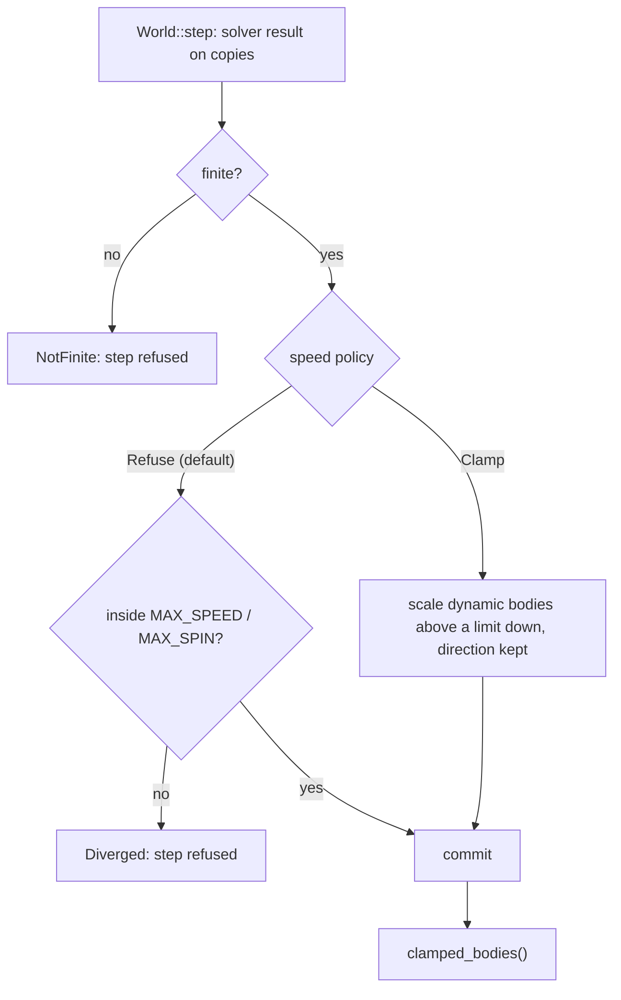

# Review 8-50: opt-in speed clamp

Task: 8-50 (follow-up of 8-47 and 8-48). Class 2 (a public type, three public `World` methods and an error variant in the shared physics core, 2D and 3D; determinism-relevant). Ordinary card into `develop`. Owner, 2026-11-20: "I like the opt-in world setting", then chose to start with the proposed defaults (the which-body query of card 8-49 stays in the Backlog).

## Decisions

1. `SpeedPolicy { Refuse (default), Clamp { linear, angular } }`, set with `World::set_speed_policy`, read with `speed_policy()`; `clamped_bodies()` counts the bodies the last successful step clamped.
2. A world method, not a `WorldConfig` field: the config is built by struct literal in about forty places, and a new field would change all of them for a setting that is off by default.
3. The limits are above zero and at most `MAX_GIVEN_SPEED` / `MAX_GIVEN_SPIN`, so a clamped speed is inside the bounds even after rounding; otherwise `InvalidSpeedLimit` (a new variant of a `#[non_exhaustive]` enum).
4. The clamp acts on the result of the step (on the copies, before the bound check and the commit), so a refused (`NotFinite`) step still changes nothing. It is not a clamp before the solver, as PhysX does; that would mean a change in each of the two solvers.
5. A refusing world hashes exactly as before; a clamping world adds its tag and limits to the state hash.

## Evidence

- Tests first (compile-red: the API did not exist), then green: `engine/physics/tests/speed_clamp.rs` (2D and 3D), unit tests of `SpeedPolicy::validate`, of the body clamp (direction kept, within-limit untouched bit for bit, static body untouched) and of the error message.
- With the clamp switched off temporarily 5 of the 10 first tests failed (the clamp-behaviour ones); restored, all pass.
- The scenes that card 8-47 and 8-48 found refused (head-on light and heavy balls at the largest given speed) step under the clamp in 2D and 3D.
- Clippy `-D warnings`, fmt, the crate's `disallowed-methods` (one `sqrt`, allowed: exact under IEEE 754).

## Not verified

- The clamp across worker counts is tested (serial against 1, 2, 4 and 6 workers, the clamp fires on every body); that test was written after the code. Linux and ARM64 run in the release PR's CI.
- The box scenes of card 8-48 under the clamp are not tested.
- Joints and resting stacks under a clamp that fires; the effect of the clamp on a scene that is healthy.
- Mutation, Miri and the golden hashes of the D2 feature: the default path is unchanged, the hashes are covered by the existing golden tests (run in the full suite and in CI).
- Mermaid read by the author, not rendered.

## R1 to R8

| phase | result |
|---|---|
| R1 self | `filter` gave a shared reference, so the count uses `map`; clippy: float comparison in a test, a test over the line limit (moved the new message to its own test); no test weakened |
| R2 automated | physics tests, clippy, fmt, local gates |
| R3 independent | see Loops |
| R4 QA | compile-red first; 5 of 10 fail with the clamp off |
| R5 architecture | one core type used by 2D and 3D; no change to the solvers; default behaviour and default hash unchanged |
| R6 security | a clamp cannot hide a NaN or an overflow; limits validated |
| R7 performance | one comparison per body per step under `Refuse` is not added (the clamp function returns at once); under `Clamp` one squared-length comparison per dynamic body, a square root only when it fires; nothing allocates |
| R8 product fit | the other engines' behaviour is available without giving up the default of 8-25 and 8-36 |

## Loops

| loop | finding | handling |
|---|---|---|
| 1 | minor: the wiki claimed a box case of 8-48 under the clamp, no such test | claim removed, listed under not shown |
| 1 | minor: "not shown: thread counts" was stale (the test exists) | wiki and this file corrected |
| 1 | minor: the rustdoc said the other engines clamp "quietly" and that the clamp fires at the bounds | reworded to what the sources say; the clamp fires at the limits you set |
| 1 | minor: `SpeedPolicy` was not `#[non_exhaustive]` | added (a later variant is not a breaking change; matching outside the crate needs a wildcard) |
| 1 | gap: the 3D angular clamp was untested | test added (3D body spinning above the limit) |
| 1 | gap: a refused step keeping the count, and setting the policy on a world that already holds a fast body, were untested | tests added |
| 1 | note: by hand the reviewer found sleeping bodies, joints, a stack and the ceiling limits behave; the default hash is unchanged (hash, golden and replay tests pass with and without the D2 feature) | stated |
| 1 | note: the loop-1 fixes were not seen by a second reviewer | stated |
