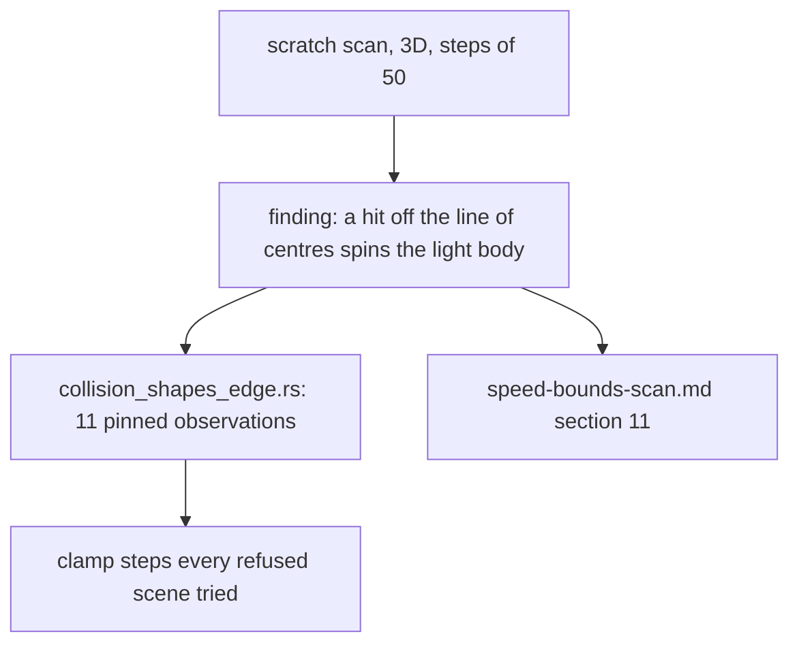

# Review 8-51: capsules, hulls, off-centre hits, rows, friction, other axes, the clamp in a stack

Task: 8-51 (follow-up of 8-48 and 8-49). Class 1 (tests and a report; no engine code changed). Ordinary card into `develop`. Owner, 2026-11-20: "yes, then go on with 8-51".

## Decisions

1. No rule or code change: the card asked for the scenes the earlier cards did not try. What is found goes in the wiki, and a few points are pinned as observations.
2. 3D only. 2D has circles and boxes, which sections 7 to 10 cover.
3. The refused rows are pinned as examples, not an edge: refusal in rows is not monotone in length or speed.

## Evidence

- A scratch scan (removed) printed the first refused spin or speed per scene; the pinned values were read from it, then each test was run. One test was wrong at first (a box was already refused at 1500; the comparison moved to 1200, between the hull's 1050 and the box's 1350).
- `collision_shapes_edge.rs`: 12 tests, all pass; clippy `-D warnings` clean (two lint fixes: nesting, a complex type).
- The tests are observations of the current solver at a few points; none is a promise.

## Not verified

- Only the points in the tests are pinned; the tables in section 11 come from a scan that is not in the repository.
- The hull case at 0.6 off sits close to its test point (first refused 1050, tested at 1000 and 1200).
- Mutation score, Miri, hosted Linux and ARM64 runs (the release PR); Mermaid read by the author, not rendered.

## Loops

| loop | finding | handling |
|---|---|---|
| 1 | major: "the hull is the most easily refused" is true only at 0.4 and 0.6 off | wording and the test name now say the point |
| 1 | major: the clamp was never run on off-centre throws, yet the chart claimed it | test added (box, capsule, hull, 0.6 off, 2500: refused by default, steps under the clamp) |
| 1 | major: "the clamp steps every refused scene" rested on rows only; the stack was never refused | wording says rows and throws; the stack claim is "stays finite"; the stack test renamed |
| 1 | minor: speed ranges, the ratio-1 claim, the spin-axis claim, the rows wording overgeneralised | scoped (offsets, boxes at ratio 1000, "no simple rule I found") |
| 1 | minor: dead `tilt` field, duplicated clamp limits, fragile hull test point | tilt removed, constants named, the all-shapes test moved to 900 m/s (margin 150 under 1050) |
| 1 | note: the scan table is a scratch scan not in the repo; the reviewer reproduced 6 table entries, the rows and the stack | stated |
| 1 | note: the loop-1 fixes were not seen by a second reviewer; mutation not run | stated |
