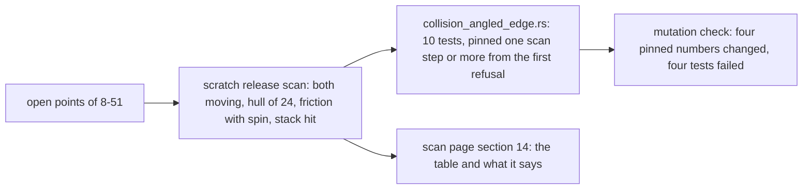

# Review 8-52: the speed edge on what 8-51 left untried

Task: 8-52 (follow-up of 8-51). Class 1 (tests and a report; no engine change). Ordinary card into `develop`. Owner, 2026-11-20: "I approve, then start 8-52".

## Decisions

1. Observations, not promises: each pinned speed sits at least one scan step from the first refused one (800 against 950 for the cells at 0.4 off).
2. No engine change and no rule change: a lower edge for moving bodies is a finding, the clamp (8-50) is the opt-in answer.
3. The scan stays out of the repository (as in 8-51); the table of section 14 is its record.

## Evidence

- The tests describe existing behaviour, so they passed at once; to show they can fail, four pinned numbers were changed (the speed of the tilted box, the spin of the capsule, the free-fall bound, the spin of the 24-corner hull): four tests failed, the file was restored.
- `cargo fmt`, `cargo clippy -p physics --all-targets -D warnings`, the file's 10 tests in the dev profile (about 2 s).
- Scratch scan (removed): 60 cells of hits between moving bodies (5 forms, 2 ratios, 3 angles, 2 offsets), 6 of the hull, 12 of friction with spin, 36 of the stack.

## Not verified

- Linux and ARM64; the pins sit one scan step or more from the first refusal, which is not a proof for another machine.
- Angles about the other axes, hits between different forms, hulls with more than 24 corners, stacks above eight, 2D.
- Mutation score and Miri (tests only); Mermaid read by the author, not rendered.

## Loops

| loop | finding | handling |
|---|---|---|
| 1 | major: the 0.2 off comparison of the two hulls was written the wrong way round | fixed to "never against 4900" |
| 1 | major: "two equal spheres are never refused" was false with 0.4 off at 0 degrees (first refused 3450) | page and test name say "with no offset"; the cell is stated |
| 1 | minor: the cell count (120) was 60 | corrected in the page and here |
| 1 | minor: the diagram said 400 m/s for the stack; the box and capsule are 12 m below already at 100 | diagram and text fixed; the hull below 400 is stated as not measured (the lowest body in the scan was the floor) |
| 1 | minor: the 10 m/s test counted the floor, so a body could sink a metre | the lowest height is taken over dynamic bodies and must be above 0 |
| 1 | minor: the clamp-fall bound is the clamp speed times the run (2000 m in 4 s) | said so in the page and the test name |
| 1 | minor: unnamed numbers in `stack_hit` and `Hit::new`; a repeated assert in the clamp test | named; the repeat removed |
| 1 | note: the loop-1 fixes were not seen by a second reviewer | stated |
