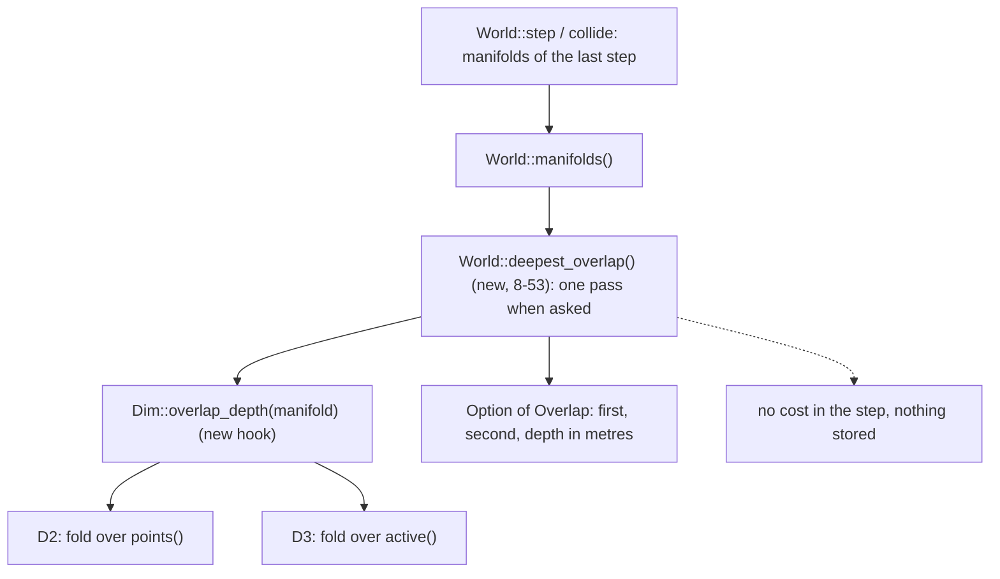

# Review 8-53: a report of the deepest contact overlap

Task: 8-53 (found in 8-39, `wiki/spikes/speed-bounds-scan.md` section 12). Class 2 (public query of the shared physics core, a new required hook of the public `Dim` trait). Ordinary card into `develop`. Owner go-ahead: "8-53"; owner choice among three: "Query that names the pair".

## What was done

| item | result |
|---|---|
| the question | the card asked whether a deepest-overlap report is worth having, its cost and what a game does with it. The overlap was already in the manifolds, but only dimension-specific code could read it |
| change | `World::deepest_overlap() -> Option<Overlap<D>>` (the two body handles in manifold order and the depth in metres; `None` when no point has a negative separation), found when asked by one pass over the manifolds; `Overlap<D>` is a small public type (`d2::Overlap`, `d3::Overlap`); `Dim::overlap_depth(&Manifold) -> f32` is a new required hook, implemented for D2, D3 and the test dimension of `generic_core.rs` |
| cost | none in a step (nothing stored); a call is one pass and allocates nothing (tested in 2D) |
| measured | three unit boxes on a floor, 5 s at 60 Hz, 3D: top of density 1: 2.1 mm (default) and 1.1 mm (stiff); density 50: 29 mm and 2.8 mm; density 200: 0.24 m and 8.5 mm. The top box is slower than 1 m/s while 0.24 m deep (asserted): no speed bound sees it |

## Decisions

1. On demand, not per step (owner's choice): no hot-path cost and no stored state.
2. The first of equal depths wins (tested).
3. A required trait method breaks an external implementer of `Dim`; a default is not possible without a depth accessor on the generic manifold. The only other implementer in the workspace is the test dimension; `tools_physics_spike` has its own trait.
4. Stale window: manifolds are remade at the next step or `collide`, so right after `create_body` or `destroy_body` the report can name a destroyed body. Documented and tested; returning `None` while the contacts are stale would be a behaviour change left to the owner.

## Evidence

- Red: `deepest_overlap` did not exist (compile error), then green; the speculative-gap test first used a gap of 0.05, beyond the 0.02 margin, so it made no contact (a test bug, fixed to 0.01, not a weakening).
- By hand: three mutations of the query (the tie rule, the `> 0` filter, the sign of the separation in the D3 hook) each fail tests.
- fmt, clippy `-D warnings` on `physics` (all targets), `cargo test -p physics --features cross-platform-determinism` (48 targets pass), `cargo build --workspace --all-targets`; see the PR for the gates.

## Not verified

- A 3D allocation test (the allocation test is 2D; the code is the same generic function).
- Static-static pairs (not checked whether the broadphase pairs them).
- The numbers are one measurement of this commit and solver; they will drift and the test pins them only with wide margins. The light-top bound has about 2.4 times the measured value; on a machine without FMA and without the cross-platform feature the result may differ, which was not run.
- Mutation score (not run: memory), Miri, coverage, benchmarks. Mermaid read by the author, not rendered.

## R1 to R8

| phase | result |
|---|---|
| R1 self | clippy nesting in the first loop (rewritten as an iterator fold); the first test of the speculative contact used a gap beyond the margin |
| R2 automated | fmt, clippy, the physics tests, workspace build |
| R3 independent | one read-only review: no blocker, two minor findings, several nits; all handled (Loops) |
| R4 QA | 2D and 3D, none, speculative only, one pair, the deepest of three, tie, a four-point face, a destroyed body, a squashed stack, no allocation |
| R5 architecture | one query, one small type, one required hook |
| R6 security | none |
| R7 performance | no cost in a step |
| R8 product fit | the owner gets a way to see a squashed stack with no world size set by the game |

## Loops

| loop | finding | handling |
|---|---|---|
| 1 | minor: after `create_body`/`destroy_body` the report can name a destroyed body until the next step; the test hid it | documented; the test now asserts the stale window, then the step |
| 1 | minor: "a refused step leaves it as it was" is false when bodies were created or destroyed first (the step remakes the manifolds before it refuses) | doc and wiki reworded |
| 1 | minor: "under 1 m/s" was not measured | asserted in the squash test (top box speed below 1 m/s) |
| 1 | minor: no tie test, no multi-point test | `equal_depths_name_the_first_pair…`, `a_box_sunk_into_the_floor…` |
| 1 | minor: the review file and the UML view were missing | this file |
| 1 | nit: the required hook breaks external `Dim` implementers | said in the wiki and above |
| 1 | nit: `StaleHandle` as a stand-in error, clumsy row index | an explicit height table; the error returned for a missing report is only a test failure value |
| 1 | note: the loop-1 fixes were not seen by a second reviewer | stated |
