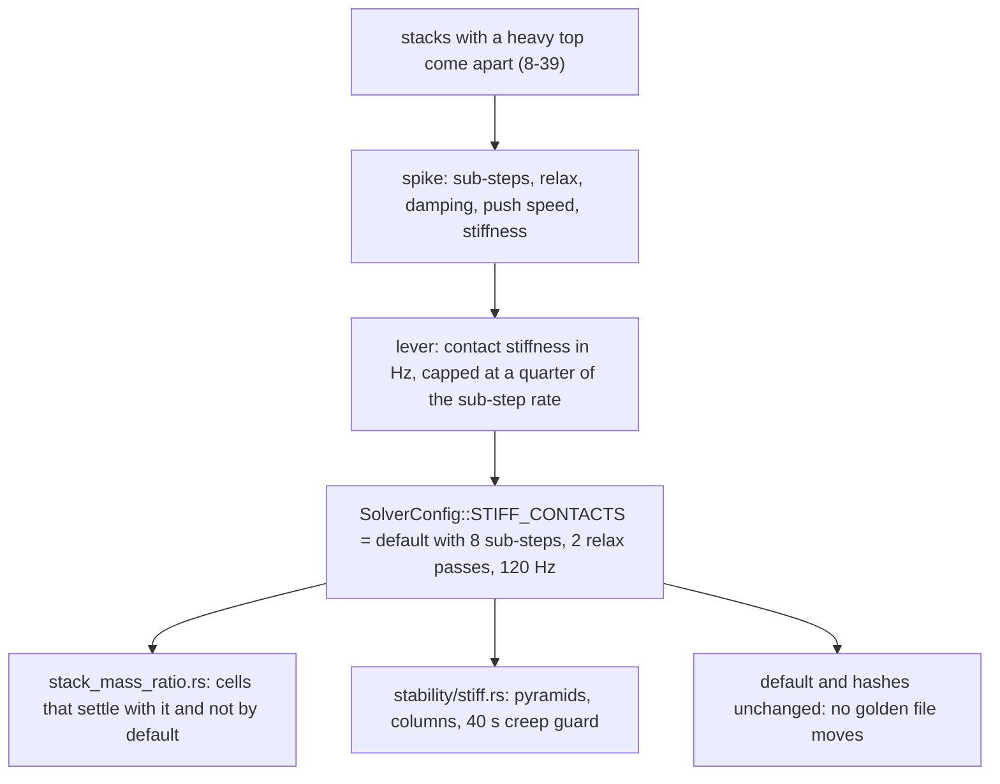

# Review 8-54: solver work for heavy-on-light stacks

Task: 8-54 (follow-up of 8-39). Class 2 (one new public constant of the shared physics core, `SolverConfig::STIFF_CONTACTS`, 2D and 3D). Ordinary card into `develop`. Owner, 2026-11-20: "Go on with your recommendation. I approve, then start 8-54". A new public constant needs the owner's approval of the PR diff hash and link, as every card. The card named a contact softness scaled by the mass ratio; a spike found a simpler lever, so the card is done as an opt-in preset, **partly**: the per-contact idea is an open card.

## Decisions

1. **Opt-in, not a new default.** With the default switched to the preset values, many tests fail: hash pins and default values (expected), tests that check that a scene moves (it is quieter now), documented findings that the preset beats (a column of 20 boxes no longer topples, the heavy bridge settles) and a few real costs (a 44-row pyramid still moving at 300 steps, one random bin with a contact 0.030 m deep against 0.02 m). Moving the default is a decision of its own with golden files (governance), not part of this card.
2. **A constant, not a field.** `SolverConfig` is built by struct literals in many places; an associated constant adds nothing to the struct and no caller changes.
3. **Two relax passes, found in review.** The first version had one; the independent reviewer asked for the ordinary scenes, and the heavy-on-light columns of two and three boxes crept (0.02 to 0.24 m/s, drift to 0.22 m over 40 s) where the default is at rest. A second relax pass cures it. The preset costs about 2.3 times the step time of a calm pile.
4. **The per-contact softening by mass ratio of the card was not built.** The stiffness is the lever; the per-contact version would cost less and change the hashes of any scene with a heavy contact. Open card.

## Evidence

- Red first: the unit test for the constant did not compile (no such item), then green. The stack tests were run once with the default in place of the preset and failed (eight boxes under x20: 2 and 3 of 5 settled), then with the preset and passed. The 40 s creep guard was written after the creep was seen; it fails with one relax pass (scratch run).
- A spike (scratch, removed): sub-steps, stiffness, damping, push speed, relax passes; the region under the preset over heights and ratios; a scan of 41 offsets (it moved four cells I first pinned to robust ones, and then again when the relax count changed); timing in isolation (a first multi-configuration run gave nonsense of 10 s and more, a memory effect on this machine, and was discarded).
- `stack_mass_ratio.rs` (10 tests, about 65 s in the dev profile), `stability/stiff.rs` (4 tests), the unit test; the default is unchanged (hash pins, golden and replay tests are untouched). Clippy `-D warnings` and fmt clean.

## Not verified

- The instruction-count benchmark (the gate runs on the default); other shapes; joints and chains beyond one scratch pass with the defaults switched; Linux and ARM64 (the tests ran on Windows; the reviewer's scratch runs covered sleeping on and 30 Hz steps).
- Mutation score, Miri; Mermaid read by the author, not rendered.

## Loops

| loop | finding | handling |
|---|---|---|
| 1 | major: the "how firm" numbers (every offset for five under x50 and three under x100 in 3D) did not reproduce | stated the grid; the numbers redone for the final preset; the pinned cells moved to those at 41 of 41 in both dimensions |
| 1 | major: the spike claims (30 Hz never settles, 120 Hz always) were false for single cases | rewritten with the per-case counts |
| 1 | major: the creep of the ratio-100 column was not shown | found to be real for all heavy-on-light columns; the preset got a second relax pass; a 40 s guard test added |
| 1 | minor: the unit test used literals and an unchecked conversion; the 30 Hz claim was unmeasured; "at any step" | the constant of the cap used; the reviewer's 30 Hz check recorded; wording fixed |
| 1 | minor: the card's own idea was not built; the owner quote was clipped | the review says partly done and names an open card; quote and the approval line corrected |
| 1 | note: the loop-1 fixes (including the second relax pass and the final numbers) were not seen by a second reviewer; mutation not run | stated |
