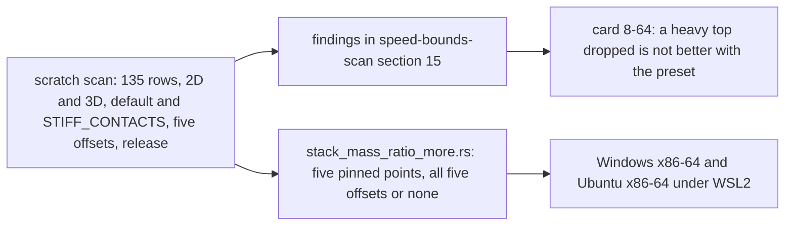

# Review 8-55: stack mass-ratio scenes not tried

Task: 8-55 (found in 8-39). Class 1 (tests and a report, no engine change). Ordinary card into `develop`. Owner, 2026-11-20: "let's tackle all class 1 tasks".

## What was done

- A scratch scan (not kept) of the scenes the card names, with the heavy box at the bottom, middle and top, 10, 12 and 16 boxes, sleeping on, and a heavy top dropped from 0.5, 2 and 5 m.
- `engine/physics/tests/stack_mass_ratio_more.rs` (new, 5 tests, about 15 s in the dev profile): heavy at the bottom settles with either solver; heavy in the middle of eight (ratio 100) never settles at the default and always with the preset; a stack of 16 with a top of ratio 5: default 0 of 5, preset 5 of 5; with sleeping on a settled stack of 8 sleeps to the last box; a three-box stack with a top dropped from 2 m in 3D: default at least 3 of 5, preset 0.
- Section 15 of the scan page, changelog v1.105.

## Evidence

- `cargo test -p physics --test stack_mass_ratio_more`: 5 passed on Windows x86-64 and on Ubuntu x86-64 (WSL2); clippy `-D warnings` and fmt.
- Red: the preset case changed to the default (the middle test fails) and sleeping switched off (the sleep test fails); restored.
- The numbers of the findings are from the scratch scan (135 rows kept in the author's notes only); a row can be reproduced by building the scene from the test file's `Scene` with the same parameters.

## Findings

- The heavy box at the bottom is not a problem; the middle is nearly as bad as the top at the default and fine with the preset.
- The default solver cannot stand a plain stack of 16 boxes; the preset can, also with a top of ratio 5.
- A heavy top that lands on a stack is not helped by the preset: three boxes, ratio 10, from 2 m in 3D settle 4 of 5 at the default and 0 of 5 with the preset. Cause not looked into (card 8-64).

## Not verified

- Hosted Linux and ARM64 runs; the Ubuntu run is WSL2 on the same machine. Five offsets, not 41. Chaotic cells: the pinned ones are all five or none.
- Spheres, capsules and hulls in a column, stacks above 16, a dropped box with the heavy box not on top.
- Mermaid read by the author, not rendered.

## Loops

| loop | finding | handling |
|---|---|---|
| 1 | pending the independent review | |
