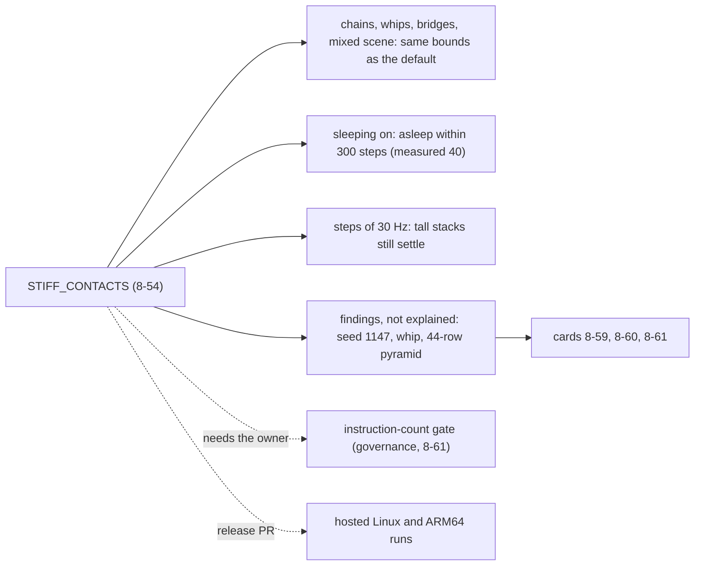

# Review 8-57: coverage of the STIFF_CONTACTS preset

Task: 8-57 (follow-up of 8-54). Class 1 (tests and a report; the only change outside tests is one rustdoc sentence of `SolverConfig::STIFF_CONTACTS`). Ordinary card into `develop`. Owner, 2026-11-20: "8-57" (picked from the Backlog). The card listed eight points; two need the owner or the release (see below), the rest are pinned.

## What the card's eight points became

| point | result |
|---|---|
| 1 instruction-count gate | not done: `gates/benchmarks.toml` and the CI workflow are governance. Card 8-61 |
| 2 44-row pyramid | pinned as a finding (final speed 0.1 to 0.5 m/s at 300 steps; measured 0.19); it settles later: 0.05 at 1200 steps, 0 at 2400, asleep at 1230 against 721 (scratch, release) |
| 3 seed 1147 | reproduced (0.030 m with the preset, 0.010 m with the default); the other 24 seeds are at most 0.0115 m; pinned as a finding, cause not looked into (card 8-59) |
| 4 joints, chains, whips, bridge | the chain, whip, heavy-end and bridge tests now run with any solver and are run with the preset; the mixed resting scene too. The mixed whip is a finding (with the default the whip hits the pyramid on its second swing, step 184, and moves it 2.5 m; with the preset it never comes nearer than on its first swing and the pyramid moves 0.006 m) |
| 5 sleeping, 30 Hz | pinned (sleeping: four scenes asleep within 300 steps, measured 30 to 40, moved under 0.05 m, measured 0.015; 30 Hz: four cases in 2D and two in 3D settle at every offset, the default at most one in five on two of them) |
| 6 other shapes | not done (3D joints too). Card 8-60 |
| 7 hosted Linux and ARM64 | not done: the release PR is the first hosted run of phase 8 code; ARM64 is not gated |
| 8 the cheaper setting | information, already in section 13; no card |

## Decisions

1. The existing stability test bodies were made callable with a solver (`check_hanging`, `check_whips`, `check_heavy_end`, `check_bridge`, `check_resting_mixed`, `calm_depth`, `fall_asleep`, `*_with` builders); the default tests call them with the default and are unchanged in effect (46 stability tests green before and after). No bound was changed or loosened.
2. The one engine-file change is the rustdoc sentence on the 30 Hz claim (it said "a scratch check", now it names the test).
3. Findings are pinned with an envelope on both sides, so that a change in either direction shows (the 44-row speed between 0.1 and 0.5 m/s; seed 1147 above 0.02 and below 0.05 m).

## Evidence

- The refactor was green before any new test (chains 5 tests, then the whole stability binary).
- Scratch scans, release, removed: the chain, whip and bridge metrics with both solvers (default and preset side by side); 25 seeds of the bins with both; sleeping on five scenes; the 44-row pyramid to 2400 steps and asleep; 30 Hz cells (6 cases, both dimensions, both solvers).
- Mutation check of the new pins: the seed of the exception, the sleep deadline, the 44-row floor and one chain run with the default plus a failing assert made four tests fail; a 30 Hz case swapped for one that does not settle failed the 30 Hz test.
- fmt, clippy `-D warnings`, `cargo test -p physics --test stability --test stack_mass_ratio` (46 and 12 tests).

## Not verified

- Linux and ARM64, mutation score, Miri (tests only), the benchmark gate. Mermaid read by the author, not rendered.
- The 30 Hz pins use 10 s of steps (300 at 30 Hz), so they are not the same number of steps as the 60 Hz pins.

## Loops

| loop | finding | handling |
|---|---|---|
| 1 | major: "the whip comes as close to the apex" compared the first swing; the default hits on the second (step 184), the preset never does | wording corrected in the page, the test comment and here; the test now also checks that the whip swings down |
| 1 | major: the whip finding test would pass if the whip did not move | asserts the tip is more than 1 m below the pin after the run |
| 1 | minor: docs said "asleep by step 40" where the test allows 300 and moved under 0.05 m | docs give the bound and the measurement; the scratch figure of the default is marked as not pinned |
| 1 | minor: "hold their bounds" read as a measurement; bare literals and inline paths in the sleeping test | "stay within their bounds"; constants named, `use` added |
| 1 | note: the loop-1 fixes were not seen by a second reviewer | stated |
