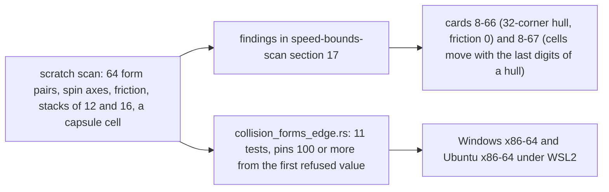

# Review 8-58: the speed edge on forms, 32-corner hulls, spin about x and y, friction and taller stacks

Task: 8-58 (found in 8-52). Class 1 (tests and a report, no engine change). Ordinary card into `develop`. Owner, 2026-11-20: "let's tackle all class 1 tasks"; 2026-11-21: "I approve then next".

## What was done

- A scratch scan (not kept) of the open points of the card: pairs of different forms (eight forms, including a hull of 32 corners and one of no symmetry), spin about x and y with three frictions, friction at hulls, stacks of 12 and 16 hit by five forms, the non-monotone capsule cell.
- `engine/physics/tests/collision_forms_edge.rs` (new, 11 tests, 9 s in the dev profile).
- Section 17 of the scan page, changelog v1.107.

## Evidence

- `cargo test -p physics --test collision_forms_edge`: 11 passed on Windows x86-64 (dev and release) and on Ubuntu x86-64 (WSL2); clippy `-D warnings`, fmt.
- Red: eight of the eleven tests fail when their pin is moved to the wrong side (700 to 1000, 1100 to 800, friction 0 expectation inverted, spin 900 inverted, box 2150 to 1500, 2000 inverted, stack floor 0.4 to 0.6, fall -5000 to -50000); restored.
- Two cells flipped when the turned square prism changed from circumradius 0.7071 to 1/sqrt(2); the first form was dropped because the constant trips a Clippy lint and the pins were redone with a prism of circumradius 0.7 and re-scanned. The box-corner hull is now exact.

## Findings

- No pair of forms is refused below 900 m/s; the 32-corner hull with friction 0 is refused head-on at 2050 (card 8-66); friction 0 lowers off-line edges by 13 to 25%.
- The box-corner hull is refused by spin about y from 750 rad/s, not about x or z; the turned prism, the capsule, the box and the 24-corner prism are not refused at 1000 rad/s about x or y.
- Stacks of 12 and 16 are never refused; the clamp bounds the fall as before.
- Chaotic cells near an edge move with the last digits of a hull's corners (card 8-67).

## Not verified

- Hosted Linux and ARM64 runs (Ubuntu is WSL2 on the same machine); the scan rows were not kept, the pinned tests and the quoted rows are the record.
- 2D, other spin ratios, hulls of 32 corners at an angle, other irregular hulls, stacks above 16 or hit at an angle.
- The window of steps near 1400 m/s of the capsule cell is not pinned.
- Mermaid read by the author, not rendered.

## Loops

| loop | finding | handling |
|---|---|---|
| 1 | major: section 17 said section 14's 600 about z was the turned prism; it is the 24-corner prism, and 8-52 is not contradicted | sentence corrected, with the note that "never refused by spin" holds about z only (8-52's test name left as merged) |
| 1 | minor: box-corner hull friction row 50 too low; the 16-stack capsule fell 1418 m, not 330 | numbers corrected |
| 1 | minor: capsule cell is a window 1375 to 1425, not one speed; test name and wording over-precise | reworded, test renamed |
| 1 | minor: spin pin 650 only 100 from the edge | moved to 600 |
| 1 | minor: stack tests could not tell a NaN body; stale `Hit` doc; "up to a third" | non-finite body now gives `None`; doc and header fixed |
| 1 | note: `stack_hit` has 4 parameters, duplication with the 8-52 file | accepted (limit is >5; per-file helper style) |
| 1 | note: the fixes were not seen by a second reviewer | stated |
