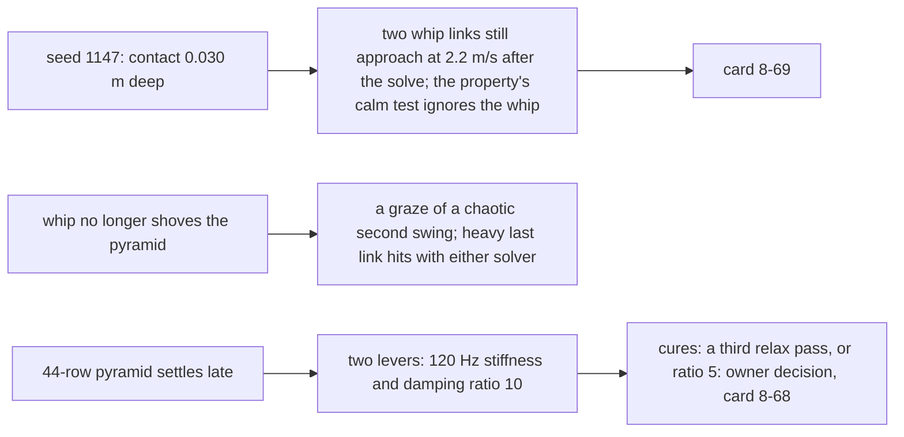

# Review 8-59: the causes of three costs of the stiff-contact preset

Task: 8-59 (follow-up of 8-57). Class 1 (investigation and tests; the engine is not changed). Ordinary card into `develop`. Owner go-ahead: "let's tackle all class 1 tasks", then "I approve" for card 8-58.

## What the card asked and what was found

| point | result |
|---|---|
| 1 seed 1147 | the deep contact is between two links of the whip (post-solve approach speed 2.2 m/s, step 169), not a calm contact; the default has the same fold at 1.1 m/s and 0.010 m. Pinned. Card 8-69 (the property's measurement) |
| 2 the whip and the pyramid | the hit of the standard scene is a graze on the second swing (default touches at pin lifts 0 to 0.02 m, 3 of 21); a heavy last link hits on the first swing with either solver. Pinned |
| 3 the 44-row pyramid | a sweep shows two levers (no mechanism): contact stiffness 120 Hz and the contact damping ratio 10 (inherited from the default). A third relax pass (0.014 m/s, +23% time) or a ratio of 5 (0.0001 m/s, no time, but a 30 Hz-step case of 3D loses one offset in five) calms it. Pinned; the choice is card 8-68 |
| 4 "without losing the settled cells of stack_mass_ratio" | nine cells measured: third pass and ratio 5 keep all, 60 Hz loses three, ratio 3 or lower loses one or two |

## Decisions

1. No engine file changed. Two temporary engine changes (a third relax pass; a damping ratio of 5 in the preset) were run against the repository tests and reverted from a saved copy; `git status` shows no engine change.
2. The helpers of the stability binary got two small changes so the new tests can reach them: `mixed_tuned` and `Pin` in `mixed.rs` (the old `mixed_with` is `mixed_tuned` with the standard pin: the same scene), and three constants of `properties.rs` made `pub` (`CALM_SPEED`, `CALM_STEPS`, `CALM_RUN_STEPS`). No bound changed.
3. The existing finding tests (seed 1147, whip, 44 rows) are unchanged; the new tests add the cause next to each, with both solvers where the contrast is the point.

## Evidence

- Scratch probes (release, removed): per-step contacts of seed 1147 for both solvers; the whip scene per step; a sweep of 21 pin lifts and 9 last-link densities for both solvers; the 44-row pyramid for eleven solver variants and for eight damping ratios; sleeping time and time cost; nine mass-ratio cells for five solver variants and five damping ratios; the bridge for 1 to 4 relax passes.
- A mutation check by engine change: with three relax passes in the preset, the three finding tests (seed 1147, 44 rows, and the new seed test) fail as "finding fixed" (the whip of seed 1147 no longer folds), the new whip tests still pass (the hit is not caused by the pass count).
- fmt, clippy `-D warnings` on `physics`, `cargo test -p physics --test stability` (50 tests).

## Not verified

- Why a damping ratio of 10 rings the pyramid and 5 does not (the response is not monotone); the solver code was not read for it.
- Linux, ARM64, 3D (the pyramid, the whip and the bins are 2D), the cost of the cures in instruction counts, mutation score, Miri, coverage, benchmarks. Mermaid read by the author, not rendered.
- The new pins sit on chaotic scenes (a whip swing). The hit cells are far from their edge in the sweep (lifts 0 and 0.01 against 0.1 and 0.2), but the same warning as card 8-67 applies.
- The 44-row test takes about 50 s in the dev profile (four pyramids).

## R1 to R8

| phase | result |
|---|---|
| R1 self | first reading of "damping 10 changes nothing" was the default value itself (fixed after a second sweep: a ratio of 5 calms the pyramid); first touch test counted only deep contacts and missed the graze (fixed: any manifold); clippy nesting and similar-names fixed |
| R2 automated | fmt, clippy, the stability binary |
| R3 independent | one read-only review: no blocker, three major, five minor; all handled (Loops) |
| R4 QA | contrasts pinned on both sides (default and preset, hit and no hit, calm and ringing); the engine mutation above |
| R5 architecture | no engine change; test helpers only |
| R6 security | none (tests) |
| R7 performance | measured the cost of both cures; the test run is long (50 s) and said so |
| R8 product fit | the owner gets the cause of each cost and two measured cures, and decides (card 8-68) |

## Loops

| loop | finding | handling |
|---|---|---|
| 1 | major: "the preset does not hit softer" contradicted the numbers (0.13 against 0.42 m) | wording: a softer hit is not excluded; the test pins that both hit |
| 1 | major: the seed test did not show the deep contact of the property is the whip-whip one | the test now asserts the whole-world calm depth equals the whip-whip depth |
| 1 | major: "approach speed" is after the solve | named so in the doc, report and review |
| 1 | minor: claims about 21 lifts rest on the scan; table header; "cause" for finding 3; the seed result under a third pass is one observation; `StaleHandle` as a failed expectation | said "scan" and "two levers"; header fixed; `expect` with a message; lift 0.01 kept (the reviewer suggested it may be fragile) |
| 1 | note: the loop-1 fixes were not seen by a second reviewer | stated |
