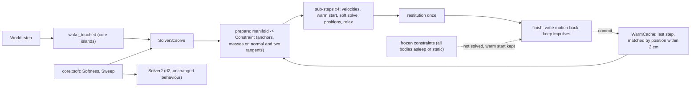

# Review 8-6: `physics::d3` contact solver

Task: 8-6. Class 2 (public API of `physics::d3`: `Solver3`; the soft-constraint maths moves from `d2` to `core`; no `unsafe`, no new dependency, no governance file). Ordinary card into `develop`. Loops: 1 fix loop (1 independent review). Open blocker/major: 0.

Delivers: 3D bodies in contact now push each other apart, rest, rub, bounce and sleep. `D3` uses `Solver3` instead of `FreeSolver`. Scope decided by the owner: a serial solver now; graph colouring and the parallel solve are card 8-19; joints stay card 8-7 (the joint list is not read). README v1.67.

## Decisions

1. **Serial first (owner).** One thread, manifold-list order, the 2D reference structure. Colouring and parallel solving are the new card 8-19; nothing in `Solver3` blocks them (the constraint has two body indices and no shared state).
2. **Soft step shared with 2D.** `Softness`, `Sweep` and two helpers moved to `core::soft`; `d2` re-exports them, so no 2D line of behaviour changed (2D suites all pass). One copy of the spring maths instead of two.
3. **Friction on two tangents inside a circular cone.** Tangents are a function of the normal alone (deterministic); the tangent impulse is stored in the kept data as a world vector and projected on the next step's tangents, so a change of tangent frame does not lose it.
4. **Warm start by position.** A 3D contact point has no feature id (card 8-4). A point takes the impulses of the nearest kept point of the same pair within 2 cm (`WARM_MATCH_DISTANCE`), each kept point once; the first of equal distances wins. A hypothesis, not tuned; kept points are greedy (an earlier point can take a point a later one is nearer to), which costs only warm-start quality.
5. **World inverse inertia of the step start.** The matrix is built once per step and kept through the sub-steps, as the effective masses are (2D has a scalar). A body that turns fast inside a step is solved with slightly stale inertia.
6. **Sleeping and islands are the shared core's.** `Solver3` solves a manifold only when a body is dynamic and awake; otherwise its warm start is kept (stats `frozen`).
7. **Joints are not read** (card 8-7), and the solver reports `colours` and `overflow` as 0 (card 8-19).
8. **`d3_no_allocation` setup changed** (assertions unchanged): the old test relied on overlapping bodies staying overlapped because nothing separated them. The solver now separates them, so the bodies rest on a static floor and keep touching through the measured steps.

Known limits (also in the design note): the ten-box column ends 3.6 cm low at the top and 9 mm off the axis; the 9 mm is a fixed offset that depends on box orientation (point solve order) and does not grow (the reviewer checked 60 s). A hull has one contact point until card 8-18, so a hull does not yet rest: one hull cube jumps between corners with 13 to 16 mm of overlap, and a second one stacked on it sinks 17 cm; that is a narrowphase limit. No gyroscopic term (card 8-3). A normal that is not of unit length is not defended against (the world only produces unit normals).

## Evidence

- Tests written first. Red evidence: with `FreeSolver` every contact test failed (a box dropped on the floor ended at y = -76.8, a ball did not bounce, equal spheres passed through each other); with `Solver3` they pass. `engine/physics/tests/d3_solver.rs`: 19 tests (rest on the floor for box, sphere, capsule; head-on elastic and inelastic collisions; bounce at restitution 0.5; friction holding at 20 degrees and sliding at the expected acceleration at 35 degrees, with and without friction, and across the z axis; stacks of 5 and 10; a tilted box lying flat; linear and angular momentum of a glancing hit; sleeping, frozen constraint stats and waking by a ball; sleeping bits unchanged; a hull and a mixed pile; replay hash equality; a 200 m/s ball). Unit tests in `solver/constraint.rs` (11), `warm.rs` (10), `body.rs` (6), `mod.rs` (6) and `core/soft.rs` (the moved ones). `cargo test -p physics`: 743 tests, 0 failed. `cargo clippy -p physics --all-targets -- -D warnings` and `cargo fmt --check`: clean.
- Mutation (`cargo mutants -p physics -j1`, per file and in small batches because large runs were stopped by low memory; tests `--lib` and `d3_solver`, plus `d3_no_allocation` for `mod.rs`). `constraint.rs`: 109 mutants, 7 missed, killed by new unit tests (rerun of the touched functions: 65 mutants, 0 missed). `warm.rs`: 40 mutants, 1 missed (exact reach), killed by a new test (`take_near` rerun 15, 0 missed). `body.rs`: 34 mutants, 5 missed, killed by 6 new tests (rerun 34, 0 missed). `mod.rs`: 115 mutants, 9 missed; after tests, rerun of the functions: 31 mutants, 1 missed (`||` against `&&` in `write_back`). `core/soft.rs`: not rerun, its tests moved with the code and are the 2D ones that were mutation-checked in earlier cards. Output in `target/mut-*` was deleted.
- Survivor judged equivalent (reasoned, not proven): `body.kind() == Static || body.is_asleep()` in `write_back`: `set_motion` refuses a static body anyway, and a sleeping body's solved copy equals the body, so writing it changes nothing (the sleeping-bits test passes with the mutant).
- Independent review probes (copy of the crate, repository untouched): box pushed along the floor (friction deceleration within 2% of mu g), a rolling sphere (vx 4.99, wz -10.02 against 5 and -10), a box on a 45 degree edge, a box spinning at 30 rad/s, a 60 m/s landing with spin, a frictionless stack, 60 bodies at 1000 m/s and 500 rad/s for 200 steps, 63 resting boxes (settle to 1e-5 m/s), a density 100 plate on a unit box: no NaN, no panic.
- Local gates (`python tools/local-gates/local_gates.py --base origin/develop`): exit 0 (the `FAIL` lines are the tools' own negative cases). Wiki lint: 70 pages, 0 violations. Output `target/local-gates-8-6.txt` (not committed).

## Not verified

No Linux or ARM64 run; no D2 cross-platform golden hash for the 3D solver (card 8-13); no multi-thread run (the solver is serial); no benchmark (cards 8-12 and 8-14); no Miri (no `unsafe`); no branch-coverage or new-line gate run; the stack figures come from one friction value (0.6, the default) on flat stacks; the solver was not compared against an independent reference simulation; mutation was not rerun on `core/soft.rs`; the Mermaid view was read by the author, not rendered.

## R1 to R8

| phase | result |
|---|---|
| R1 self | read against the 2D solver; found test values that hid mutants (bias, shift, turn, thresholds) and wrote unit tests with hand-computed numbers |
| R2 automated | tests, clippy, fmt, mutation, local gates, wiki lint, diff hash |
| R3 independent | read-only reviewer: 0 blocker, 0 major, 3 minor, 2 nit; handled below |
| R4 QA | physics oracles (momentum, slope acceleration, restitution, rolling) and 19 scenes |
| R5 architecture | `Dim` unchanged; `core` gained only `soft.rs`; the solver lives in `d3` (ADR-0018); `FreeSolver` stays for the test instance |
| R6 security | no `unsafe`, no new dependency, no secrets; fixed capacity; non-finite impulses make the step fail as in 2D |
| R7 performance | no allocation in a step (counting-allocator test); speed not measured (cards 8-12 and 8-14) |
| R8 product fit | the owner reads the known limits above (hull resting, column sink, drift) |

## Loops

| loop | finding | handling |
|---|---|---|
| 1 | minor: the 9 mm drift of the ten-box column is a point-order bias, fixed in the box frame | documented in the design note and above; no code change (a symmetric solve order is a later tuning) |
| 1 | minor: the ten-box test tolerance (5 cm) was looser than the behaviour; the hull test only checks it stays above the floor | column limits tightened to 4.5 cm and 1.5 cm; hull test renamed to say what it shows |
| 1 | minor: the wiki understated the hull limit | rewritten with the measured overlap and the stacked-hull sink |
| 1 | minor: `reviews/8-6.md` missing | written (this file) |
| 1 | nit: a non-unit manifold normal is not defended against | latent, documented; the world only produces unit normals |
| 1 | nit: warm-start matching is greedy | documented in decision 4 |
