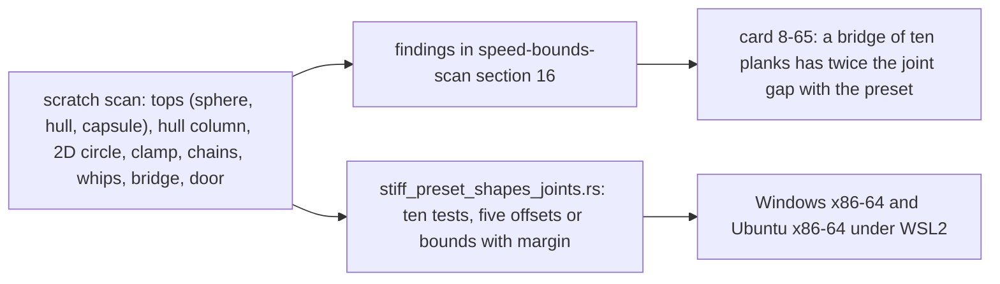

# Review 8-60: the stiff-contact preset on other shapes and on 3D joints

Task: 8-60 (found in 8-57). Class 1 (tests and a report, no engine change). Ordinary card into `develop`. Owner, 2026-11-20: "let's tackle all class 1 tasks".

## What was done

- A scratch scan (not kept) of the cases the card names.
- `engine/physics/tests/stiff_preset_shapes_joints.rs` (new, 10 tests, 18 s in the dev profile): heavy sphere top (default 3 of 5, preset 5 on three boxes; 0 against at least 2 on eight boxes at ratio 50), hull top as the box, upright capsule 0 of 5 with either solver, a column of hull prisms, a 2D circle top, the speed clamp on, a 20-link hanging chain with a heavy end, whips of 8 links (ball and hinge, light and heavy end), a bridge of 6 and 10 planks with a heavy load, a hinge door with limits.
- Section 16 of the scan page, changelog v1.106.

## Evidence

- `cargo test -p physics --test stiff_preset_shapes_joints`: 10 passed on Windows x86-64 and on Ubuntu x86-64 (WSL2); clippy `-D warnings`, fmt.
- Red: the hull case with the default in both places, a whip with a light end and a gap above 1, and a door limit of -0.5: the door, whip and hull tests fail; restored.
- A first run of the 20-link chain failed (gap 1.7): the test world has a floor and a chain of 20 m from 10 m hung through it. The pins hang from 25 m; the numbers then equal those of the scan.

## Findings

- The preset helps heavy sphere, hull and 2D circle tops and a column of hulls, and holds with the speed clamp on; an upright capsule top rolls off with either solver.
- Joints: hanging chains, whips and the door are as good or better with the preset (one hinge whip with a heavy end 0.092 against 0.086 m). **A bridge of ten planks with a heavy load has twice the gap (0.43 against 0.20 m); six planks have less (0.39 against 0.58).** Cause not looked into: card 8-65.

## Not verified

- Hosted Linux and ARM64 runs (Ubuntu is WSL2 on the same machine); five offsets; the scan rows were not kept, the pinned tests and the quoted rows are the record.
- Capsule and sphere columns, spheres in 2D, joints with sleeping on, a clamped chain, heavy bodies in the middle of a chain, distance joints.
- Mermaid read by the author, not rendered.

## Loops

| loop | finding | handling |
|---|---|---|
| 1 | minor: `f32::max` ignores NaN, so a non-finite body counted as settled | a non-finite position now counts as infinite drift (both 3D and 2D helpers) |
| 1 | minor: bridge `y > 4.0` loose; two test names claimed a comparison they do not make | bound 4.5; names say what is pinned |
| 1 | minor: exact counts of chaotic scenes may differ on other hardware | stated in the file header; not loosened |
| 1 | major wording: "one contact line" for an upright capsule was wrong and unverified | now "one point at the cap, likely, not verified" |
| 1 | minor: sphere-column claim came from half length 0.0001 capsules; garbled floor sentence | both reworded |
| 1 | note: five-parameter helpers and `hull_column`/`clamped_column` near-duplicates | accepted (limit is >5; per-file helper style of the repo) |
| 1 | note: the fixes were not seen by a second reviewer | stated |
