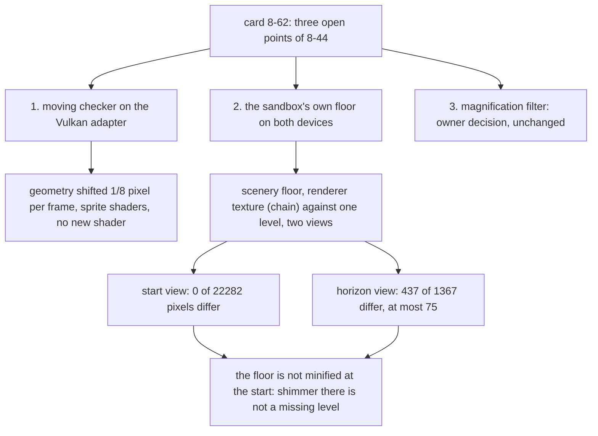

# Review 8-62: motion on the Vulkan adapter and the sandbox's floor measured

Task: 8-62 (follow-up of 8-44). Class 1 (tests and a measurement, no engine change). Ordinary card into `develop`. Owner, 2026-11-20: "let's tackle all class 1 tasks". The choice of the sandbox's magnification filter stays the owner's.

## What was done

1. `adapter_render_vk/tests/device.rs`: two tests mirror the OpenGL ones of 8-44. The picture moves because the quad's texture coordinate is shifted by an eighth of a pixel per frame (the existing sprite shaders; an SPIR-V shader was not needed). Helpers `picture_of`, `shifted_quad`, `checker_texture`, `watch`. Measured on this machine's device: without levels 1024 of 3840 steps pop (largest 128); with levels none (largest 32).
2. `app_sandbox3d/tests/floor_mips.rs` (new, both devices): the floor block of the scenery drawn by the sandbox's `Renderer` with the texture it makes (full chain) and with the same checker as a single level, from the start view and from the extreme view (pitch 0.05, 40 m). Pinned: from the start view no pixel differs (and more than 10000 floor pixels are drawn, so it is not an empty picture); at the horizon view more than 100 pixels differ (measured 437 of 1367).

## Evidence

- Red (each restored): Vulkan, the chain left out of one test and the linear sampler made nearest in the other: both fail; floor, the horizon view made equal to the start view ("the levels change 0 pixels") and the start view moved to the horizon (the "nothing changes" claim fails).
- Green: `DUCK_REQUIRE_VK=1 cargo test -p adapter_render_vk --test device` 11 passed; `DUCK_REQUIRE_GL=1 DUCK_REQUIRE_VK=1 cargo test -p app_sandbox3d --test floor_mips` 2 passed; clippy `-D warnings` and fmt on both.
- A scratch orbit run (32 frames at yaw steps of 0.0015 and 0.004 rad, four views, OpenGL and Vulkan) gave the same share of changes above 64, the same largest change (219) and the same number of floor pixels with and without the chain to four digits, and, as a flicker count, the same number of pixels that flip twice or more. Not pinned: the numbers measure cell edges crossing the floor, which is motion and not shimmer; the scratch file is not in the repository.

## Findings

- At the start view of the sandbox the floor is not minified: its texel is 1.5 m, about 20 pixels, so the mip chain is not used. The earlier reading of 8-44 (the crawl at about one texel per pixel comes from nearest magnification) is a statement about a flat test picture; it does not apply to the floor, whose texels are far larger than a pixel.
- The pieces (spheres, boxes, capsules) have the same 8 texel texture over a unit mesh and may be minified or at one texel per pixel; they were not measured (card 8-63).

## Not verified

- Nobody has watched the sandbox move; the perspective motion was measured by pixel statistics, which cannot tell shimmer from the motion of edges.
- The numbers at the horizon view were measured by the reviewer's scratch copy and by mine (OpenGL 437 of 1367 floor pixels, largest channel difference 75; Vulkan 426 and 76); the test pins only zero at the start view and more than 100 at the horizon.
- Only two views were sampled (start, and pitch 0.05 at 40 m, both at yaw 0.6): a low pitch at the normal distance was not, and it may use the levels. The test draws with a light of its own and without the walls, not with the sandbox's `sun()`; the pixel counts do not depend on it.
- The start-view constants in `floor_mips.rs` copy the private `CAMERA_*` of `sandbox.rs` (target, yaw, pitch, distance) and are not checked against them.
- Linux, ARM64, devices other than this machine's. Mermaid read by the author, not rendered.

## Loops

| loop | finding | handling |
|---|---|---|
| 1 | major: the wiki said a floor flicker cannot be a missing level, from two views | worded to the start view and the horizon view; the unsampled views are named |
| 1 | minor: stale "Vulkan has no motion test"; Vulkan floor numbers only asserted; the test's own light and missing walls; copied camera constants; leaked vertex buffers; unnamed 4 and cell | fixed or stated above |
| 1 | note: Clamp instead of Repeat addressing leaves the Vulkan motion tests passing (nothing checks the address mode) | stated, not fixed: the shifted coordinate stays inside 0..1 plus at most two pixels over a 16 pixel target, so wrap is hardly reached |
| 1 | note: the loop-1 fixes were not seen by a second reviewer | stated |
