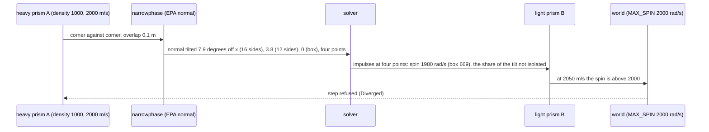

# Review 8-66: a hull is refused head-on when its spin limit is reached, and where depends on its orientation, not on its corner count

Task: 8-66 (open point of 8-58). Class 1 (investigation); no code change. Outcome: **the refusal of the 32-corner prism head-on at 2050 m/s with friction 0 is, from the numbers, the angular speed of the light body reaching the spin bound (`MAX_SPIN`, 2000 rad/s), not its linear speed; the contact normal printed for the prisms is tilted off the line of centres (7.9 and 3.8 degrees; the hulls start 0.1 m overlapped, edge against edge) and an impulse along it is the likely source of the spin, which is not isolated (the order of the points, card 8-91, also gives the box spin); and the speed at which the refusal happens depends on how the prism is turned about its axis (12 sides: never at 0 degrees, 1650 at 7.5, 1300 at 11.25; 16 sides: 2050 at 0, none at 5.6 and 8.4, 4250 at 11.25), so "only a hull of 32 corners is refused" is a property of the angle that the scan of 8-58 used. No defect is claimed; a correction of the scan page is written (section 17 of `wiki/spikes/speed-bounds-scan.md`). The second half of the card (friction moves the off-line edges) was not examined: card 8-92.** Owner go-ahead: "I approve, 8-66" (2026-11-26).

## What was found

| item | result |
|---|---|
| the scene | the scan of 8-58 (`collision_forms_edge.rs`): two bodies of the same form, the thrown one density 1000 at `speed` along x, the target density 1 at 0.9 m, restitution 1, 30 steps, friction 0, a refusal is `World::step` returning `Diverged`. The prisms are 1 m high, circumradius 0.5, corners at angles k times 360/n about y, so a corner (an edge along y) faces the other body and the two start 0.1 m overlapped |
| what is refused | at 2000 m/s (not refused) after step 0 the light body of the 16-sided prism has speed 3514 m/s (the bound `MAX_SPEED` is 10000) and angular speed (98, 1869, -643), norm 1980 rad/s; the bound `MAX_SPIN` is 2000. Spin grows with speed, so it reaches the bound between 2000 and 2050, where the scan first refuses. So the refusal is the spin bound. The refusing check itself was not instrumented: this is read from the numbers |
| the other forms at 2000 m/s | box: the light body gets spin (0, -538, 397), norm 669, speed 3926; 12 sides: spin (45, -469, 659), norm 810, speed 3679 |
| the cause of the spin | the first manifold printed at 1 m/s: box normal (1.000, 0, 0) with four corner points; 12 sides normal (0.998, 0.002, -0.066) (3.8 degrees); 16 sides normal (0.991, -0.003, 0.137) (7.9 degrees). With two identical regular prisms corner to corner the depth along a direction turned by theta from x is 0.1 cos(theta) for theta inside the fan of the corner (+-11.25 degrees for 16 sides, +-15 for 12), so the depth falls off the line of centres and its minimum is at the face normal at the edge of the fan: the geometry puts the normal somewhere in the fan, not at x. The printed angles (7.9 and 3.8 degrees) are not the face normals (11.25 and 15) and the depth differs by about 0.0002 m between them, so the angle reached is likely EPA's stopping point on a nearly flat minimum, not the geometry's. The box has flat faces, normal x, and 669 rad/s of spin. That the tilt is the cause of the spin was not separated from the sequential order of the points (card 8-91): the spin is not proportional to the tilt (12 sides: 810 at 3.8 degrees; 16 sides: 1980 at 7.9; box: 669 at 0) |
| orientation | the same hit with both prisms turned about y by a fraction of the half face angle (friction 0, first refused speed in steps of 50 m/s up to 4900): 12 sides at 0, 3.75, 7.5, 11.25, 15 degrees: none, 2500, 1650, 1300, 1700; 16 sides at 0, 2.81, 5.62, 8.44, 11.25 degrees: 2050, 3000, none, none, 4250. So, in this one-run-per-cell scan, the 12-sided prism is refused from 1300 when turned, below the 2050 of the 16-sided one at 0 degrees, and the 16-sided one is not refused up to 4900 at two of the five angles. The pattern over the angle is not monotone and a cell near the edge may move with the last digits of the corners (8-67). A turn of half a face (12 sides at 15 degrees, 16 sides at 11.25, a flat face against a flat face) is still refused (1700 and 4250), so the tilt of a corner-to-corner normal is not the whole of it; the starting overlap also changes with the angle (0.1 m at 0 degrees) |
| friction | with friction 0.5 the same scan: 12 sides none, 4650, 3450, 2800, 3550; 16 sides 4100, none, none, none, none. Friction raises the first refused speed where both values exist (12 sides at 11.25 degrees 1300 to 2800; 16 sides at 0 degrees 2050 to 4100) and turns several cells to none; in no cell did it lower it |
| change | none. The probes (a printing test and a rotated scan in `collision_forms_edge.rs`) are not in the repository |

## Decisions

1. No code change: the world refuses what it cannot bound (card 8-25) and the `Clamp` policy exists for a caller that wants the step to go on. That a hit at 2000 m/s with a thousand-fold density ratio is outside normal use is my judgment, not a measurement of the speed-bounds spike; the owner decides whether a refusal there matters.
2. The pin of 8-58 (`a_hull_of_32_corners_is_refused_head_on_at_2500_with_no_friction_and_not_with_friction_half`) stays: it is an observation at one angle (0 degrees; its comment says the 24-corner prism is not refused, true at 0 degrees). Section 17 of the scan page carries a correction pointing here; the test is not changed.
3. The half of the card about friction and off-line edges is not examined here: card 8-92.

## Not verified

- That the refusal is raised by the spin bound: read from the norm 1980 at 2000 m/s (the check compares the norm of the angular velocity with `MAX_SPIN`, `Body::motion_is_bounded`) and the linear speed far under its bound, assuming the spin grows in proportion to the speed; the refused step was not instrumented (the error does not say which bound), and which of the two bodies is refused is not shown.
- What gives the spin: the tilt of the EPA normal (not the face normals), the order of the points (8-91), or both; the flat-face turns (12 sides at 15 degrees, 16 at 11.25) are refused too.
- Other overlaps (the scene starts 0.1 m overlapped; a hit that arrives from a gap may reach the corner at another depth), other ratios, other shapes.
- The first refused speed was scanned in steps of 50 m/s, one run per cell, Windows, release profile, 30 steps; the scan over angles has five angles per prism.
- Friction 0.5 over off-line hits (the second half of the card); the speed clamp or a smaller step as a remedy (not tried).
- The local gates (card 8-88 ran them on `develop`; this change adds a report). Mermaid read by the author, not rendered.

## R1 to R8

| phase | result |
|---|---|
| R1 self | the first guess was a divergent manifold of a hull with many faces; the printed spin and the rotated scan showed an orientation effect instead |
| R2 automated | no code change: nothing to build |
| R3 independent | one read-only review, no blocker; three majors fixed (Loops) |
| R4 QA | step-by-step trace of three forms; the first manifold at 1 m/s; a scan over five angles for two prisms and two frictions |
| R5 to R7 | none |
| R8 product fit | the open point is answered as far as the numbers go: the refusal is at the spin bound and its first speed depends on the orientation of the prism, not on the corner count; the exact cause of the spin is not isolated |

## Loops

| loop | finding | handling |
|---|---|---|
| 1 | major: 'the tilt is the geometry's' against the printed angles; the mechanism does not explain the flat-face turns; the scan page and the pin keep the refuted claim | reworded; section 17 of the scan page gets a correction; the pin's comment is true at 0 degrees |
| 1 | minor: lever 0.43 m unsourced; norm check; friction wording; chaotic cells (8-67); Decision 1 a judgment | removed or marked |
