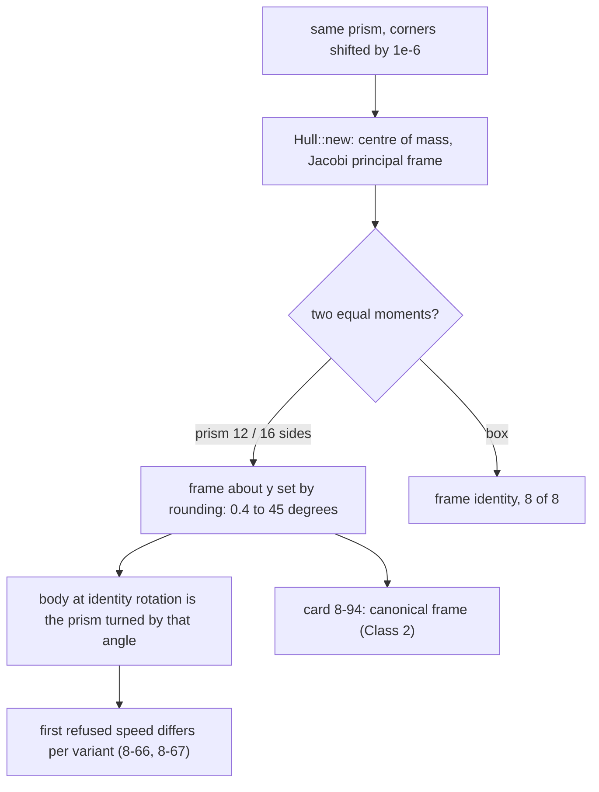

# Review 8-67: the speed edge of a hull cell moves with the last digits of its corners because the hull's stored frame is chosen by rounding; the prism's frame turns by 0 to 45 degrees about y under a shift of 1e-6 m

Task: 8-67 (open point of 8-58). Class 1 (investigation); no code change. Outcome: **`Hull::new` stores the vertices in the principal frame of the inertia tensor, found by a Jacobi sweep; for the 12- and 16-sided prisms two moments are equal, so the axes inside that plane are set by rounding. Shifting all corners by 1e-6 m (the same shape in the world) gives a stored frame that differs by 0 to 45 degrees about y (16 sides: 25.1, 45.0, 10.3, 45.0, 7.9, 5.3, 2.7, 0.9 degrees for shifts of 0 to 7e-6; the unit box: 0 in all 8). A test that builds the hull and puts the body at a position with identity rotation, as `collision_forms_edge.rs` does, therefore gets the prism turned by that frame, so its pins on the 24- and 32-corner prisms are lotteries over a rounding. Three of its pins fail when every corner of every hull is shifted by 1e-6 m (5 of 6 draws red) or scaled by 1 + 1e-6 (6 of 6 red). The cells without such a degenerate frame (the 8-corner box hull spinning about y, edge 750; the sphere at the 24-corner prism 0.4 m off the line, edge 950) did not move in 12 of 12 variants. This also qualifies card 8-66: its scan angles were added to a frame that nobody had read (25.1 degrees for the 16-sided prism as built there, 11.1 for the 12-sided), so "0 degrees" there was not 0; the finding of 8-66 that the first refused speed depends on how the prism is turned stands and has now a cause for the scatter. A cure is a change of `Hull::new` (a canonical frame in a degenerate plane), Class 2, the owner's pick: card 8-94.** Owner go-ahead: "I approve, 8-67" (2026-11-26).

## What was found

| item | result |
|---|---|
| method | a temporary edit of `hull()` in `collision_forms_edge.rs` (not kept): the corner list is moved before `Hull::new` by a deterministic pseudo-random amount (seeded) of at most `EPS`: the same shift for all corners ("shift"), a scale 1 + e ("scale"), or each coordinate separately ("each"). Baseline (EPS 0) 11 of 11 tests pass. Release profile, Windows, the 11 tests of the file |
| the 11 tests under a variant (scale is not geometry-preserving: it changes the 0.1 m overlap and the mass by about 1e-6; each corner is a different hull, a confound, and 1e-5 is at the plane tolerance of `Hull::new`, construction errors were not checked) | shift 1e-6, seeds 1 to 6: 5 red (one green); shift 1e-4: 5 red of 6; scale 1e-6: 6 of 6 red; scale 1e-4: 6 of 6 red; each corner 1e-6 and 1e-5, seeds 1 to 8: 8 of 8 red at both sizes. The tests that failed: `the_lowest_edges_between_forms_are_about_900_at_ratio_1000_and_refuse_at_1100` (which of its four assertions was not printed; the capsule at the 32-corner prism at 1100 is the one the scan shows moving), `a_hull_of_32_corners_is_refused_head_on...` and `spin_of_1000_about_x_or_y_does_not_refuse_a_capsule_a_box_or_a_hull_of_24_corners` (not in the scan; a pin that must step, with the 24-corner prism); with each corner moved also `a_hull_of_eight_corners_is_refused_by_spin_about_y...` (a confound: moving each corner of a box breaks its flat faces, so that is a different hull, not the same hull rounded differently) |
| band, shift 1e-6 and scale 1e-6, 12 variants each, step 50 m/s from 600 (spin 50 rad/s from 400 to 1000) | 8-corner hull, spin about y: refused from 750 in 12 of 12 (both modes), steps at 700. Sphere at the 24-corner prism, 0.4 off, ratio 1000, friction 0.5: refused from 950 in 12 of 12, steps at 900. The 32-corner prism at itself, head-on, friction 0: baseline 2050; counts as in the reading row. The capsule at the 32-corner prism, friction 0.5: baseline 900; count refused from 900 is 5 (shift) and 1 (scale); no variant of either mode is refused below 900 down to 600 |
| the stored frame (`zz_frame`, shift of (0.7, -0.3, 0.5) times k e-6 m, `Hull::orientation()`) | `Hull::new` works about the box centre, recentres on the centre of mass and stores the vertices in the principal frame (hull.rs), `origin()` and `orientation()` carry the offset back and the test never applies them. 16 sides, k = 0 to 7: angle 25.10, 45.00, 10.28, 45.00, 7.85, 5.31, 2.68, 0.89 degrees about y; 12 sides: 11.05, 24.34, 2.38, 0.89, 1.79, 7.44, 0.89, 0.45; unit box: 0 in all eight. The world shape is the same, the frame is not: the hull is stored turned about y by an arbitrary angle, and a body at identity rotation is turned by it. That a shift of 1e-6 m cannot turn the faces by that much is why it must be the choice of axes in a plane of equal moments (an unverified reading of the numbers; the Jacobi code was not stepped through) |
| reading | for the cells with such a frame the count of refused variants rises with speed (head-on 32 corners, shift: 1, 4, 5, 9 of 12 at 1450, 1600, 2050, 3000; scale: 0, 7, 9, 9) or stays flat (capsule at the 32-corner prism: 5 of 12 from 900 to 2550, 8 at 3000), so a single speed and a single variant do not give the edge; the baseline 2050 is where 5 of 12 shifted and 9 of 12 scaled variants are refused. Whether each variant has one monotone edge was not checked (8-58 found non-monotone cells) |
| the 64 pairs at 700 m/s | the test of 64 pairs in four cells (256 hits) was green in every variant that left the three others, and the cells of the card were not re-run; no variant put an edge under 700 for any pair, at that one speed (an edge between 700 and 900 is not excluded) |
| not the pins of 8-51 and 8-52 | `collision_shapes_edge.rs` and `collision_angled_edge.rs` were not run with a jitter |

## Decisions

1. No code or test change in this card. A pin on a hull with a degenerate frame is a lottery over a rounding, not a bound; the two cells without it held in 12 of 12 variants at 1e-6 only, one machine, which is thin evidence for calling them safe. The header of the test file ("every pinned speed keeps 100 m/s or more from the first refused one") is not true across variants; it is not edited here.
2. Two follow-ups, the owner's picks: card 8-94 (Class 2): make `Hull::new` pick a canonical frame inside a plane of equal moments, so one shape gives one simulation; that removes the cause and the pins become meaningful (and the golden hashes of any scene with a prism may move). Card 8-93 (tests only): until then, pins with the 24- and 32-corner prisms should assert over variants with direction in mind (a pin that must step needs every variant to step) or use the stable cells; do not lower a bound.
3. 8-66 gets a correction for its angle labels (the next PR of that line of work; not edited in this one beyond this report).

## Not verified

- The cause chain: the frame angle is measured, the link from the frame to the refusal is inferred (the same prisms at the angles of 8-66 refuse at different speeds, and the frame varies with the same scatter), not shown by building the prism in a fixed frame and re-scanning; the Jacobi code was not stepped through.
- Machines: Windows only; the hosted Linux and ARM64 runs the card names were not run (WSL2 Ubuntu passed the baseline in 8-58).
- Other files: the pins of 8-51, 8-52 and the remaining pins of this file at other cells (64 pairs at 700 m/s in four cells passed under every variant that left them green, the two cells of the card were not re-run).
- The size of a draw: 6 draws per mode and size for the tests, 12 for the scans; the pseudo-random generator is mine, not the engine's.
- The probes are not in the repository.
- Mermaid read by the author, not rendered.

## R1 to R8

| phase | result |
|---|---|
| R1 self | the first run (each corner moved) failed even the 8-corner pin; the shift and scale modes were added to separate a changed hull from a rounded one |
| R2 automated | no code change |
| R3 independent | one read-only review, no blocker, three majors; the frame check it asked for was run and changed the report (Loops) |
| R4 QA | baseline 11 of 11; three jitter modes; a speed scan over 12 variants for four cells |
| R5 to R7 | none |
| R8 product fit | the open question (how large is the band around an edge, do the pins need more margin) is answered: for the unstable cells margin does not help; a repair is card 8-93 |

## Loops

| loop | finding | handling |
|---|---|---|
| 1 | major: mechanism stated against the code (a shift cannot turn faces); capsule cell self-contradicting; 'margin protects nothing' overstated | `Hull::orientation()` read across variants: the frame turns 0 to 45 degrees for the prisms, identity for the box; report rewritten around it; claims limited to the counts |
| 1 | minor: title contradiction, 64-pairs row, scale and each-corner confounds, test header, Decision 2 weak, missing Hull::new option | fixed or named (card 8-94) |
