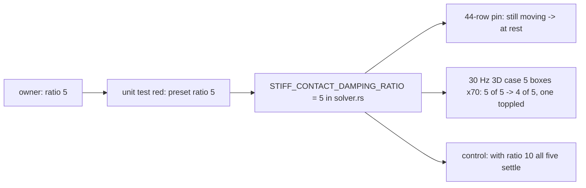

# Review 8-68: the stiff-contact preset takes a contact damping ratio of 5

Task: 8-68 (follow-up of 8-59). Class 2 (one public constant of the shared physics core, `SolverConfig::STIFF_CONTACTS`; the default stays). Ordinary card into `develop`. Owner decision, asked in the session: the damping ratio of 5 (over a third relax pass, a ratio between 5 and 10, or leaving the preset).

## Decisions

1. One new private constant `STIFF_CONTACT_DAMPING_RATIO = 5.0` and one field in `STIFF_CONTACTS`; the rustdoc of the preset and of the constant say why and name the cost. The default and every hash are unchanged.
2. Pins changed, none lowered or skipped: the 44-row finding became a rest pin (speed below 0.02 m/s against 0.0001 measured, drift below 0.2 m against 0.07, penetration below the bound); the cause test now runs the ratio-10 variant as the ringing one and the three other cures against it; the 30 Hz test pins the lost case as four settled and one toppled (with the owner's accepted cost) and all other cases at five of five; a new test shows that with the ratio of 10 the lost case settles all five, so the cost is the ratio's.
3. Not taken: a third relax pass (+23% time, the 6-plank bridge ends lower), a ratio between 5 and 10 (not scanned; the response is not monotone), leaving the preset as it was.

## Evidence

- Red first: the unit test of the preset (`core::solver`) expecting a ratio of 5 failed with the old bits, green after the constant.
- Whole physics test suite after the change (`cargo test -p physics --no-fail-fast`): only the two expected pins failed (44 rows finding, 30 Hz lost case); after the pin changes none fail. fmt and clippy `-D warnings` on `physics` clean.
- Local gates (exit status in the PR).

## Not verified

- A ratio between 5 and 10; the 41-offset scan; the creeping columns beyond the repository tests; the 512-box cost with the new ratio; the speed-edge cells of cards 8-51 to 8-58 beyond what the repository tests pin; 3D pyramids of 44 rows; Linux and ARM64; mutation score, Miri, coverage, benchmarks. Mermaid read by the author, not rendered.
- The 30 Hz case pins one toppled offset of five: a chaotic cell. It sat at 4 of 5 in the earlier scan and now; but a change that moves the offset is read as a failure of this pin.

## R1 to R8

| phase | result |
|---|---|
| R1 self | clippy nesting in the 30 Hz test fixed by a helper |
| R2 automated | fmt, clippy, the whole physics test suite |
| R3 independent | one read-only review: no blocker, no major, five minors; handled (Loops) |
| R4 QA | red test; the two pins that moved; a control with the old ratio |
| R5 architecture | one constant of the shared core; 2D and 3D both use it |
| R6 security | none (a number) |
| R7 performance | no time cost measured in the earlier sweep; not re-measured in instruction counts |
| R8 product fit | an opt-in preset that no longer rings on tall pyramids, with one named cost |

## Loops

| loop | finding | handling |
|---|---|---|
| 1 | minor: the rustdoc said 'no cost in time' citing section 18 and generalised the ratio range | worded as 'no time cost showed in the sweep of card 8-59', sections 18 and 20, 'of the ratios tried' |
| 1 | minor: the 8-57 statements (pyramid settles later, pinned 0.1 to 0.5 m/s) read as current | forward pointers to section 20 on the scan line and the phase 8 bullet; the 8-57 changelog and review stay as the record |
| 1 | minor: `SLOWER_SETTLE_FLOOR` named a slower settle | renamed `RINGING_FLOOR` |
| 1 | note: the two untouched users of the preset (`stack_mass_ratio_more.rs`, `stiff_preset_shapes_joints.rs`) were not re-run by the reviewer | they ran in the whole-suite run above, green |
| 1 | note: the loop-1 fixes were not seen by a second reviewer | stated |
