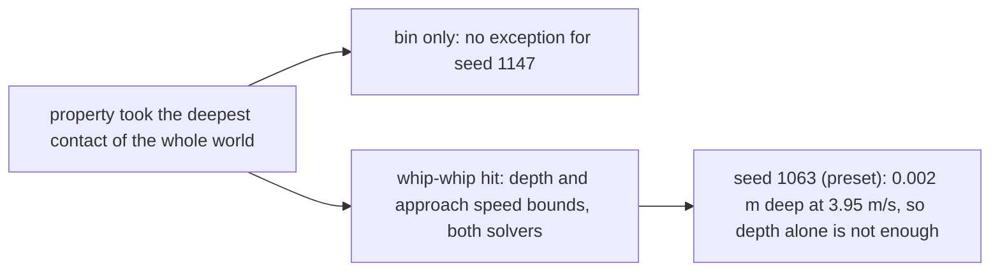

# Review 8-69: the calm-bin property measures the bin, not the whip

Task: 8-69 (follow-up of 8-59). Class 1 (tests only; the engine is not changed). Ordinary card into `develop`. Owner go-ahead: "8-69".

## Decisions

1. `calm_depth` is replaced by `calm_contacts`, which returns the bin depth over the calm steps and the worst whip-whip hit (depth and post-step approach speed) over the run. `deepest_where` moved to `measure.rs`.
2. The exception for seed 1147 and its finding test are dropped; the preset test now holds all 25 seeds to 0.02 m among the bodies of the bin (measured at most 0.0025 m).
3. The whip hit is bounded: depth 0.02 m for the default (as the old whole-world property did; measured 0.0104), 0.05 m for the preset (0.0296 measured), approach 5 m/s for both (3.95 measured). The 0.05 m is the bound the old finding test used for the exception; the 5 m/s is a measurement with a margin, not a derived value.
4. A third bucket (found by the reviewer): contacts between a link and anything that is no link (a bin body, the floor, a wall) over the calm steps, held to 0.02 m with both solvers, as the whole-world measure held them before.
5. No bound was lowered, with one thing said plainly: the whip-whip depth bound of the preset is 0.05 m for all 25 seeds, where the old test held 24 seeds to 0.02 m on the whole world and gave 0.05 m to seed 1147 only. Only seeds 1063 and 1147 ever hit (0.002 m and 0.0296 m measured), so nothing real is looser today; on paper it is.

## Evidence

- Probe of the 25 seeds with both solvers (values in [speed-bounds-scan](../wiki/spikes/speed-bounds-scan.md) section 19); the probe test was removed.
- Red: with the approach bound at 2 m/s the preset whip test fails naming seed 1063 at 3.95 m/s; the file was restored.
- fmt, clippy `-D warnings` on `physics`, `cargo test -p physics --test stability` (52 tests).

## Not verified

- That the 5 m/s bound would catch a solver regression (no engine change tried); 3D; seeds outside the fixed list; Linux, ARM64, mutation score, Miri, coverage, benchmarks. Mermaid read by the author, not rendered.
- The whip bounds sit on chaotic scenes; the fixed seed list is deterministic on this machine, but the hit seeds are only two.

## R1 to R8

| phase | result |
|---|---|
| R1 self | clippy nesting fixed by computing the bin depth before the calm check |
| R2 automated | fmt, clippy, the stability binary |
| R3 independent | one read-only review: no blocker, one major, six minors; handled (Loops) |
| R4 QA | red check above; both solvers on all 25 seeds |
| R5 architecture | test helpers only |
| R6 security | none (tests) |
| R7 performance | the property runs the same steps; one extra manifold pass per step in the tests |
| R8 product fit | the property now says what it means; a whip hit is held to a speed |

## Loops

| loop | finding | handling |
|---|---|---|
| 1 | major: contacts of a link with a bin body or a static body fell in no bucket, so no test bounded them | third bucket `touch_depth`, 0.02 m over the calm steps, both solvers |
| 1 | minor: the preset whip depth bound is looser on paper for 24 seeds | stated in Decisions 5; not tightened (only two seeds ever hit) |
| 1 | minor: the seed 1147 pin above 0.02 m left the old test | survives in the 8-59 cause test (whip depth above 0.02 m with the preset), stated |
| 1 | minor: two comments of `stiff.rs` said the property takes the whole world; a doc comment of `WHIP_APPROACH` described another bound | fixed |
| 1 | minor: `bin_depths` in `stiff.rs` repeats the loop of `calm_contacts` | accepted; it also measures the whole world, which the property no longer does |
| 1 | note: the loop-1 fixes were not seen by a second reviewer | stated |
