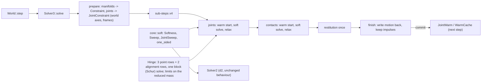

# Review 8-7: `physics::d3` joints

Task: 8-7. Class 2 (public API of `physics::d3`: `Joint3`, `BallJoint3`, `HingeJoint3`, `DistanceJoint3`, `AngleLimits`, `LengthLimits`; the soft-limit helpers move from `d2` to `core::soft`; no `unsafe`, no new dependency, no governance file). Ordinary card into `develop`. Loops: 3 fix loops (3 independent reviews), the most the rules allow. Open blocker/major at the end: 0 known; the fix of loop 3 was not reviewed again (see "Not verified").

Delivers: 3D bodies can be joined by a ball-and-socket, a hinge with angle limits, and a distance joint (a rigid rod, or a rope between two lengths). `Solver3` solves the joints serially before the contacts in every pass. Scope decided by the owner: all three joints in one PR, limits only; motors and springs are card 8-20. README v1.68.

## Decisions

1. **All three joints in one PR, limits only (owner).** Motors and springs: card 8-20.
2. **Joints before contacts in every pass,** as in 2D, so a contact sees the joint's correction of the same pass.
3. **Hinge rows solved as one block.** The three point rows and the two alignment rows are solved together (Schur complement of the point block). One row after another made a heavy door wobble 10 cm out of its plane; the block solve holds it to 0.4 mm.
4. **Hinge limits use the reduced mass** of the angle (inertia about the axis less what the anchors take) and push with a torque plus the matching point reaction, recomputed at the warm start from the limit impulses and the current arms and not stored (stored copies went stale: 0.2 to 0.5 m permanent anchor offset; accumulating them blew up).
5. **A violated limit counts at most 0.02 rad / 0.02 m of error** (`MAX_LIMIT_CORRECTION`), so a body that starts far outside its range is eased back. 0.1 let a small body on a long arm diverge (review 2); 0.05 was still not stable in the reviewer's probe.
6. **Hinge frames.** The first reference direction is the first tangent of the local axis; the second is that direction carried to the second axis by the smallest rotation, turned by minus the reference angle; angle by `atan2` (`dmath`). Zero when the frames coincide; with equal local axes it is the relative angle minus the reference angle, as in 2D.
7. **Opposite local axes are the same line seen from the other side.** The sign is fixed at creation from the two local axes and the alignment keeps the first axis on `sign x axis_b` (review 3: the raw cross product left the opposite pose as an unstable equilibrium that rounding noise tipped over in any turned frame). This also removes the half-turn jump of the zero pose near opposite axes.
8. **Distance joint:** without limits a rigid rod of `length`; with `limits` a rope slack between min and max (the length must lie within). A rope has no direction when its anchors coincide, so its shortest length cannot act there.
9. **Validation when a joint is added:** non-finite values, zero or non-unit axes, limits out of order or beyond a half turn, lengths, anchor extents.

Known limits (also in the `d3::joint` module doc and the design note): masses differing by about 30 times or more at far anchors can diverge (rod with a 100 times heavier end: 0.02 m off; 10 000 times: 2 m); a body that is tiny for its arm (mass x arm squared over the inertia about the axis above about 1000) can end moving through its limit range instead of resting at the near limit, and above about 5000 with a fast approach the step can diverge (one scene of 216 scanned ended non-finite: 0.1 m cube, 10 m arm, gravity); a diverging step can end with huge but finite values that the finiteness check does not see; no continuous check, so a body spinning faster than a step can follow can pass through a limit.

## Evidence

- Tests written first. Red evidence: before the solver was wired in, 10 of 15 joint scenes failed (bodies fell apart); each fix of the review loops has a test that fails without it: the far-outside-the-limit scenes with the cap at 0.1 (spin 2.6e17 for a 0.05 m cube on a 2 m arm), and the opposite-axes tests with the sign forced to +1 (the axes end antiparallel instead of aligned). `engine/physics/tests/d3_joints.rs`: 21 tests (ball chain, pendulum, hinge door with and without limits, limit sides, reference angle, rope and rod under load, joints between two dynamic bodies, collide-connected, sleeping and waking, validation, long-arm and opposite-axes regressions). Unit tests in `solver/joint.rs` (42) and `joint.rs` (10); allocation test with joints in `d3_no_allocation.rs`. `cargo test -p physics`: 817 tests, 0 failed. `cargo clippy -p physics --all-targets -- -D warnings` and `cargo fmt --check`: clean.
- Mutation (`cargo mutants -p physics -j1`, per file and in small batches; tests `--lib` and `d3_joints`, `d3_solver` for `stats`). `solver/joint.rs`: 136 + 78 + 40 + 8 mutants in the reruns after the loops; survivors were killed by new unit tests with hand-computed numbers (the `carried` coefficients, the relative speed and spin of two moving bodies, the rod's accumulated impulse, `axis_of` at the limit length, `rod_mass`, `JointSet::is_finite` and `write_bits`, `block_solve` off-diagonals, the refinement sign). `joint.rs`: 32 mutants, 0 missed. `solver/mod.rs`: 20 mutants, the one survivor (`frozen` stat) is killed by `d3_solver`. Output in `target/mut-*` deleted.
- Survivors judged equivalent (reasoned, not proven): `cosine < -1 + CARRY_LIMIT` against `<=` in `carried` (at exactly the limit both branches give the same direction within rounding); `unit(axis_b) * sign` against `/ sign` (the sign is plus or minus one).
- Independent review probes (copies of the crate, repository untouched): a scan of arms 1 to 10 m, half-extents 0.05 to 0.3 m, starts 0.6 to 3 rad and -2, zero and standard gravity; rope limits under 1, 100 and 10 000 kg loads; a door asleep and woken; pendulums between dynamic bodies; swings up to 90 m/s at the tip; mass ratios up to 10 000.
- Local gates (`python tools/local-gates/local_gates.py --base origin/develop`) and wiki lint: see the pull request.

## Not verified

No Linux or ARM64 run; no D2 cross-platform golden hash for the 3D joints (card 8-13); no multi-thread run (serial solver); no benchmark (cards 8-12 and 8-14); no Miri (no `unsafe`); no branch-coverage or new-line gate run; the loop-3 fix (opposite axes, doc changes, new tests) was not seen by a fourth independent reviewer (three loops is the limit); the solver was not compared against an independent reference simulation; the Mermaid view was read by the author, not rendered; the wiki README status line still says v1.64 (older than this change).

## R1 to R8

| phase | result |
|---|---|
| R1 self | read against the 2D joints; found and fixed the hinge wobble, limit overshoot and the reference-angle sign by tests |
| R2 automated | tests, clippy, fmt, mutation, local gates, wiki lint, diff hash |
| R3 independent | three read-only reviews; findings below |
| R4 QA | oracle scenes (pendulum period, rope hold, limit rest angle, reference angle) and 21 integration scenes |
| R5 architecture | `Dim` and the 2D solver unchanged; `core` gained `JointSweep`, `rigid_softness`, `one_sided` shared with 2D; joints live in `d3` (ADR-0018) |
| R6 security | no `unsafe`, no new dependency, no secrets; validation of every joint description; fixed capacity; non-finite impulses fail the step as in 2D |
| R7 performance | no allocation in a step with joints (counting-allocator test); speed not measured (cards 8-12 and 8-14) |
| R8 product fit | the owner reads the known limits above (mass ratio, tiny bodies on long arms, high-speed tunnelling) |

## Loops

| loop | finding | handling |
|---|---|---|
| 1 | major M1: a hinge limit violated by 1 rad or more blew up to NaN | reaction recomputed at the warm start, correction capped (0.1 then 0.02, see loop 2) |
| 2 | major: a small body on a long arm (0.1 m cube, 3 m) diverged at step 3 and `World::step` returned Ok | cap 0.02, one refinement step in the reaction solve, floor on the reduced mass, regression tests |
| 2 | minor: antiparallel doc wrong; `carried` jump undocumented; tunnelling undocumented; limit warm start can inject energy | docs rewritten; energy injection remains for bodies tiny for their arm (documented, measured) |
| 3 | major: an antiparallel hinge (`axis_b = -axis_a`) flips by half a turn after about 20 steps in a turned frame | the sign is fixed at creation and the alignment keeps the first axis on `sign x axis_b`; unit and integration tests, red without the fix |
| 3 | minor: the `MOST_REDUCED` floor makes a body tiny for its arm cross its range (ratio above 1000) | documented with the measured threshold; the test that hid it (`angle.abs() < 0.56`) now has a second test with side assertions for bodies that are not tiny |
| 3 | minor: the tiny-body divergence threshold in the docs (10 000) was too optimistic (5400 diverged with a fast approach) | docs now say about 1000 and 5000 |
| 3 | minor: a diverging step can end finite and huge | documented; a bound on speed or position is a later change |
| 3 | minor: mass-ratio doc gave no numbers | numbers added from the review's probes |
| 3 | nit: `du.exe.stackdump` untracked | not committed |
