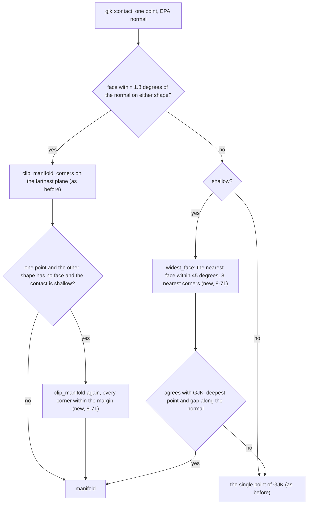

# Review 8-71: a rolling prism keeps both points of its edge

Task: 8-71 (found in 8-34, `reviews/8-34.md`). Class 2 (physics: narrowphase face clipping of hull contacts; a new `pub(super)` helper in `gjk.rs`). Ordinary card into `develop`. Owner go-ahead: "8-71".

## What was done

| item | result |
|---|---|
| the question | a prism of 8, 12 or 16 sides rolling at 2 m/s had one contact point in 52, 65 and 58 of 240 steps where an edge (two points) touches; why one point, and should the edge keep both |
| cause 1 | the normal of EPA at a corner leans 1.8 to 29 degrees from the face that touches (measured: the floor normal at 0.87 to 0.9995 of a cosine), past `MIN_FACE_COSINE`, so neither shape got a fitted face and the single GJK point stood (145 of 720 calls over the three prisms in a probe) |
| cause 2 | with the floor as fitted reference, the prism edge kept only the corners within a thousandth of its reach of its farthest plane; an edge tilted by 0.0006 rad has ends 0.6 mm apart, so one end was dropped (97 of 240 steps at 1.8 m/s, 8 sides) |
| change 1 | `widened()` / `widest_face()`: when no face fits, the nearest face within 45 degrees (planes spanned by the 8 corners nearest the normal that bound the solid, the best cosine wins), only for a shallow contact (no deeper than 5 % of the reach of the smaller shape) and only when `agrees()` (deepest point and gap along the normal within a thousandth of that reach of GJK's, with the new `gjk::gap_along`) |
| change 2 | a shallow manifold of one point with a fitted reference and an incident shape without face is tried again with every corner within the margin of its farthest plane (`incident_for` takes the band); same reference, same normal, so it can only gain points |
| refactor | `contact` split into `clip_manifold`, `widened`, `Ask`, `agrees`, `is_shallow`; `face_plane` takes a `Fit` (tolerance, reach, cosine); `face_on`, `nearest_corners` extracted; `Face` is `Copy`, passed by reference |
| measured | one-point steps over 3 prisms and speeds 1.0, 1.4, 1.8, 2.0 m/s: 31 to 70 of 240 before, 0 to 9 after; the roll stays within 0.5 mm of the radius, 11 mm sideways, spin about the other axes 0.23 rad/s at most; the physics suite (1098 tests, cross-platform feature on) passes, hashes included |
| cost | one prism on a floor, release build, 28800 steps: 255 ms before, about 340 ms after (+35 %); with 16 candidates instead of 8 it was 528 ms (card 8-78) |

## Decisions

1. Two separate fixes, because the two causes are separate: the wide face repairs the missing normal, the band repairs the tilted edge. Each fails the rolling test when taken out by hand.
2. Both are limited to shallow contacts (5 % of the reach of the smaller shape). Unguarded, the wide face broke three oracle tests of `d3_narrowphase` (deep overlaps, a ridge against a ridge, a hull of a box's corners against the box routines) and a stack of five hull cubes (a manifold with a point 50 m deep).
3. The wide face is accepted only when it loses nothing against GJK (depth and gap along the normal). The band needs no such check because it keeps the old reference and normal and is tried only for a manifold of one point (the first version of the band, with the check, was refused wrongly when GJK itself was off by 2.5 mm, card 8-75).
4. `WIDE_CANDIDATES` is 8, not 16: the rolling results are identical and the scene is 35 % slower instead of 107 %.
5. The one-point pin of 8-34 is replaced, not weakened: the test now pins the repaired behaviour (at most 20 of 240, 9 measured, the old code gave 31 at the first scene) over 12 scenes instead of 3, and keeps the other pins of the finding; "never airborne" became "no contact on at most 6 steps", because GJK gives none on 0 to 3 steps of 240 with the old code as well (a 16-sided prism at 2 m/s had none before the change in this card's own first run, none in the original pin: chaos), card 8-75.

## Evidence

- Red: against the old `face_clip.rs` the rolling test fails at the first scene (8 sides at 1 m/s: 31 steps with one point). A sweep of speeds 1.0 to 2.8 m/s before and after was run by a temporary probe (not kept): one-point steps 31 to 112 before, 0 to 10 after.
- By hand: the band switched off fails the rolling test (97 steps at 1.8 m/s, 8 sides); the wide face switched off fails it (30 steps at 1 m/s); `agrees` made always true fails three oracle tests of `d3_narrowphase`.
- Unit tests: `widest_face` (face within 45 degrees, none beyond, a 12-gon corner), `nearest_corners` (the 8 farthest, order), `incident_for` band, `agrees`, `is_shallow`, `gjk::gap_along`, and `contact` of an octagonal prism on a floor with its edge tilted by 0, 0.2, 5 and 15 mm (two points) and 29 mm (one point, beyond the margin).
- fmt, clippy `-D warnings` on `physics` (all targets), `cargo test -p physics --features cross-platform-determinism` (1098 tests), `cargo build --workspace --all-targets`; see the PR for the gates.

## Not verified

- The wide face in a unit test of `contact` (the lean of EPA that triggers it was not constructed by hand; the rolling test covers it and fails without it).
- Benchmarks on the reference machine and the PR benchmark gate (the gate runs only on `main`); the +35 % is one release run of one scene on this machine, twice.
- Mutation score (not run: memory, cards 8-34 and 8-70), Miri, coverage.
- Linux and ARM64: the new code uses only `+ - * /`, `sqrt`-free arithmetic and comparisons (no libm), and the golden file was not changed; not run there.
- That the extra points of the band are harmless for a capsule against a hull (a capsule tilted so both ends are within the margin now has two points where one was); no test of that pair.
- Mermaid read by the author, not rendered.

## R1 to R8

| phase | result |
|---|---|
| R1 self | the first wide face broke 5 tests (deep overlaps, ridges, a stack); the first band version was refused when GJK was wrong (found by the unit test of the tilted prism) |
| R2 automated | fmt, clippy, the physics tests with the feature, workspace build |
| R3 independent | one read-only review: no blocker, 2 major, 4 minor, 3 nits; all handled (Loops) |
| R4 QA | rolling prisms of three sizes at four speeds; hand mutations; unit tests per helper |
| R5 architecture | one `pub(super)` helper in `gjk.rs`; the rest private to `face_clip.rs` |
| R6 security | none (no input from outside; arithmetic on finite values, fixed arrays) |
| R7 performance | +35 % in a rolling-prism scene, measured, card 8-78 |
| R8 product fit | the owner learns the cause of the one-point steps and what the repair costs; three more defects are on the board |

## Loops

| loop | finding | handling |
|---|---|---|
| 1 | major: `widest_face` cost unmeasured (560 triples, each a scan of every corner) | measured: 528 ms against 255 ms; candidates 16 to 8 gives 343 ms with the same results; one-point manifolds only for the band; card 8-78 |
| 1 | major: the rolling test is statistical on a chaotic scene; nothing tests the wiring of `contact` | `prism_on_the_floor` unit test of `contact` for the band (red: found a bug in the first band version); the wide face is covered by the rolling test and the unit tests of its helpers, stated under Not verified |
| 1 | minor: stale module header and `incident_for` doc, a long doc line | header and docs rewritten |
| 1 | minor: the band recomputed an identical manifold when the incident face was fitted | skipped unless the other shape has no face and the manifold has one point |
| 1 | minor: the band could add a wrong point | the band keeps the reference and normal and adds points within the margin only; a tilted capsule note under Not verified |
| 1 | minor: the old numbers cannot be rechecked once the old code is gone | the old figures are in `reviews/8-34.md` and this file; the sweep command is in the test comment |
| 1 | nit: 4 parameters (tuples), `is_none_or` needs Rust 1.82 | tuples as in `face_plane`; the toolchain builds it (1.94) |
| 1 | note: the loop-1 fixes were not seen by a second reviewer | stated |
