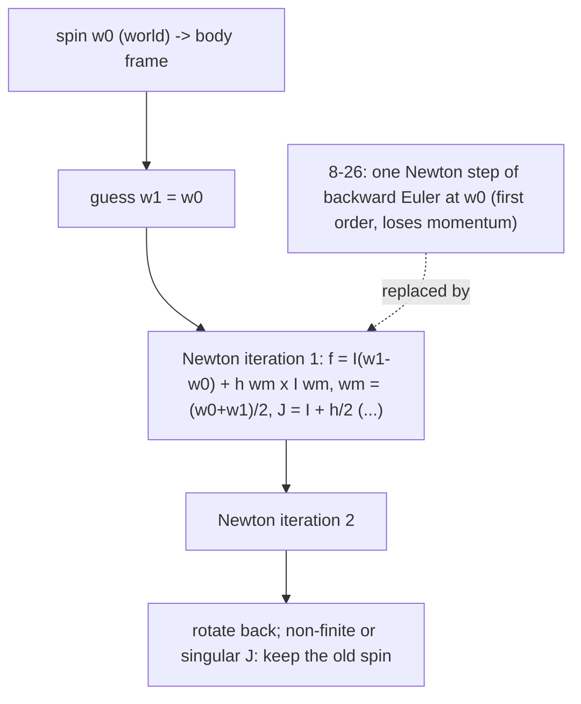

# Review 8-73: the gyroscopic term keeps its energy and the length of its momentum (midpoint rule); it costs about 8% of a step of a pile when on, and nothing that could be measured when off

Task: 8-73 (found by 8-26). Class 2 (physics `gyroscopic.rs`; the term is opt-in, no protected path, default path untouched). Owner go-ahead: "I approve then 8-73" (2026-11-27), Wave 2 card 4 of 4.

In plain words: a spinning box that nothing pushes should keep its energy and the size of its angular momentum. The first version of the term lost about 3% of the momentum in 2 s at 240 Hz and 10% at 60 Hz, a little at every step. The new version solves the same equation with a second-order rule that keeps both to rounding, for twice the arithmetic of the term. The term is still off by default, so nothing else moves.

Outcome:

- **(1) Cost:** with the term **off** the step of a pile of 125 tumbling boxes is the same as before to within what can be measured; with it **on** the new term costs about 25 µs of 325 µs a step (8%) in that pile, 23 ns more a call than the old one (65 ns against 42 ns).
- **(2) Momentum loss:** the implicit midpoint rule replaces backward Euler: the energy is kept to 1.4e-4 over 10 s and the length of the momentum to rounding; the momentum vector moves 0.8% over 2 s at 240 Hz (before 2.6%) and 3.3% at 60 Hz (before 10%) for a free body, and no longer grows with time (0.8% over 10 s; before 7.8%). The rest is the first-order turn of the orientation, not the term.
- **(2b) Sub-stepping untouched bodies:** not done; with the better step the free body at 60 Hz loses 3.3% in 2 s instead of 10%, which was the reason for it.
- **(3) Mutation:** six hand mutations (five of the step, one of the guard), all killed (below). The tool run is not done.

## What was measured

Method: one laptop (8-14), release build, Windows, one thread; a pile of 125 boxes (half extents 0.5, 0.3, 0.2) in a 5x5x5 grid with spins of 1 to 4 rad/s dropped on a floor, sleeping off, 60 warm-up and 600 timed steps at 240 Hz, minimum of 7 runs, binaries alternated. Throwaway probes, not in the repository.

| item | result |
|---|---|
| step, term off, code of before card 8-26 | 348 µs |
| step, term off, code of `develop` before this change | 323 to 326 µs |
| step, term off, this change | 322 to 326 µs (equal to the line above: the default path did not change) |
| step, term on, backward Euler (before) | 323 to 332 µs (not distinguishable from off; see Not verified) |
| step, term on, midpoint (this change, with the guard) | 345 to 353 µs: **+25 µs, 8%** |
| one call alone, spin of normal size | old 42 ns, new 65 ns |
| calls a step in the pile | about 410 (126 bodies, several sub-steps) |

Whole-scene errors, box of half extents (0.5, 1, 0.25), spin (1, 4, 0.5), the maximum of the energy error over the run, "free" = nothing touches the body, "joint" = a ball joint through the centre (set up by the solver, sub-stepped):

| scene | momentum vector moved, before | now | energy moved now |
|---|---|---|---|
| free, 240 Hz, 2 s | 2.6% | 0.83% | below 5e-5 |
| free, 60 Hz, 2 s | 10.0% | 3.3% | below 5e-5 |
| free, 240 Hz, 10 s | 7.8% | 0.84% | 1.4e-4 |
| joint, 240 Hz, 2 s | 0.67% | 0.22% | 3e-4 |
| joint, 60 Hz, 2 s | 2.6% | 0.84% | 1e-4 |
| joint, 240 Hz, 10 s | 2.1% | 0.25% | 1.3e-3 |

Before the change the energy was lost: 1.4% at 240 Hz in 2 s and 6% in 10 s for the free body (0.3% for the joint body in 2 s). A first try, scaling the result of backward Euler back to the length of the momentum, kept the momentum but made the energy **rise** (up to +18% at 10 s) and was dropped.

## What changed

| item | result |
|---|---|
| code | `gyroscopic.rs`: the step is the implicit midpoint rule `I (w1 - w0) + h wm x (I wm) = 0`, `wm = (w0 + w1)/2`, solved by two Newton iterations from `w0` (`newton_step`, Cramer's rule, the same guards as before: a singular Jacobian or a non-finite result keeps the old spin). `NEWTON_ITERATIONS = 2`. Only `+ - * /` (no `sqrt`, `sin`, `cos`, no fused multiply-add; the singularity test of the Jacobian now compares squared lengths, the old one used `length()`). A guard (R3) keeps the old spin if the energy would rise by more than 1%. Module doc updated |
| tests | unit `a_step_keeps_the_length_of_the_momentum_and_the_energy_to_rounding` (4 spins by 3 steps, 2e-6) ; integration `the_midpoint_step_keeps_the_energy_and_loses_little_momentum_at_240_and_60_hz` and `a_body_the_solver_sets_up_keeps_the_energy_and_loses_little_momentum` (3 runs each, bounds about 2 to 3 times the measured values); an old comment corrected |
| red evidence | the unit test failed against backward Euler (momentum changed by 1.1e-5 at 60 Hz); the two integration tests failed against the old file (the file of `develop` put back) |
| robustness (R3) | measured for spins of 6, 50, 200 rad/s and (30, 40, 20) at steps of 1/240 to 10 s: up to a spin times a step of 50 radians energy and momentum are kept to 1e-5; beyond that Newton from the old spin does not converge, the result loses energy (down to 18% of it) except one case (200 rad/s, 10 s) that gained 1.8%, now refused by the guard (the test is red without it) |
| hand mutations | one Newton iteration, the midpoint taken as `w1`, the half missing in the Jacobian, the sign of the step, the missing `h` in `f`: all five killed; the first and third by the unit test only |
| docs | `wiki/architecture/phase8-3d-v0.md` (the paragraph of the term: scheme, figures, cost) and the module doc of `d3/mod.rs` |
| default | unchanged: the term is off in `SolverConfig::DEFAULT`; the physics tests pass and the 3D golden is equal on Windows and on Linux (WSL2) |

## Decisions

1. **Midpoint rule, not a rescaling.** Scaling the old result to the length of the momentum keeps the momentum and gives energy gain (+18% at 10 s); the midpoint rule keeps both because both are quadratic in the spin.
2. **Two Newton iterations.** One iteration is the card's old cost and is killed by the unit test (the error is then first order); two reach rounding for 1/960, 1/240 and 1/60 s and the spins tried. A third is not needed for them and costs 20 ns a call more.
3. **Safety is a guard, not a proof:** the step has no convergence test; the guard bounds the energy gain per step at 1% and the tests cover the cases listed. A residual check or a fallback to the old step would be an improvement if a user turns the term on for very fast spins at long steps (card 8-101).
4. **Not done:** sub-stepping of untouched bodies (the main loss is gone), turning the term on by default (the owner's, a governance card), a closed-form step.
5. **The cost is paid only with the term on.** If the owner wants the term cheaper, a spin below some limit could skip it; a 20-fold slowdown for spins near 1e-20 (subnormal numbers, 1.5 µs a call; the old step the same) was measured, and a skip below 1e-6 rad/s was tried and removed because it never fired in the pile.

## Not verified

- One laptop and one pile; a scene with few rotating bodies, or one where the term is on and most bodies sleep, was not timed. The PR benchmark gate runs only on `main`.
- The energy of the joint-held body moves 1.3e-3 over 10 s, ten times the free body (1.4e-4); the cause was not isolated. "What is left is the first-order turn of the orientation" is the likely cause for the momentum vector, not shown by an experiment.
- **Unexplained:** the old term (42 ns a call, about 410 calls a step) should have cost about 17 µs a step in the pile, but the pile with it on was not slower than with it off. The new term's 25 µs fits its own per-call time. A possible reason is that the two piles are different (the spin sum after 100 steps is 77 against 356, so the bodies move differently); not isolated.
- Whether the cost of the field and comparison with the term off is zero: against the code of before card 8-26 the step is 7% *faster* now (other changes), so that cost is hidden, not shown to be zero.
- Spins and moments outside those tried (a long rod, a spin of 50 rad/s at a large step): the finite result is pinned by the old tests, the accuracy is not.
- The mutation score of `gyroscopic.rs` by the tool, the hosted `ci`, Linux ARM64, Miri (no `unsafe`). The 60 Hz figures come from one run each. Mermaid read by the author, not rendered.

## R1 to R8

| phase | result |
|---|---|
| R1 self | the first idea (rescale) was measured and dropped for energy gain; the midpoint rule was chosen on the algebra and checked on both quantities |
| R2 automated | rustfmt, Clippy with warnings denied, the physics tests, the 3D golden on both platforms, the local gates |
| R3 independent | one read-only review: no blocker, two majors (robustness untested, false `sqrt` claim), five minors; all handled (Loops) |
| R4 QA | one-step conservation over 12 cases, whole-scene runs at 240 and 60 Hz for 2 and 10 s, free and joint bodies, five hand mutations |
| R5 to R7 | no API change, no `unsafe`, no allocation, no libm; cost measured |
| R8 product fit | the opt-in tumble no longer bleeds energy, for 7% of a step of a pile with the term on |

## Loops

| loop | finding | handling |
|---|---|---|
| 1 | major: no convergence guard and untested fast spins or long steps | measured; the guard and a stress test added; the limit of validity written in the module doc |
| 1 | major: the module doc and the report said no `sqrt` but the singularity test used `length()` | the test compares squared lengths; the wiki and the code now agree |
| 1 | minor: 7% should be 8%; title overclaim; joint-body energy 10 times worse unexplained; cause of the leftover momentum drift not isolated; subnormal and confounded timing without a card | corrected; stated in Not verified; Backlog card 8-101 |
