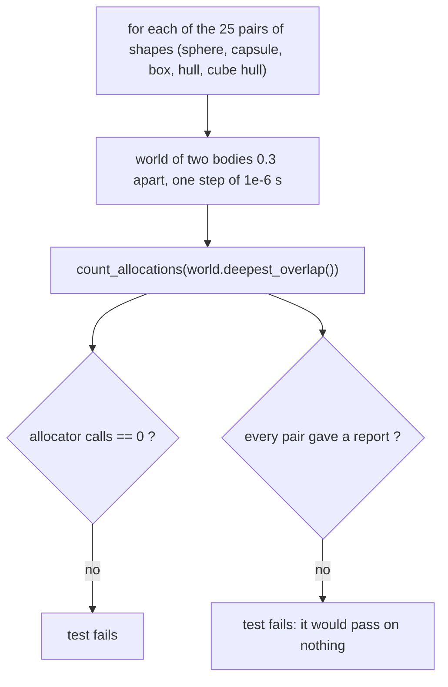

# Review 8-74: a 3D allocation test for `World::deepest_overlap`

Task: 8-74 (found in 8-53, `reviews/8-53.md`, Not verified). Class 1 (a test). Ordinary card into `develop`. Owner request: "Do a 3d allocation test".

## What was done

One test, `asking_for_the_deepest_overlap_makes_no_allocator_call`, in `engine/physics/tests/d3_no_allocation.rs`: for every pair of the five 3D shapes the query runs inside the counting allocator and makes no allocator call, and every pair gives a report (so the test cannot pass on nothing). No source changed.

## Decisions

1. All 25 pairs rather than one: the manifold code differs per pair (sphere, capsule, box, hull and the face clipping of cube hulls), and the query reads whatever manifolds exist.
2. The guard that every pair gives a report compares with `shape_pairs().count()`, not a literal.

## Evidence

- The test passed on its first run, which is the finding: the query allocates nothing in 3D, as the 2D test of card 8-53 showed. All 25 pairs gave a report.
- By hand: adding `let _spare: Vec<u8> = vec![0; 8];` to the query makes the test fail; the file was restored (the diff holds the test file only).
- fmt, clippy `-D warnings` on `physics` (all targets), the `d3_no_allocation` tests (5 pass); see the PR for the gates.

## Not verified

- That the pairs produce manifolds of four points (the query reads whatever points are active, so the count does not change whether it allocates; the claim was removed from the doc after the review).
- Multi-thread counting (the counter is per thread; the test is single-threaded).
- Mutation score, Miri, coverage, benchmarks. Mermaid read by the author, not rendered.

## R1 to R8

| phase | result |
|---|---|
| R1 self | the first threshold was 20 pairs; measured 25, so it asserts all |
| R2 automated | fmt, clippy, the test file |
| R3 independent | one read-only review: no blocker, two minor findings, three nits; all handled (Loops) |
| R4 QA | a deliberate allocation in the query fails it |
| R5 to R7 | no source change; no security or performance effect |
| R8 product fit | the card closes the open point of 8-53 |

## Loops

| loop | finding | handling |
|---|---|---|
| 1 | minor: the doc claimed four-point faces, never asserted | the parenthesis is removed |
| 1 | minor: the literal 25 | `shape_pairs().count()` |
| 1 | nit: the 1e-6 step unexplained; duplicated `WorldConfig` literal | a comment added; the literal is kept (other tests in the file repeat it, a helper would touch them) |
| 1 | note: the loop-1 fixes were not seen by a second reviewer | stated |
