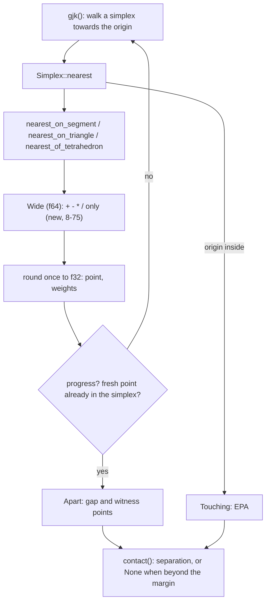

# Review 8-75: GJK keeps its digits over a wide floor

Task: 8-75 (found in 8-71, `reviews/8-71.md`). Class 2 (physics: the simplex arithmetic of GJK, determinism surface). Ordinary card into `develop`. Owner go-ahead: "8-75".

## What was done

| item | result |
|---|---|
| the question | card 8-71 saw `gjk::contact` return `None` for a prism that touches the floor (0 to 5 of 240 steps of a roll, with the old code too) and a depth 2.5 mm off for a tilted edge; why |
| cause | a probe over prism poses on a floor 100 m wide (8, 12, 16 sides) found 144 to 231 of 17280 poses with no contact. Traced: the simplex held a tetrahedron with slivers 140 m long and under 1 m wide; `nearest_on_triangle` (Ericson 5.1.5) multiplies dot products of the edges (about 1e8, where `f32` keeps 8 units) and subtracts them to pick the region (about 1e4), so its point was 0.03 m off, the distance grew from 5e-3 to 29e-3 instead of shrinking, the loop repeated the same state to its 64 rounds and returned an "apart" gap 0.03 m wrong, which `contact` compared with the margin |
| change | `d3/wide.rs`: a small `f64` vector (`+ - * /`, dot, cross, one `narrow` to `f32`); `nearest_on_segment`, `nearest_on_triangle` and the side tests of `nearest_of_tetrahedron` now compute in `f64`; `Nearest` keeps `f32` point and weights (narrowed once); the vertices of the simplex, EPA and `face_clip` are unchanged |
| measured | sweep: 8 and 16 sides, 360 turns of half a degree (plus 0.13 degree), tilts 0, 0.0006, 0.003, 0.01 rad, heights 0.5 mm, 0.1 mm, 0 above and 1, 5, 20, 50 mm and 0.2 m sunk, the floor 13.7 m and 21.3 m off the prism: a contact in every pose and the separation of the lowest corner within 0.1 mm (red before: no contact at 8 sides, step 45, tilt 0.0006, height 0); the rolling test measures 0 steps without contact over its 12 scenes (limit 1, was 6); the physics suite with the cross-platform feature: 1101 tests pass (1098 before, 3 new), golden and replay hashes unchanged |
| cost | a release run of `d3_hull_contacts` shows 0.07 s with and without the change (three runs each): no difference at that resolution; not a benchmark |

## Decisions

1. `f64` only inside the three nearest-point routines, not for the whole of GJK: the failing step was the region arithmetic of slivers, and the vertices (`f32` supports) are exact inputs. EPA and the face clipping stay `f32`: the reviewer argued that the normal of an EPA face (a cross product of long edges) can lose a milliradian-scale direction on slivers, so the sweep was extended to sinks of 20 mm, 50 mm and 0.2 m, off-grid turns and an off-centre floor; all pass within 0.1 mm. That is evidence for this floor, not a proof (see Not verified).
2. One rounding to `f32` (`wide::narrow`, `#[expect(clippy::cast_possible_truncation)]` with a reason, as in `adapter_window_glfw`): it rounds to nearest while the simulation asserts the control registers at the start of each job. `base::dmath` has an integer-only conversion that is `pub(super)`; making it public is a change in `base` and was not needed here.
3. The depth error of card 8-75 (2.5 mm for a tilted edge sunk by 1 mm) had the same cause: the sweep includes sunk heights and they pass, so no second fix.
4. The rolling limit is tightened from 6 to 1 step without contact (0 measured over its 12 scenes): the scene is chaotic, `develop` has no CI and the machine without FMA was not run, so one step of headroom stays.

## Evidence

- Red: the new sweep test failed before the change (`no contact: 8 sides, step 45, tilt 0.0006, height 0`), the probe counted 144, 163, 231 poses without contact for 8, 12, 16 sides.
- Traced by hand: iteration 5 to 6 of one failing pose (nearest point 0.0051 then 0.029; the same state repeated to round 64).
- fmt, clippy `-D warnings` on `physics` (all targets, cross-platform feature), `cargo test -p physics --features cross-platform-determinism` (1101 pass); see the PR for the gates.

## Not verified

- Mutation score of `wide.rs` and the changed routines (not run: memory, cards 8-34 and 8-70), Miri, coverage, benchmarks on the reference machine and the PR benchmark gate.
- Linux and ARM64: only `+ - * /` and one `as f32` rounding, no libm, and the golden file was not changed (the hashes are the same on this machine); not run there.
- The cost is two runs of a coarse timing, not a benchmark; GJK is on the path of every hull contact and `f64` arithmetic is slower than `f32`.
- EPA is still `f32`: a floor wider than 100 m (500 m was not tried), a yawed floor, and `adds_dimension` (its `THIN` test has an `f32` rounding error of the same size at 140 m) were not tried; no failing pose was found.
- The cost: `nearest_of_tetrahedron` converts its points to `f64` and `nearest_on_triangle` converts again per candidate face (redundant, not removed); the physics instruction-count benchmark was not run (card 8-78 tracks the roll scene).
- Linux, and a machine without FMA with the cross-platform feature off: `develop` has no CI, so the first run there is the release PR (or `gh workflow run ci.yml --ref <branch>` by hand).
- Mermaid read by the author, not rendered.

## R1 to R8

| phase | result |
|---|---|
| R1 self | the sweep test first failed clippy's nesting limit three times (split into `prism_pose`, `height_error`, `poses_at`, `sweep_poses`, `first_bad_pose`); a stash made by mistake was put back at once |
| R2 automated | fmt, clippy, the physics suite with the feature |
| R3 independent | one read-only review: no blocker, 2 major, 6 minor, 3 nits; all handled (Loops) |
| R4 QA | sweep of poses with sunk, touching and apart heights; the rolling test; unit tests of `wide.rs` |
| R5 architecture | one new private module of `d3`; no public name |
| R6 security | none (no input from outside; finite arithmetic) |
| R7 performance | not measured beyond a coarse timing (Not verified) |
| R8 product fit | a prism no longer loses its floor contact for a step, and the owner learns what the cause was |

## Loops

| loop | finding | handling |
|---|---|---|
| 1 | major: "EPA and face_clip need no change" argued by unit-length normals, which is not the point (the cross product of long edges is formed first) | sweep extended (sunk to 0.2 m, off-grid turns, off-centre floor): all pass; reasoning in Decision 1 reworded; limit stated under Not verified |
| 1 | major (process): Loops pending | this table |
| 1 | minor: sweep coverage narrow, symmetric with the prism's periods | turns offset by 0.13 degree, floor off-centre, sunk down to 0.2 m |
| 1 | minor: pin 0 on a machine without CI or FMA | limit 1, 0 measured, comment says so |
| 1 | minor: README said 5 mm, review 2.5 mm | both say 2.5 to 5 mm (card 8-71 measured 2.5, the probe 5) |
| 1 | minor: `adds_dimension` rounding of the same size as `THIN` | no failing pose found; named under Not verified |
| 1 | minor: points converted twice in the tetrahedron | left as is, named under Not verified; the benchmark was not run |
| 1 | nit: repeated `Wide::new(0.0, 0.0, 0.0)`, blank line, split module doc | `Wide::ZERO`, blank line, one paragraph |
| 1 | note: the loop-1 fixes were not seen by a second reviewer | stated |
