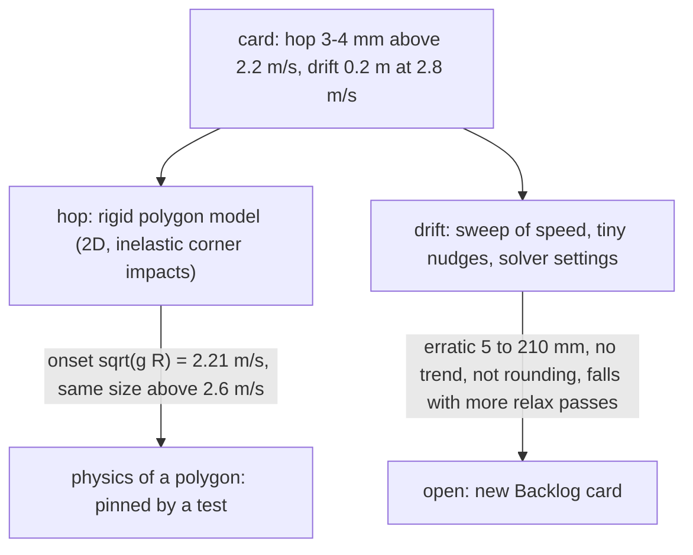

# Review 8-76: the hop of a fast rolling prism is physics, the sideways drift is not a trend

Task: 8-76 (found in 8-71, `reviews/8-71.md`). Class 2 (physics). Investigation card: the only code change is one test; no engine code changed. Ordinary card into `develop`. Owner go-ahead: "Go on 8-76".

## What was done

| item | result |
|---|---|
| hop: the threshold | a body rolling over a corner leaves the ground when it is faster than sqrt(g R) (the centre follows a parabola above the arc of radius R): R = 0.5 m gives 2.21 m/s, the speed at which the card sees the hop begin |
| hop: the engine | sweep of 8, 12 and 16 sides, 1.0 to 3.2 m/s in steps of 0.2, 240 steps: rise above the radius 0.07 to 0.54 mm up to 2.0 m/s, then growing: 8 sides 0.53 (2.2), 3.35 (2.4), 0.65, 2.95, 8.4 (3.0), 17.1 (3.2) mm; 12 sides 0.44, 0.65, 1.65, 2.98, 5.66, 3.65 mm; 16 sides 1.51, 2.88, 2.03, 3.85, 3.93, 6.24 mm |
| hop: an independent model | a 2D regular polygon, inelastic corner impacts about the new corner, no sliding, ballistic flight when the normal force would be negative (a throwaway script, not kept): 0 mm up to 2.2 m/s; at 3.0 m/s 7.2, 9.0 and 6.3 mm and at 3.2 m/s 18.2 mm for 8 sides, against 8.4, 5.7, 3.9 and 17.1 mm in the engine |
| hop: a difference | the engine hops a little earlier and from a lower speed: 8 sides at 2.4 m/s 3.35 mm (model 0), 16 sides at 2.2 m/s 1.5 mm (model 0); at most about 3 mm. Cause not separated (contact softness, the slop and the speculative margin are candidates) |
| drift: 1 um nudges | 6 starting offsets along z of 0 to 5 um on 12 sides at 2.8 m/s: 206 to 210 mm and yaw 0.385 each time; on 16 sides 6.7 to 10 mm; on 12 sides at 1.8 m/s 4.0 to 4.5 mm. The scene does not amplify rounding noise: the number is set by the solver |
| drift: speed | below 2.2 m/s at most 4.7 mm; above it between 1.5 and 206 mm with no order (8 sides: 14, 53, 54, 180, 111 mm at 2.4 to 3.2 m/s; 12 sides: 43, 21, 206, 20, 45 mm) |
| drift: solver settings | 12 sides at 2.8 m/s: 4 sub-steps (default) 210 mm, 8 sub-steps 142 mm, 16 sub-steps 4.7 mm; one more relax pass (2 instead of 1): 28 mm and yaw 0.056 (0.385 before); over the five scenes more relax gave yaw 0.045 to 0.095 against 0.09 to 0.45 and drift 29 to 60 mm against 20 to 210 mm; the gyroscopic term changes nothing (146 to 210 mm as before) |
| change | one test, `a_prism_rolls_without_a_hop_below_the_speed_a_corner_holds_it_and_hops_above` (`d3_hull_contacts.rs`): at 2.0 m/s every prism stays within 1 mm of its radius (0.54 mm measured at most), at 3.0 m/s it rises above 2 mm (3.9 mm at least) |

## Evidence

- The new test is a characterization of behaviour that exists: it passed on the first run, so there is no red step (TDD exception: characterization of an investigated behaviour, said so). It cannot fail by removal of a fix because there is none; it would fail if a change made the hop vanish or start below 2.0 m/s.
- Sweeps ran from a temporary test file and a temporary script (neither is in the diff): the probe copied the helpers of `d3_hull_contacts.rs` with a z offset and solver settings added.
- `d3_hull_contacts`: 6 tests pass (5 before). The suite, the golden hashes, clippy and the local gates: see the PR; no engine file is changed, so they are not expected to move.

## Decisions

1. No engine change. The hop follows from rigid-body physics and the engine is within a few millimetres of an independent model; lowering it would mean changing contact softness, which is a hash-moving, governance-class choice with no measured fault to justify it.
2. The drift is not fixed here: nothing shows a defect to fix, only that the result depends on solver settings by two orders of magnitude, and the candidate (more relax passes) is a default that moves every golden hash. It is left to the owner as a new card with this evidence.
3. The test pins the threshold and not the drift, because the drift has no stable number to pin (5 to 210 mm by setting).

## Not verified

- Why the drift exists. The evidence points at the sequential solving of the two points of the edge at a landing (more relax passes cut it by a factor of 2 to 7), but a symmetric scene giving no drift with a symmetric solver was not built, and the drift of 8-71's "before" code (0.099 m) was not rerun, so whether the two-point manifold changed it is not measured here.
- The rigid-polygon model is crude: its count of flights is inflated by chatter at the threshold (the normal force sits near zero), its inertia is that of a solid regular polygon, and it was run for 4 s at a step of 5 us; it supports the order of magnitude and the onset, not a number to 0.1 mm.
- Other shapes (a cylinder hull with more than 16 sides, a hull cube rolled over an edge, capsules), friction values other than the default and other masses were not swept.
- Linux and ARM64: not run; the new test uses 1 mm and 2 mm bounds against 0.54 and 3.9 mm measured on Windows.
- Mermaid read by the author, not rendered.

## R1 to R8

| phase | result |
|---|---|
| R1 self | the first hypothesis of the card (hop from the geometry R(1-cos(pi/n))) was wrong for the size (that is below 1 mm for 12 and 16 sides at rest speeds) and for the onset; the critical speed sqrt(g R) was found by reading the numbers, then checked by the model |
| R2 automated | the new test, the file, fmt; the rest in the PR |
| R3 independent | see Loops |
| R4 QA | speeds 1.0 to 3.2, three prisms, nudges, six solver settings |
| R5 architecture | no engine code |
| R6 security | none |
| R7 performance | none |
| R8 product fit | the owner can stop worrying about the hop; the drift is a documented, bounded, open point |

## Loops

| loop | finding | handling |
|---|---|---|
