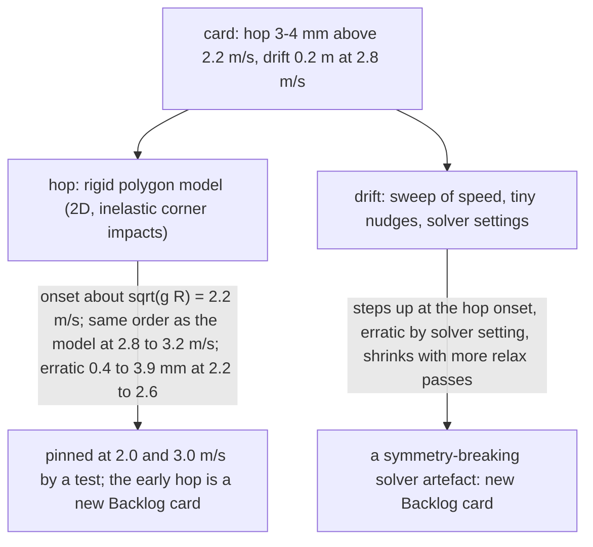

# Review 8-76: the hop of a fast rolling prism is mostly physics, the sideways drift is a solver artefact

Task: 8-76 (found in 8-71, `reviews/8-71.md`). Class 2 (physics). Investigation card: the only code change is one test; no engine code changed. Ordinary card into `develop`. Owner go-ahead: "Go on 8-76".

## What was done

| item | result |
|---|---|
| hop: the threshold | a body rolling over a corner leaves the ground when it is faster than sqrt(g R) (the centre follows a parabola above the arc of radius R): R = 0.5 m gives 2.21 m/s, the speed at which the card sees the hop begin |
| hop: the engine | sweep of 8, 12 and 16 sides, 1.0 to 3.2 m/s in steps of 0.2, 240 steps: rise above the radius 0.07 to 0.54 mm up to 2.0 m/s, then growing: 8 sides 0.53 (2.2), 3.35 (2.4), 0.65, 2.95, 8.4 (3.0), 17.1 (3.2) mm; 12 sides 0.44, 0.65, 1.65, 2.98, 5.66, 3.65 mm; 16 sides 1.51, 2.88, 2.03, 3.85, 3.93, 6.24 mm |
| hop: an independent model | a 2D regular polygon, inelastic corner impacts about the new corner, no sliding, ballistic flight when the normal force would be negative (a throwaway script, not kept, so these numbers cannot be reproduced from the repository). Rise in mm, model / engine: 8 sides 2.4 m/s 0 / 3.35, 2.6 0 / 0.65, 2.8 1.68 / 2.95, 3.0 7.2 / 8.4, 3.2 18.2 / 17.1; 12 sides 2.4 0 / 0.65, 2.6 2.69 / 1.65, 2.8 5.74 / 2.98, 3.0 9.0 / 5.7, 3.2 10.5 / 3.65; 16 sides 2.4 0.68 / 2.88, 2.6 2.42 / 2.03, 2.8 4.31 / 3.85, 3.0 6.3 / 3.9, 3.2 6.4 / 6.2. Below 2.2 m/s the model has no hop and the engine under 0.6 mm |
| hop: solver settings | rise at 2.4 and 3.0 m/s for 8, 12 and 16 sides under the default, 8 and 16 sub-steps, one more relax pass, slop 0, contact stiffness doubled and halved: at 3.0 m/s 8 sides 7.3 to 10.1, 12 sides 4.9 to 7.2, 16 sides 3.9 to 6.7 mm (the same order as the model whatever the setting, so the large hop is not a softness artefact); at 2.4 m/s 0.4 to 3.9 mm by scene and setting, with no setting removing it |
| hop: a difference | the engine hops 0.4 to 3.9 mm at 2.2 to 2.6 m/s where the model gives 0 to 0.7 mm (largest gap: 8 sides at 2.4 m/s, 3.35 against 0); it is 25 to 60% lower than the model for 12 and 16 sides at 3.0 and 3.2 m/s (5.7 against 9.0, 3.9 against 6.3, 3.65 against 10.5). Cause of both not found |
| drift: 1 um nudges | 6 starting offsets along z of 0 to 5 um on 12 sides at 2.8 m/s: 206 to 210 mm and yaw 0.385 each time; on 16 sides 6.7 to 10 mm; on 12 sides at 1.8 m/s 4.0 to 4.5 mm. Offsets of this kind did not change the outcome; offsets of the speed or of other state were not tried, and the changes of speed in the sweep do change it a lot |
| drift: speed | below 2.2 m/s at most 4.7 mm; above it between 1.5 and 206 mm: a step up at the hop onset, then erratic (12 sides: 43, 21, 206, 20, 45 mm at 2.4 to 3.2 m/s; 16 sides: 1.5, 6, 7, 19, 70 mm, rising; 8 sides: 14, 53, 54, 180, 111 mm, roughly rising) |
| drift: solver settings | 12 sides at 2.8 m/s: 4 sub-steps (default) 210 mm, 8 sub-steps 142 mm, 16 sub-steps 4.7 mm; one more relax pass (2 instead of 1): 28 mm and yaw 0.056 (0.385 before). Over the five scenes (8 sides 3.0, 12 sides 2.6, 2.8, 3.0, 16 sides 3.2 m/s) one more relax pass gave a lower yaw in all five (0.045 to 0.095 against 0.089 to 0.452) and a lower drift in three (36.8, 28.1 and 59.9 mm against 180, 210 and 70 mm) but a higher one in the two small scenes (27.9 and 29.7 mm against 21 and 20 mm); the gyroscopic term changes nothing in the two scenes run (146 and 19 mm against 180 and 21) |
| change | one test, `a_prism_rolls_without_a_hop_below_the_speed_a_corner_holds_it_and_hops_above` (`d3_hull_contacts.rs`): at 2.0 m/s every prism stays within 1 mm of its radius (0.54 mm measured at most), at 3.0 m/s it rises above 2 mm (3.9 mm at least) |

## Evidence

- The new test is a characterization of behaviour that exists: it passed on the first run, so there is no red step (TDD exception: characterization of an investigated behaviour, said so). It cannot fail by removal of a fix because there is none; it would fail if a change made the hop vanish or start below 2.0 m/s.
- Sweeps ran from a temporary test file and a temporary script (neither is in the diff): the probe copied the helpers of `d3_hull_contacts.rs` with a z offset and solver settings added.
- `d3_hull_contacts`: 6 tests pass (5 before). Clippy, the whole workspace test run and the local gates are run on the final commit (PR description); no engine file is changed.
- The hop-by-settings sweep of Loop 1 ran from a second temporary test file, removed afterwards.

## Decisions

1. No engine change. The large hop (3.0 m/s and above) is of the size a rigid polygon gives, whatever the solver setting. The early hop (2.2 to 2.6 m/s, up to 3.9 mm) is not explained and is a new card, not a fix made here.
2. The drift is not fixed here. A prism in a scene that is symmetric about z should not yaw and slide 0.2 m: it is a symmetry-breaking artefact of solving the two points one after the other, shown by its size varying 45-fold with the sub-steps and shrinking with more relax passes. The candidate fix (a default of more relax passes) moves every golden hash and costs time on every scene, so it is the owner's decision, on a new card with this evidence. It was bounded over 240 steps only.
3. The test pins the threshold and not the drift or the 2.2 to 2.6 m/s region, because those have no stable number to pin (5 to 210 mm and 0.4 to 3.9 mm by setting). Its bounds (1 mm at 2.0 m/s against 0.54 measured; 1.5 mm at 3.0 m/s against 3.9 measured at least, 3.9 to 10.1 over the settings tried) leave room for another platform's rounding.

## Not verified

- Why the drift exists. The evidence points at the sequential solving of the two points of the edge at a landing (yaw falls in every scene with one more relax pass), but a symmetric scene giving no drift with a symmetric solver was not built, and the drift of the code before 8-71 (0.099 m on the card) was not rerun, so whether the two-point manifold changed it is not measured here.
- Why the engine hops at 2.2 to 2.6 m/s where the model does not; the onset is also a little below sqrt(g R): the exact value for a polygon is sqrt(g R cos(pi/n)), 2.12, 2.17 and 2.19 m/s for 8, 12 and 16 sides (reviewer's calculation, not checked by the model, which hops without a rise at 2.2 m/s).
- One sample per speed and scene; no repeat with another speed offset.
- The rigid-polygon model is crude: its count of flights is inflated by chatter at the threshold (the normal force sits near zero), its inertia is that of a solid regular polygon, and it was run for 4 s at a step of 5 us; it supports the order of magnitude and the onset, not a number to 0.1 mm.
- Other shapes (a cylinder hull with more than 16 sides, a hull cube rolled over an edge, capsules), friction values other than the default and other masses were not swept.
- Linux and ARM64: not run; the new test uses 1 mm and 2 mm bounds against 0.54 and 3.9 mm measured on Windows.
- Mermaid read by the author, not rendered.

## R1 to R8

| phase | result |
|---|---|
| R1 self | the first hypothesis of the card (hop from the geometry R(1-cos(pi/n))) does not give the onset (that is a rise of the centre in the stance, not a hop); the critical speed sqrt(g R) was found by reading the numbers, then checked by the model |
| R2 automated | the new test, the file, fmt; the rest in the PR |
| R3 independent | one read-only review: no blocker, 5 major (all on claims), 6 minor, 3 nits (Loops) |
| R4 QA | speeds 1.0 to 3.2, three prisms, nudges, six solver settings |
| R5 architecture | no engine code |
| R6 security | none |
| R7 performance | none |
| R8 product fit | a prism rolling above about 2.2 m/s hops by physics and by an unexplained extra of up to 4 mm; the drift is an artefact of the solver with a known lever (relax passes) and is left to the owner |

## Loops

| loop | finding | handling |
|---|---|---|
| 1 | major: no model values at 2.4 to 2.8 m/s; the diagram said "same size above 2.6"; the engine is 25 to 60% lower than the model for 12 and 16 sides at 3.0 and 3.2 m/s | the table now gives the model and the engine at every speed from 2.4 to 3.2; the diagram and Decision 1 say "same order" at 2.8 and above and name the early hop and the lower values |
| 1 | major: the hop was not tried under other solver settings | a sweep over default, 8 and 16 sub-steps, one more relax pass, slop 0 and stiffness x2, x0.5: at 3.0 m/s the same order for all, so not a softness artefact; the early hop stays erratic |
| 1 | major: "drift not a trend", "not a defect" | the title and Decision 2 call it a solver artefact; the step at the hop onset and the rising 8 and 16 sided rows are stated |
| 1 | major: "within a few millimetres" and "not a contact fault" for 2.2 to 2.6 m/s | removed; that region is now an open point with its own card |
| 1 | minor: the 2 mm bound at 3.0 m/s on chaotic data | 1.5 mm, with the range over the settings (3.9 to 10.1 mm) stated |
| 1 | minor: "2 to 7 times", "two orders of magnitude", nudges only along z | replaced by the numbers; the nudge row says what was not tried |
| 1 | minor: the onset formula ignores cos(pi/n); the test comment cites a model that is not in the repository; the stale "3 to 4 mm" comment; 9.81 | the exact onset is given under Not verified; the test comment says the model is a throwaway and cites this review; the stale comment reworded; the code uses 9.80665 and the comment says "about" |
| 1 | minor: the Loops table was empty and the suite figures were missing | this table; the figures are added in the PR description after the final run |
| 1 | note: the loop-1 text was not read by a second reviewer | stated |
