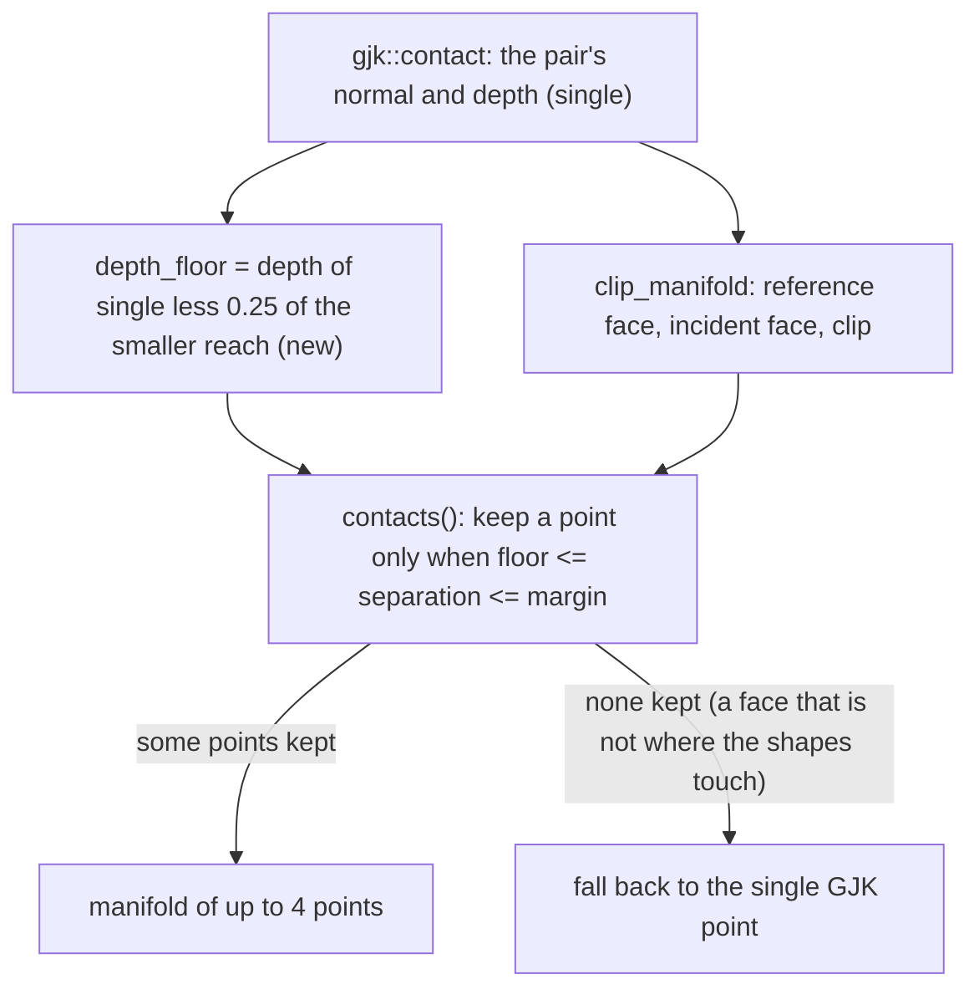

# Review 8-77: a contact point may not be far behind the reference plane

Task: 8-77 (found in 8-71, `reviews/8-71.md`). Class 2 (physics: `face_clip.rs`, contact generation, determinism surface). Ordinary card into `develop`. Owner go-ahead: "8-77".

## What was done

| item | result |
|---|---|
| the question | card 8-71 saw a manifold whose deepest point was -50.5 m while GJK's depth was 0.00003 m (a face 15 degrees off the normal of a stack of hull cubes was taken as the reference); `contacts()` kept any point with a separation at most the margin and had no lower bound. No scene on `develop` produces it (8-71 rejects such a face with a check of depth and gap in `agrees`), but the first try (fitted faces within 1.8 degrees) trusts any reference plane |
| change | `face_clip.rs`: a constant `DEPTH_ALLOWANCE` (0.25), a function `depth_floor` (depth of GJK's point less that share of the reach of the smaller shape), a field `floor` of `Ask`, and a lower bound in `contacts()`: a point is kept when `floor <= separation <= margin`. Both paths (the first try and the second try `widened`) pass it. When every point is dropped the manifold falls back to GJK's single point, as it does when there is no point within the margin |
| measured | a throwaway sweep of a cube hull on a floor box, 1800 poses (four tilt axes, 0 to 0.18 rad in 0.002 steps, sunk 0 to 0.2 m): the deepest point of the manifold was never deeper than GJK's (worst excess 0), so the allowance (0.2165 m for a unit cube) is far above anything a correct face gives; the probe is not kept |
| unchanged | the physics suite with the cross-platform feature: 1107 tests pass; the stored golden hashes verify: 3D 5 scenes, 2D 12 scenes, equal on Windows. No hash moved, so no governance task |

## Evidence

- Red: `a_point_far_behind_the_reference_plane_is_not_a_contact` failed (`left == right`: 2 points kept, 1 expected: the corner 50 m behind the plane was kept) and `the_depth_floor_is_the_depth_of_gjk_less_a_share_of_the_smaller_reach` failed (the stub floor was the lowest `f32`), with the floor added but not applied; green after. The first test calls `contacts()` with a reference plane far from the incident face, the case of the card.
- fmt, clippy `-D warnings` on `physics` (all targets, cross-platform feature): clean; the local gates: see the PR.

## Decisions

1. The bound is relative to GJK's depth and to the reach of the smaller shape, not an absolute number: it follows the size of the pair, as `FACE_WINDOW` and `WIDE_AGREEMENT` do.
2. The share is 0.25, wide on purpose: the goal is to stop metres, not to police centimetres. `WIDE_AGREEMENT` (0.001) was not used: the fitted faces of the first try may be 1.8 degrees off, which moves the far end of a long face by about 3% of its length, and a bound that tight could drop a correct point and move the golden hashes.
3. The fallback is GJK's single point (the answer that existed before the clip), so a dropped manifold is never empty.
4. `contacts()` changed signature (a floor next to the margin); the four calls of its existing unit test pass `f32::MIN` and assert what they did before: no test weakened.

## Not verified

- The -50 m scene itself: no scene on `develop` reproduces it (that is why 8-71 could reject it), so the proof is at `contacts()` level and by the sweep, not by a world that triggers it.
- The sweep covered a cube hull on a floor box, not hull against hull, capsules, prisms on slopes or stacks; the allowance was not tuned on them, and nothing says the floor ever fires in a real scene (the goldens and 1107 tests say it does not change any of them).
- Cost: one comparison per candidate point on the hull path; the instruction-count benchmark was not run (the gate runs on `main`, and the cost is not expected to show).
- Linux and ARM64: the golden hashes were verified on Windows; first hosted run is the release.
- Miri, coverage, mutation score of the new lines (the new tests aim at the bound and the floor).
- Mermaid read by the author, not rendered.

## R1 to R8

| phase | result |
|---|---|
| R1 self | the stub made both tests fail for the right reason; the constant for the allowance was first thought to be `WIDE_AGREEMENT`, the 1.8 degree argument showed it is too tight |
| R2 automated | fmt, clippy, the physics suite, both golden files, the local gates |
| R3 independent | see Loops |
| R4 QA | red and green for the two unit tests; the sweep of 1800 poses |
| R5 architecture | one private function, one constant, one field; no public API |
| R6 security | none (finite arithmetic on shapes the caller built) |
| R7 performance | not measured (see Not verified) |
| R8 product fit | a clip can no longer hand the solver a contact point metres behind the surface |

## Loops

| loop | finding | handling |
|---|---|---|
