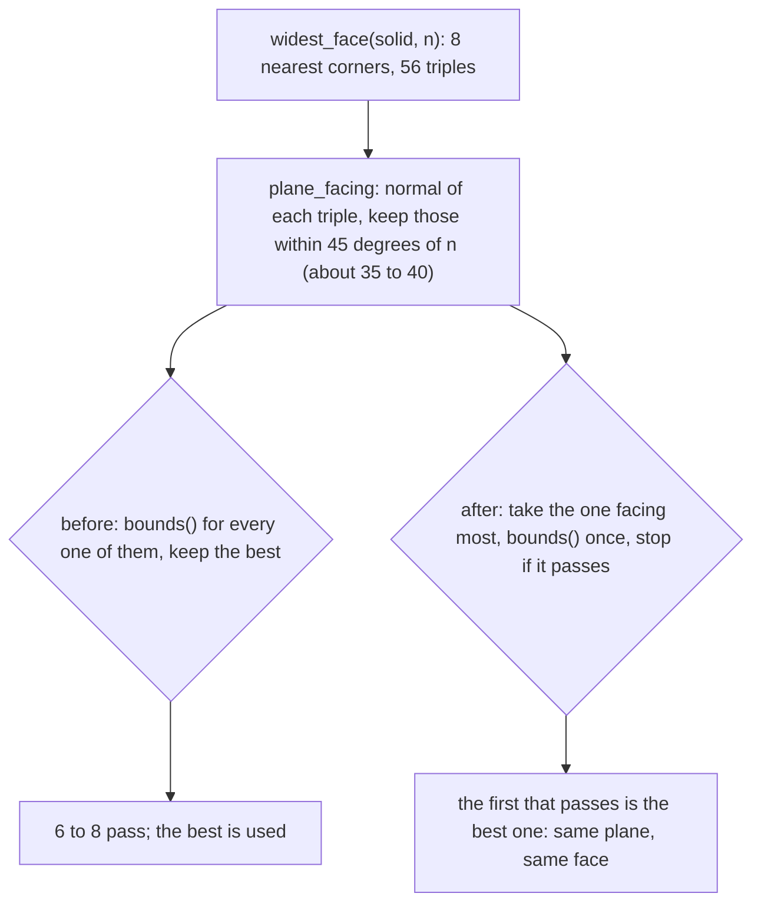

# Review 8-78: the second try for a face stops at the first plane that has every corner on one side of it, 2.3 to 2.8 times faster, same answer bit for bit

Task: 8-78 (found by 8-71). Class 2 (physics `face_clip.rs`, hot path; no `unsafe`, no protected path). Owner go-ahead: "I approve, then 8-78" (2026-11-26), Wave 2 card 2 of 4.

Outcome:

- **Where the cost was:** in a rolling prism scene the second try for a face (`widest_face`, card 8-71) was 8.5%, 15.7% and 11.4% of a step for prisms of 8, 12 and 16 sides (a measured run with timers in the code). The second clip for a one-point manifold (the "wider edge") cost 0.1% to 0.4% of a step: it is not the problem.
- **What was wasteful:** each call tested all 56 triples of the 8 nearest corners, and about 35 to 40 of them (those that face the direction) were scanned against every corner of the hull, but only 6 to 8 of those are planes that have every corner on one side of them, and only the best of them is used.
- **The change:** the planes that face the direction are put in order of how much they face it (the first of equal ones first), and the scan stops at the first plane that has every corner on one side of it. That plane is exactly the one the old search chose, so the answer is the same bit for bit (a test compares 3,960 searches).
- **The gain:** `widest_face` alone 2.0 to 2.8 µs a call before and 0.8 to 1.2 µs after (2.3 to 2.8 times); a rolling-prism scene 3.6%, 8.1% and 5.5% faster for 8, 12 and 16 sides (5.8% over the 28,800 steps, weighted by the time of each prism).

## What was measured

Method: throwaway timers in `face_clip.rs` and a timing test, release build, Windows, one thread, the laptop of the 8-14 report (Balanced power plan, an editor and an agent session open); the probe is not in the repository (a patch is kept outside it). The scene is the rolling prism of `d3_hull_contacts.rs` (a prism on a floor, 8, 12 and 16 sides, speeds 1.0, 1.4, 1.8 and 2.0 m/s, 240 steps), ten rolls of each: 9,600 steps a prism, 28,800 in all.

| item | 8 sides | 12 sides | 16 sides |
|---|---|---|---|
| step before (timers in) | 7.38 µs | 9.14 µs | 11.67 µs |
| GJK (every step) | 1.83 µs | 2.17 µs | 2.67 µs |
| first try for a fitted face, both shapes | 1.37 µs | 1.18 µs | 1.33 µs |
| second try (`widened`) | 0.78 µs, 15% of the steps | 1.81 µs, 31% of the steps | 1.71 µs, 26% of the steps |
| of that `widest_face` (two calls a try) | 0.63 µs, 2.06 µs a call | 1.43 µs, 2.29 µs a call | 1.33 µs, 2.52 µs a call |
| the second clip of a lone point (the "wider edge") | 0.011 µs | 0.020 µs | 0.043 µs |
| triples / scans of every corner / planes that have every corner on one side of them, a call | 56 / 35 / 6 | 56 / 39 / 8 | 56 / 39 / 8 |
| steps (best of 7 runs of 9,600, runs alternated old and new, 4 rounds, minimum) before | 6.76 µs | 8.27 µs | 10.41 µs |
| steps after | 6.52 µs | 7.60 µs | 9.84 µs |
| change | -3.6% | -8.1% | -5.5% |
| `widest_face` alone, 180 directions round a prism, before / after | 2,010 / 795 ns | 2,554 / 899 ns | 2,799 / 1,214 ns |

- **The upper rows of the table are from the run with timers, the rows from "steps" down from runs without them.** The timers add cost, so a share against the timer run's step is a little too low (against the plain 6.76 µs step, `widest_face` of 8 sides would be about 9%).
- **What remains of the second try** is the 56 normals (a square root and a division each, 0.8 to 1.2 µs a call) and `nearest_corners` (0.12 to 0.2 µs). GJK (25% of a step) and the first try for a fitted face (13 to 18%) are larger and untouched.
- **Why only 3.6% to 8.1%:** the second try runs in 15% to 31% of the steps, and `widest_face` was 8.5% to 15.7% of a step; saving 60% of that would be 5% to 10%. The 8-sided scene (3.6%) is below that range; noise between runs of a few percent, and the timers inflating the share, are likely reasons, not shown.

## What changed

| item | result |
|---|---|
| code | `face_clip.rs`: `face_plane` is split into `plane_facing` (the cheap half: the normal of a triple and its cosine with the direction) and `bounds` (the scan of every corner); `face_plane` is those two and gives the same result for the first try (`fitted_face`) for every direction that is a number; for a NaN direction the old test `cosine <= edge` let a plane through to the scan and the new `cosine > edge` refuses it, which is the safer answer and was not tried. `widest_face` collects the planes within 45 degrees in an array of 56, then tries them in order of cosine, the first of equal ones first, and returns at the first that has every corner on one side of it. Nothing is allocated; `Leaning`, `WIDE_TRIPLES`, `most_leaning` are new |
| new test | `the_widest_face_is_the_one_the_search_of_every_triple_finds_bit_for_bit`: the old search is kept in the test module as `widest_face_by_every_triple`, and the two are compared on a unit box, prisms of 8, 12 and 16 sides, a square pyramid (5 corners) and a tetrahedron (4), each under three turns, in 220 directions (every 5 degrees in three planes and the ties: the diagonals of a box); 3,960 comparisons, the corners and normal by their bits, and at least half but not all find a face. It is a characterisation test of a refactor: green before the change and after it, so the red evidence of this card is the timing above, not a failing test |
| hand mutations of the new code | 4 tried against that test: the tie-break `>` to `>=` (killed), the tried plane not marked (killed), the sign of the cosine (killed), the corner of the plane `near[j]` for `near[i]` (survived: the three corners are on the plane, so the face could differ only by rounding for a corner at the edge of the tolerance, which the test does not exercise; not proven equivalent) |
| other tests | the unit tests, `d3_hull`, `d3_hull_contacts`, the pins and the whole `physics` crate pass on Windows and on Linux x86-64 (WSL2); the local gates pass (the last edit of the test, the pyramid and tetrahedron, was followed by the whole `physics` test run and Clippy on Windows, not by a second run of the gates) |
| 3D golden | unchanged: GOLDEN lines recorded on Linux compared with `gates/golden/physics3d-replay.toml`: equal (5 scenes); Windows: equal too (5 scenes) |

## Decisions

1. **Only the order of the work changes, not its arithmetic.** The same normal, the same cosine, the same tolerance, the same scan: so no pin, hash or golden may move, and none did.
2. **Not done: a cheaper test than the square root.** Comparing squared cosines would skip 20 or so square roots a call, but near the 0.7 cosine edge it can differ from the float result of today, which would change a face. It is a card (8-99), not part of a change that promises the same bits.
3. **Not done: the second clip.** It costs 0.1% to 0.4% of a step; the card's guess that the wider edge was part of the 35% is not borne out.

## Not verified

- One laptop, one scene (one prism on a floor); a scene with many hulls was not timed (the card asks whether it shows there). The PR benchmark gate runs only on `main`; the instruction counts of this change were not read. The 8-71 figure of +35% (255 to 340 ms) was not reproduced: the baseline here is the code of today.
- Timers add cost, so the shares of a step in the first rows are of a run that is slower than the plain run.
- The mutation score of `face_clip.rs` was not run (hand mutations only). Branch coverage was not measured.
- A NaN direction, a hull in which no plane has every corner on one side of it (the new code then does the same scans as the old plus the ordering), and a near-planar hull with a corner at the tolerance edge were not tried; the 56-entry array is cleared on every call and the ordering is quadratic in the planes at worst, both small and not timed separately.
- Linux ARM64, the hosted `ci`, Miri. Mermaid read by the author, not rendered.

## R1 to R8

| phase | result |
|---|---|
| R1 self | the first hope was the second clip of a lone point (the "wider edge"): it costs 0.1% to 0.4%; the timers moved the work to the scans |
| R2 automated | rustfmt, Clippy with warnings denied (nesting and by-value limits of the test code reshaped), the physics tests on two platforms, the golden |
| R3 independent | one read-only review, no blocker or major; minors fixed (Loops) |
| R4 QA | bit-for-bit comparison on 3,960 searches, four hand mutations, an alternating old and new timing |
| R5 to R7 | no new `unsafe`, no allocation, no API change; the answer of `widest_face` unchanged; the speed measured |
| R8 product fit | a rolling prism and any hull contact with no face near the normal are 4% to 8% cheaper, with no change of behaviour |

## Loops

| loop | finding | handling |
|---|---|---|
| 1 | minor: a NaN direction behaves differently; 'face_plane unchanged' too strong | said, with the reason |
| 1 | minor: no shape under 8 corners; M3 'equivalent' too strong; timer-run shares; 5.8% weighted; missing Verification section; 8-sided range unexplained | pyramid and tetrahedron added, M3 reworded, caption fixed, text corrected |
