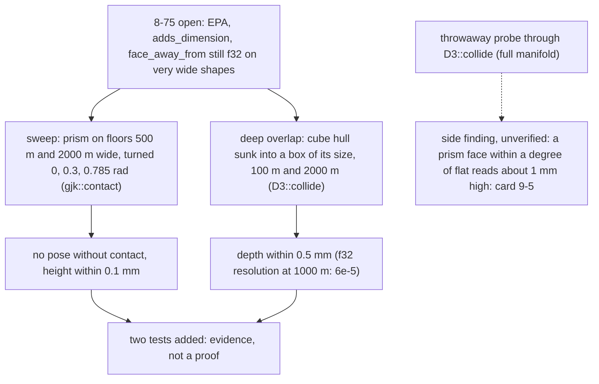

# Review 8-79: GJK on very wide shapes: no failing pose found

Task: 8-79 (found in 8-75, `reviews/8-75.md`, R3). Class 2 (physics: `gjk.rs`). Ordinary card into `develop`. Owner go-ahead: "start 8-79" (2026-11-25). Outcome: **no failing pose found in the scenes tried (6 floors, 18 cube cases); two tests added that pin it. No production code changed.**

## What was done

| item | result |
|---|---|
| the question | whether EPA (`face_away_from`), `adds_dimension` and the progress test of GJK, still `f32`, fail on shapes much wider than the 100 m floor of 8-75 |
| floors | the sweep of 8-75 (8 and 16 sides, 360 turns of half a degree, tilts 0 to 0.01 rad, heights from 0.5 mm above to 0.2 m sunk) over floors 500 m and 2000 m across, each turned 0, 0.3 and 0.785 rad about the vertical axis (6 floors), off-centre: every pose gives a contact whose lowest separation is within 0.1 mm of the height (`gjk::contact`) |
| deep overlap | a cube hull sunk by 0.2, 1 and 10 m into a box of its size (half 50 m and 1000 m, so the depth is at most 0.5% of the shape at 1000 m), both turned together by 0, 0.37 and 1.1 rad (18 cases): the depth is within 0.5 mm of the expected one and the normal is the box's x axis (measured worst depth error 1.4e-4 at half 1000, about one step of `f32` at 2000 m from the origin, 1.2e-4, and the expected value is itself `f32`) |
| change | two tests: `a_prism_touching_a_wider_or_turned_floor_always_gives_a_contact_at_its_height` (`gjk.rs`) and `a_huge_hull_cube_sunk_into_a_box_of_its_size_gets_its_depth` (`d3_narrowphase.rs`). They pass before and after: there is nothing to fix, so there is no red run, and they were not run against the code of before 8-75 to show them failing |
| side finding | (unverified, from a throwaway probe) a probe through `D3::collide` (the full manifold, not `gjk::contact`) reads the lowest separation of a prism face within about a degree of flat 1 mm above the lowest corner (turn 0.13 degree, 2 points at the ends), the same for every floor width: not a width effect and not this card. Card 9-5 |

## Decisions

1. No code change: the probes found no failing pose, and `f64` in EPA would cost time on every hull contact for no measured gain.
2. The tests are kept as evidence: they are meant to fail if a later change loses digits on wide shapes. That was not shown (no red run against the code of before 8-75); the 0.5 mm tolerance of the cube test catches a gross loss only.

## Not verified

- A large hull against a large box with a relative tilt (the cube test has none: both shapes have the same orientation, the easy case for EPA), a depth that is a large part of the shape, and the normal for tilted cases.
- The `1e-4` threshold of the floor sweep is about 1.6 steps of `f32` at 1000 m: marginal on another platform or with another FMA behaviour (not run there).
- Floors wider than 2000 m, slivers other than a box floor (a wide hull against a wide hull, a capsule over a floor), tilted floors in `gjk::contact`, 12-sided prisms and other tilts.
- EPA and `adds_dimension` were exercised only through these scenes; a proof for every shape was not attempted.
- Linux and ARM64 (only `+ - * /` and the existing `f64` routines of 8-75; first hosted run on the release PR that carries this).
- The full local gates (not run, memory, card 8-88); mutation, coverage, Miri.
- The side finding of card 9-5 was seen in a throwaway probe (not in the repository), the cause is not traced.
- Mermaid read by the author, not rendered.

## R1 to R8

| phase | result |
|---|---|
| R1 self | the first probe through `D3::collide` flagged most poses (of the order of ninety per cent in a throwaway run, the exact count is not reproducible): the 1 mm criterion was stricter than the manifold's own design, so the sweep was redone at the `gjk::contact` level that 8-75 used; clippy's nesting limit forced two helper functions |
| R2 automated | fmt, clippy `-D warnings`, the physics suite with the cross-platform feature |
| R3 independent | one read-only review (Loops) |
| R4 QA | two sweeps, 6 and 18 scenes, run twice (probe, then the tests) |
| R5 architecture | none (tests only) |
| R6 security | none |
| R7 performance | none (tests only; the sweep test runs in about 0.15 s) |
| R8 product fit | the open question of 8-75 has no failing pose in 6 floors up to 2000 m across and 18 cube cases up to 2000 m; not a proof |

## Loops

| loop | finding | handling |
|---|---|---|
| 1 | major: 'no defect' and 'answered' overclaim; only 3 of 6 floors tried | all 6 floors (2 widths x 3 turns) in the test, wording reduced |
| 1 | major: 'they fail if...' unproven, tests never red | reworded: meant to; not shown; tolerance limits said |
| 1 | minor: cube scene is the easy case and only the depth is asserted | normal asserted; relative tilt listed in Not verified |
| 1 | minor: resolution figure (6e-5) wrong at 2000 m | corrected to about 1.2e-4 |
| 1 | minor: `1e-4` threshold thin; `unwrap_or(Quat::IDENTITY)` | threshold in Not verified; the fallback mirrors `prism_pose` and cannot fail for a unit axis (kept) |
| 1 | minor: Mermaid edge from the wrong node; R1 count not reproducible; side finding stated as fact | diagram, count and wording fixed |
| 1 | nit: 'slab' wording, named constants | comment reworded; literals kept as in the file |
| 1 | note: the loop-1 text was not read by a second reviewer | stated |

## Correction (card 9-5)

**WITHDRAWN:** the side finding (the "side finding" row of the table, the dotted node of the diagram, the Not-verified line about card 9-5, and the sentence of the PR text) is withdrawn. The side finding of this review (a prism face within a degree of flat reads about 1 mm high through `D3::collide`) was an error of the probe, not of the engine: `Hull::new` keeps the corners in the principal frame of the hull (for a regular prism turned about z by an arbitrary angle, 3.6 degrees for 8 sides), and the probe computed the lowest corner from the points it had given. With the corners of the hull (`Hull::vertices`) the sweep is exact (0 of 10080 poses per prism off by 1 mm, worst 2e-8 m). See `reviews/9-5.md`; the rows, the diagram node and the Not-verified line above that mention it stand as written then.
