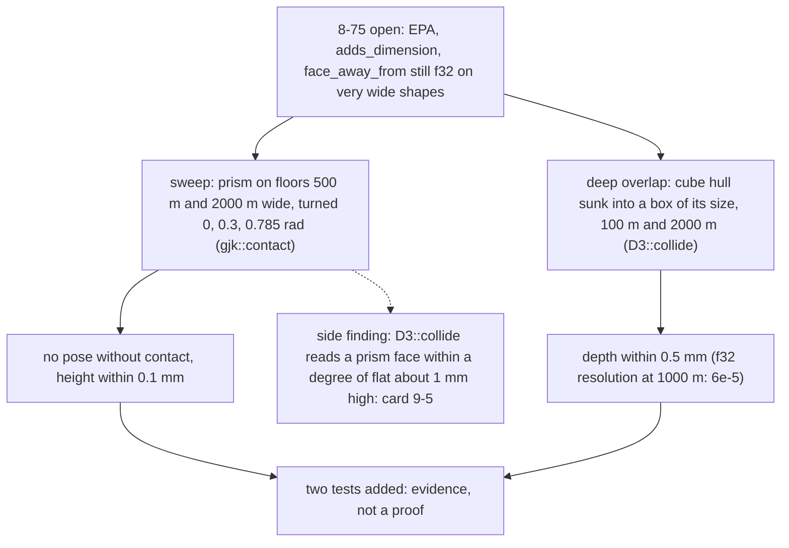

# Review 8-79: GJK on very wide shapes: no failing pose found

Task: 8-79 (found in 8-75, `reviews/8-75.md`, R3). Class 2 (physics: `gjk.rs`). Ordinary card into `develop`. Owner go-ahead: "start 8-79" (2026-11-25). Outcome: **no defect found; two sweep tests added that pin it. No production code changed.**

## What was done

| item | result |
|---|---|
| the question | whether EPA (`face_away_from`), `adds_dimension` and the progress test of GJK, still `f32`, fail on shapes much wider than the 100 m floor of 8-75 |
| floors | the sweep of 8-75 (8 and 16 sides, 360 turns of half a degree, tilts 0 to 0.01 rad, heights from 0.5 mm above to 0.2 m sunk) over floors 500 m and 2000 m across, turned 0, 0.3 and 0.785 rad about the vertical axis, off-centre: every pose gives a contact whose lowest separation is within 0.1 mm of the height (`gjk::contact`) |
| deep overlap | a cube hull sunk by 0.2, 1 and 10 m into a box of its size (half 50 m and 1000 m), both turned by 0, 0.37 and 1.1 rad: the depth is within 0.5 mm of the expected one (measured worst 1.4e-4 at 1000 m, where `f32` has 6e-5 of resolution) |
| change | two tests: `a_prism_touching_a_wider_or_turned_floor_always_gives_a_contact_at_its_height` (`gjk.rs`) and `a_huge_hull_cube_sunk_into_a_box_of_its_size_gets_its_depth` (`d3_narrowphase.rs`). They pass before and after: there is nothing to fix, so there is no red run |
| side finding | a probe through `D3::collide` (the full manifold, not `gjk::contact`) reads the lowest separation of a prism face within about a degree of flat 1 mm above the lowest corner (turn 0.13 degree, 2 points at the ends), the same for every floor width: not a width effect and not this card. Card 9-5 |

## Decisions

1. No code change: the probes found no failing pose, and `f64` in EPA would cost time on every hull contact for no measured gain.
2. The tests are kept as evidence: they fail if a later change loses digits on wide shapes.

## Not verified

- Floors wider than 2000 m, slivers other than a box floor (a wide hull against a wide hull, a capsule over a floor), tilted floors in `gjk::contact`, 12-sided prisms and other tilts.
- EPA and `adds_dimension` were exercised only through these scenes; a proof for every shape was not attempted.
- Linux and ARM64 (only `+ - * /` and the existing `f64` routines of 8-75; first hosted run on the release PR that carries this).
- The full local gates (not run, memory, card 8-88); mutation, coverage, Miri.
- The side finding of card 9-5 was seen in a throwaway probe (not in the repository), the cause is not traced.
- Mermaid read by the author, not rendered.

## R1 to R8

| phase | result |
|---|---|
| R1 self | the first probe through `D3::collide` flagged 9184 of 10080 poses: the criterion (1 mm) was stricter than the manifold's own design, so the sweep was redone at the `gjk::contact` level that 8-75 used; clippy's nesting limit forced two helper functions |
| R2 automated | fmt, clippy `-D warnings`, the physics suite with the cross-platform feature |
| R3 independent | one read-only review (Loops) |
| R4 QA | two sweeps, 6 and 18 scenes, run twice (probe, then the tests) |
| R5 architecture | none (tests only) |
| R6 security | none |
| R7 performance | none (tests only; the sweep test runs in about 0.15 s) |
| R8 product fit | the open question of 8-75 is answered for floors up to 2000 m and a deep overlap up to 2000 m |

## Loops

| loop | finding | handling |
|---|---|---|
| 1 | (filled after the review) | |
