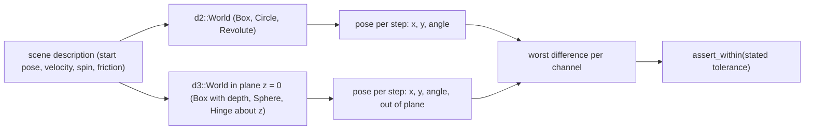

# Review 8-8: dimension-consistency tests

Task: 8-8. Class 1 (tests only: one new integration test file, no engine code, no governance file). Ordinary card into `develop`. Loops: 1 independent review, 0 fix loops needed for code (4 minor comment findings fixed). Open blocker/major: 0.

Delivers: `engine/physics/tests/dimension_consistency.rs`. Four short, non-chaotic scenes run in a `d2` world and in a `d3` world whose motion starts in the plane z = 0; the pose (x, y, angle about z) is compared after every step, and so is the drift of the 3D body out of its plane. Scenes: a spinning box dropped on the floor, a box sliding to a stop with friction, a glancing elastic collision of a circle and a sphere, a box swinging on a hinge.

## Decisions

1. **Mass and inertia about z are matched** (2D density 1, 3D density `1 / (2 hz)`), but only the ratio inertia to mass shows in these scenes; the file says so.
2. **No rolling ball:** circle `m r^2 / 2` against sphere `2 m r^2 / 5` roll differently by design; a sliding box takes its place.
3. **Tolerances are measured, with a margin of two to three** (about 40 where the difference is zero), not widened to get green.
4. **The out-of-plane drift is measured and bounded,** not hidden: it is a fourth compared channel.

## Evidence

- Measured worst differences (x, y, angle, out of plane): spinning drop 0.025, 0.011, 0.027, 0.044; sliding box 0.029, 0.0003, 0.0008, 0.0069; collision 0, 0, 2.6e-7, 0; hinge 1.0e-4, 0.8e-4, 1.1e-4, 0. Tolerances at the scenes.
- Sensitivity (red evidence for a tests-only card): halving the 3D friction fails both box scenes (x off by 0.38 m and 0.085 m); a 3D bob of half width 0.5 fails the hinge scene (0.48 m); 3D restitution 0.5 fails the collision (0.82 m). The reviewer also flipped the 3D spin sign, the start angle and offset the hinge anchor: all fail. A first version of the hinge and collision tests had no assertions (an edit missed the reformatted code); found by this check and fixed.
- `cargo test -p physics --test dimension_consistency`: 4 passed. `cargo clippy -p physics --all-targets -- -D warnings`, `cargo fmt`: clean.
- Out-of-plane drift of the 3D box, probed by the reviewer: 3D-only, a perfectly symmetric flat drop still gets z 0.005, tilt 0.003, out-of-plane spin 0.15 rad/s; the spinning drop z 0.0099, tilt 0.034. Consistent with the serial solve of the four manifold points (card 8-6 notes the same order effect); small, bounded, not growing. Not a bug found; no card opened.

## Not verified

No Linux or ARM64 run; no mutation run (no engine code changed); no independent check of the tolerances on another machine (single-threaded, no clocks, deterministic on this one); the Mermaid view was read by the author, not rendered; stacking and other chaotic scenes are out of scope by design.

## R1 to R8

| phase | result |
|---|---|
| R1 self | found vacuous hinge and collision tests, fixed |
| R2 automated | tests, clippy, fmt, local gates, wiki lint |
| R3 independent | one read-only review, findings below |
| R4 QA | sensitivity perturbations per scene |
| R5 architecture | public API only; no engine change |
| R6 security | no `unsafe`, no dependency, no secrets |
| R7 performance | not applicable (tests only) |
| R8 product fit | the owner reads the drift numbers above |

## Loops

| loop | finding | handling |
|---|---|---|
| 1 | minor: mass match not tested, comment overclaimed | header says only inertia/mass shows |
| 1 | minor: some tolerances not "about twice" the measurement | header and comment say two to three, and 40 where zero |
| 1 | minor: stop distance checked in 2D only | accepted (3D bounded by the difference) |
| 1 | minor: pose channel 3 mixes metres and radians | comment names it "z plus tilt" |
| 1 | nits: index loops, near-duplicate trace helpers | left |
