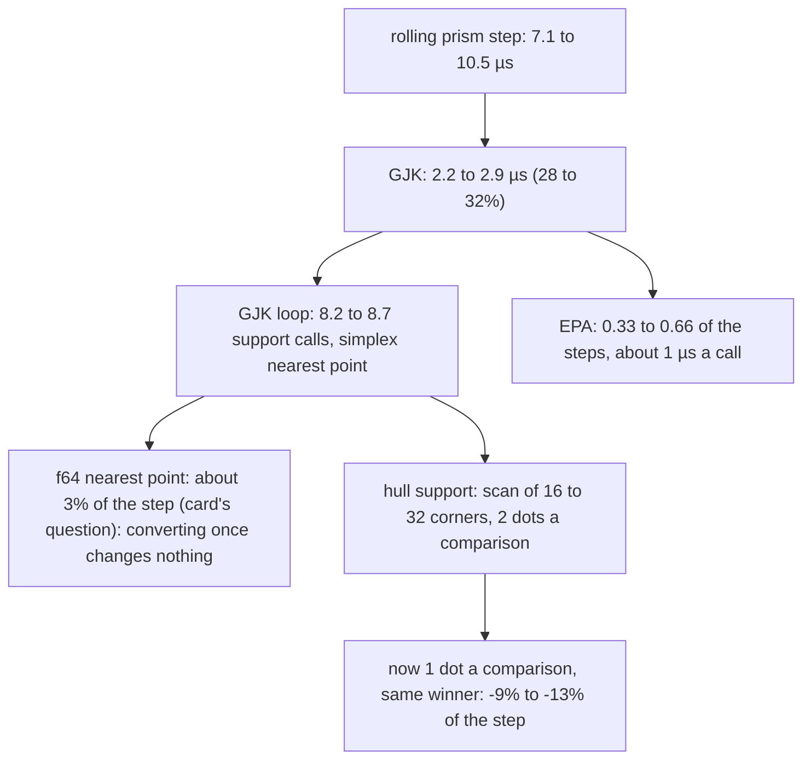

# Review 8-80: the f64 conversions are not the cost of GJK; the support scan was, and a rolling prism is 9% to 13% cheaper without it

Task: 8-80 (found by 8-75). Class 2 (physics `gjk.rs`, hot path; no `unsafe`, no protected path). Owner go-ahead: "I approve then 8-80" (2026-11-27), Wave 2 card 3 of 4.

Outcome:

- **The card's question:** the f64 arithmetic of the nearest point of the simplex is about 3% of a step of a rolling prism (one prism on a floor), and converting the points once instead of for every face of the tetrahedron changed nothing that could be measured (6.40, 7.53 and 9.85 µs a step against 6.47, 7.54 and 9.86 µs, inside the noise). **That change is not made.**
- **What the profile showed instead:** GJK is 28% to 32% of a step, and the largest part of it is the support search of a hull (8.2 to 8.7 calls a step, each a scan over 16 to 32 corners) which computed the dot product of two corners at every comparison, twice as many as needed.
- **The change:** `farthest` in `gjk.rs` computes each corner's dot product once and keeps the same winner as before in every case, including ties and the zeros of both signs (the last of equal corners, in the total order of `f32`). The answer is bit for bit the same.
- **The gain:** a rolling-prism scene is 8.6%, 13.4% and 11.2% faster for prisms of 8, 12 and 16 sides (old and new alternated, minimum of 5 rounds of 7 runs).

## What was measured

Method: throwaway timers in `gjk.rs` and a timing test (kept outside the repository as a patch), release build, Windows, one thread, the laptop of the 8-14 report (Balanced power plan, an editor and an agent session open). The scene is the rolling prism of `d3_hull_contacts.rs` (8, 12 and 16 sides, speeds 1.0, 1.4, 1.8 and 2.0 m/s, 240 steps), ten rolls of each: 9,600 steps a prism.

| item | 8 sides | 12 sides | 16 sides |
|---|---|---|---|
| step with timers | 7.10 µs | 8.37 µs | 10.46 µs |
| GJK in all (`gjk::contact`) | 2.24 µs (32%) | 2.57 µs (31%) | 2.92 µs (28%) |
| GJK loop (supports and nearest point) | 1.48 µs | 2.14 µs | 2.49 µs |
| EPA (`penetrate`), calls a step and µs a call | 0.66 and 1.02 | 0.34 and 1.05 | 0.33 and 1.13 |
| nearest point of the simplex, all sizes, with timer cost | 0.36 µs | 0.44 µs | 0.44 µs |
| of that the tetrahedron, calls a step and ns a call (with about 25 ns of timer) | 3.2 and 72 | 4.1 and 77 | 4.3 and 75 |
| `support_pair` calls a step (a hull and a floor each) | 8.2 | 8.6 | 8.7 |
| steps without timers, before (minimum of 5 interleaved rounds) | 6.48 µs | 7.71 µs | 9.83 µs |
| steps after | 5.92 µs | 6.67 µs | 8.73 µs |
| change | -8.6% | -13.5% | -11.2% |
| the f64 change alone (convert once), before and after | 6.47 and 6.40 µs | 7.54 and 7.53 µs | 9.86 and 9.85 µs |

- **The timers cost about 25 ns a call**, so the nearest-point rows are too high: with 6 to 7 calls a step, about 0.15 to 0.2 µs of the 0.36 to 0.44 µs is the timer. The tetrahedron's real cost is about 45 ns a call, 0.14 to 0.19 µs a step (2% of the step), of which the repeated conversion of the corners (36 conversions of a float to a double, a few ns) is a small part: hence no measurable gain from removing it.
- **The first run of 4 rounds** with the f64 change and the single dot together gave -8.8%, -12.9% and -12.5%; the second run (this table) -8.6%, -13.5%, -11.2%. The machine was noisier in the second (the first round of the new binary was no faster than the old); the minimum over rounds is what is reported.
- **The dot product** `x.dot(direction).total_cmp(&y.dot(direction))` inside `max_by` computes both dot products at each comparison; the running best is recomputed. A 32-corner prism had 64 dot products a support call and now has 32.

## What changed

| item | result |
|---|---|
| code | `gjk.rs`: `farthest` keeps the running best and its height, computes `corner.dot(direction)` once, and replaces the best when `best.total_cmp(&height).is_le()` (the same rule as `Iterator::max_by`: the later of equal ones wins, the total order puts -0.0 below 0.0). Nothing else changed |
| new test | `the_farthest_corner_is_the_one_the_comparing_search_finds_bit_for_bit`: the old function is kept in the test module as `farthest_by_comparison`; 240 comparisons on 1, 2, 3, 8, 16 and 32 corners, in rounds with random corners, a corner twice, two different corners at one height, heights of 0.0 and -0.0 (zero first, negative zero last), and an empty list; by the bits of the answer. A characterisation test of a refactor: green before the change and after, so the red evidence is the timing |
| hand mutations | the tie rule `is_le` to `is_lt` and the total order to `<=` on the height: **both survived the first version of the test** (a corner twice shows nothing, and no height was a signed zero) and are **killed by the final test** |
| tests | the `physics` tests pass on Windows and on Linux x86-64 (WSL2); the local gates pass |
| 3D golden | unchanged: equal on Linux; Windows and Linux (WSL2): equal |

## Decisions

1. **The card's proposed change is not made:** passing the converted points through the tetrahedron saves a handful of conversions and no step time that could be measured. A change with no gain is churn in a hot, determinism-sensitive file.
2. **The change made is the one the profile asked for,** in the same function family (the support of the same GJK, on the same path) and with the same promise (no bit moves). It goes beyond the card's wording; the owner can ask for it to be taken out.
3. **Not done:** a support that starts from the last vertex (hill climbing) or a warm start of GJK. The first needs proof that it picks the same corner including ties; the second changes results. Both are card 8-100.

## Not verified

- One laptop, one scene (one prism on a floor, rolling); a scene with many hulls or a box on a box was not timed. The PR benchmark gate runs only on `main`; the instruction counts of this change were not read.
- The timers add cost, so the shares in the table are of a slower run than the plain steps.
- The mutation score of `gjk.rs` was not run; branch coverage was not measured. Linux ARM64, the hosted `ci`, Miri. Mermaid read by the author, not rendered.
- The cost of converting a point to double was not measured by itself; it is inferred from the null result of the one change.

## R1 to R8

| phase | result |
|---|---|
| R1 self | the timers showed the nearest point is small and the support is large; the card was answered with a null and a different change |
| R2 automated | rustfmt, Clippy with warnings denied (nesting and cast limits of the test code reshaped), the physics tests on two platforms, the golden |
| R3 independent | pending |
| R4 QA | 240 comparisons by bits, two hand mutations killed after the test was strengthened, an alternating old and new timing |
| R5 to R7 | no `unsafe`, no allocation, no API change; the answer of `farthest` unchanged; speed measured |
| R8 product fit | any hull contact is cheaper by a tenth of a step with the same results |

## Loops

| loop | finding | handling |
|---|---|---|
| | pending | |
