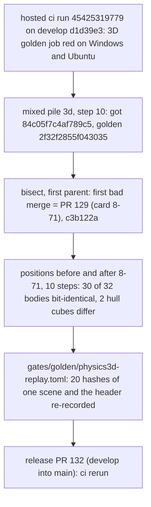

# Review 8-81: re-record the 3D golden hashes of "mixed pile 3d"

Task: 8-81. Class 3 (governance: `gates/golden/physics3d-replay.toml` is a protected path). Governance card: PR into `main` first, then `develop` merges `main` in. Owner go-ahead: "1" (the option "governance PR to `main` first, then the release") and "Go on", after the owner chose to find the cause first.

## What was done

| item | result |
|---|---|
| the failure | the 3D golden job of the hosted `ci` run on `develop` (release PR #132) is red on Windows and Ubuntu with the same output: scene `mixed pile 3d`, first difference at step 10, got `84c05f7c4af789c5`, golden `2f32f2855f043035` |
| the cause | first-parent bisect over the 36 merges since the phase 8 release (run locally, 5 builds): the last good merge is `eebfc7e`, the first bad one is PR #129 (card 8-71, `c3b122a`). Reproduced locally at `c3b122a` and at the `develop` head `d1d39e3`; the other four scenes are unchanged |
| the nature of the change | positions of all 32 pile bodies over the first 10 steps, bit by bit, before and after 8-71: 30 are identical (spheres, boxes, capsules); two hull cubes (pile indices 15 and 31, the same grid corner next to the wall boxes) differ by 1 to 2 mm at step 2 and by 4 to 7 mm (x) and about 3.5 cm (y) at step 10. The 8-71 change rewrote the contact points of a hull against a box, and only hulls differ: consistent with an intended effect, not proof that the new motion is better (card 8-82) |
| the change | `gates/golden/physics3d-replay.toml`, written by `golden_check.py record --i-am-changing-the-golden-file` from the recorder output of `develop` at `d1d39e3`: the header line and the `recorded` line, and the 20 hashes of `mixed pile 3d` from step 10 to step 200. Step 1 of that scene and the four other scenes are byte for byte as before |
| lint and verify | `golden_check.py lint`: 5 scenes, 97 hashes; `verify` against the recorder output of `develop`: equal on Windows |

## Decisions

1. The golden file changes because the behaviour changed in a reviewed card (8-71); no threshold is lowered, no test weakened.
2. The hashes come from one run on Windows. For the later steps nothing says they are equal on Linux: the CI comparison stops at the first difference, so only step 10 is known to be the same on both platforms (both jobs printed the same `got`). The first full comparison on both platforms is the `ci` run on the release PR after this merge.
3. After this merge `main` still has the old 3D code: its 3D golden job is red on a push to `main` until the release PR merges (the release workflow does not depend on `ci`, so it still publishes one patch version for this PR). Said to the owner before the merge.
4. The review file of card 8-71 stays as a dated record. Its words "hashes included" meant the in-repository determinism tests (a run against itself); the stored golden file was not compared, because the local gates do not compare it. This is the correction.

## Not verified

- Linux values of steps 20 to 200 of `mixed pile 3d` (see Decision 2).
- That the new motion of the two hull cubes at the corner is better, only that it differs and where (card 8-82; the wall contact is an inference from their position, the contacts were not printed).
- Miri, coverage, mutation, benchmarks: no code is changed in this PR.
- Mermaid read by the author, not rendered.

## R1 to R8

| phase | result |
|---|---|
| R1 self | the first `record` run mangled the title line (the tool writes "D2 golden hashes of " itself); redone, diff read: 22 lines |
| R2 automated | `golden_check.py lint` and `verify`, the local gates (see the PR) |
| R3 independent | see Loops |
| R4 QA | the failure reproduced locally at two commits, the good commit confirmed |
| R5 architecture | no code |
| R6 security | none; the file is data read by a tool from `main` |
| R7 performance | none |
| R8 product fit | the release PR can pass its 3D golden job; the owner reads a 22-line diff |

## Loops

| loop | finding | handling |
|---|---|---|
| (filled below) | | |
