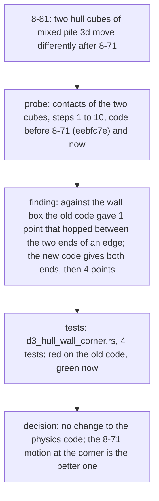

# Review 8-82: a hull cube against a wall box in a corner

Task: 8-82 (found in 8-81). Class 1 (tests only; the question was about physics code, no physics code changes). Ordinary card into `develop`. Owner go-ahead: "8-82".

## What was done

| item | result |
|---|---|
| the question | card 8-82: is the new motion of the two corner hull cubes (pile indices 15 and 31) sensible, and which contacts do they have (the wall contact was only inferred in 8-81) |
| how | a probe copy of the golden scene printed, for steps 1 to 10, every manifold of a body near the corner (the two cubes at x = z = 1.65, y = 1.0 and 2.2, next to two wall boxes with inner faces at x = 2 and z = 2), on `eebfc7e` (before 8-71) and on `develop`. The probe is not kept |
| finding | both cubes start 0.03 to 0.06 m inside the walls (their tilt makes them reach past the faces). Against the x-wall a tilted vertical edge of each cube touches. Before 8-71: one point, and the point is the lower end of the edge at steps 1, 4, 6, 8 and the upper end at steps 2, 3, 5 (it hopped), so the cube was held at one end. Now: both ends at step 1 (y 0.61 and 1.31, 0.7 m apart, the edge), steps 2 to 6 the same, and from step 6 to 10 four points (the face of the cube nearly flush with the wall, two points in contact and two within the speculative margin). Against the z-wall both versions have a single point at a corner at steps 1 to 6, the new code has two points from step 8 |
| the effect | with two points where it had one the cube is held better: at step 10 its height is 0.953 m against 0.915 m (the old code let it drop further), which is the 3.5 cm y difference seen in 8-81; the other 30 bodies are bit-identical |
| tests | `engine/physics/tests/d3_hull_wall_corner.rs`: (1) a vertical edge against a wall keeps both ends (hull cube turned 30 degrees, one `collide`); (2) the hull edge has as many points as the same cube as a box; (3) the cube of pile index 15, with the golden scene's tilt (generator seed 7, stream 21), keeps both ends of its wall edge over its first five steps; (4) the same cube dropped into a floor and two-wall corner comes to rest inside it (speed under 0.1 m/s, depth under 2 cm, on the floor) |
| red evidence | on `eebfc7e` test (3) fails at step 1 (`points [Vec3 { x: 2.0148435, y: 0.6146103, z: 1.9193203 }]`, one point); tests (1), (2), (4) pass on both versions: they pin the behaviour that was already right and that must not be lost |

## Decisions

1. No change to the physics code: the new manifold at the corner is the one geometry asks for (an edge has two ends), and the golden re-record of 8-81 stands.
2. The test uses the golden scene's own tilt (reproduced from the seeded generator) because a plain 30 degree turn did not show the old one-point contact: the old code had two points for that edge.
3. The tests do not pin exact point positions or depths: they pin the count and the spread of the points (at least 2, more than 0.5 m apart) and the rest state, so a later change of the solver does not break them for no reason.

## Not verified

- Only one tilt and one cube size were probed in detail (the two cubes of the golden scene); other tilts of a hull cube at a wall edge were not swept (card 8-75 swept hull poses against a floor, not walls).
- The z-wall contact still has a single point at a corner at steps 1 to 6 in both versions: a corner is one point, but whether a second point would help was not tried.
- Whether the new motion is also what a person would call physically right (the cube starts inside the walls: the push-out is the solver's, not judged here).
- Linux and ARM64: the tests ran on Windows only (and the old code on Windows); the hosted run comes with the next release.
- Miri, coverage, mutation, benchmarks: tests only, no code.
- Mermaid read by the author, not rendered.

## R1 to R8

| phase | result |
|---|---|
| R1 self | the first geometry test passed on the old code too (no red), so test (3) with the golden tilt was added; `collide` needs `find_pairs` first (the first run saw no manifold) |
| R2 automated | fmt, clippy `-D warnings` on `physics` (all targets), the local gates (see the PR) |
| R3 independent | see Loops |
| R4 QA | probe on two versions; tests red on the old code and green now |
| R5 architecture | one new test file, no public API |
| R6 security | none |
| R7 performance | none |
| R8 product fit | the owner learns that 8-71 behaves well at that corner and why the golden moved |

## Loops

| loop | finding | handling |
|---|---|---|
