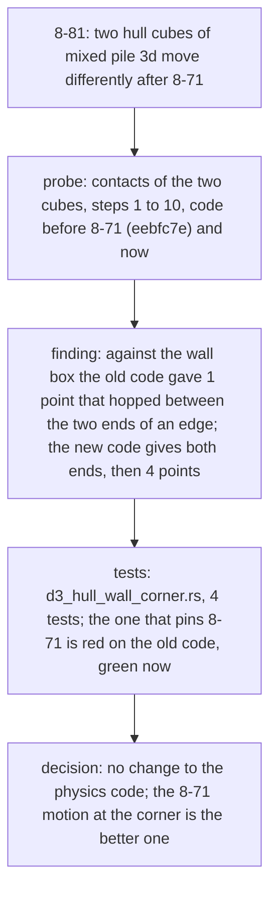

# Review 8-82: a hull cube against a wall box in a corner

Task: 8-82 (found in 8-81). Class 1 (tests only; the question was about physics code, no physics code changes). Ordinary card into `develop`. Owner go-ahead: "8-82".

## What was done

| item | result |
|---|---|
| the question | card 8-82: is the new motion of the two corner hull cubes (pile indices 15 and 31) sensible, and which contacts do they have (the wall contact was only inferred in 8-81) |
| how | a probe copy of the golden scene printed, for steps 1 to 10, every manifold of a body near the corner (the two cubes at x = z = 1.65, y = 1.0 and 2.2, next to two wall boxes with inner faces at x = 2 and z = 2), on `eebfc7e` (before 8-71) and on `develop`. The probe is not kept |
| finding | both cubes start 0.03 to 0.06 m inside the walls (their tilt makes them reach past the faces). Against the x-wall a tilted vertical edge of each cube touches. Before 8-71: one point, and the point is the lower end of the edge at steps 1, 4, 6, 8 and the upper end at steps 2, 3, 5 (it hopped; steps 7, 9, 10 were not read for this), so the cube was held at one end. Now: both ends at steps 1 to 5 (y 0.61 and 1.31, 0.7 m apart, the edge); from step 6 one or both cubes have four points (the face nearly flush with the wall, two points in contact and two within the speculative margin), and at steps 8 and 10 both do. Against the z-wall both versions have a single point at a corner at steps 1 to 6; the new code has two points at steps 8 and 10 |
| the effect | with two points where it had one the cube is held better: at step 10 its height is 0.953 m against 0.915 m (the old code let it drop 0.038 m further), the y difference seen in 8-81; the other 30 bodies are bit-identical |
| tests | `engine/physics/tests/d3_hull_wall_corner.rs`: (1) a vertical edge against a wall keeps both ends (hull cube turned 30 degrees, one `collide`); (2) the hull edge and the same box edge both have exactly two points; (3) the two cubes of the golden scene (indices 15 and 31, one above the other, with their golden tilts from generator seed 7, stream 21), each keep both ends of their wall edge, on the wall plane, over their first five steps; (4) a regression guard: the same two cubes dropped into a floor and two-wall corner come to rest inside it (no centre closer to a wall than the half side, speed under 0.1 m/s, depth under 2 cm) |
| red evidence | on `eebfc7e` test (3) fails at step 1 (`points [Vec3 { x: 2.0148435, y: 0.6146103, z: 1.9193203 }]`, one point); tests (1), (2), (4) pass on both versions: they pin the behaviour that was already right and that must not be lost |

## Evidence

- Red: on `eebfc7e` test (3) fails at step 1: `points [Vec3 { x: 2.0148435, y: 0.6146103, z: 1.9193203 }]` (one point); the other three pass there. Green on `develop`.
- The probe (printing every manifold of a body at the corner, steps 1 to 10) ran on the full golden scene on both versions; the tests use the two cubes and the walls only.
- fmt, clippy `-D warnings` on `physics` (all targets, cross-platform feature); the local gates: see the PR.

## Decisions

1. No change to the physics code: the new manifold at the corner is the one geometry asks for (an edge has two ends), and the golden re-record of 8-81 stands.
2. The test uses the golden scene's own tilt (reproduced from the seeded generator) because a plain 30 degree turn did not show the old one-point contact: the old code had two points for that edge.
3. The tests do not pin exact point positions or depths: they pin the count and the spread of the points (at least 2, more than 0.5 m apart) and the rest state, so a later change of the solver does not break them for no reason.

## Not verified

- The other thirty bodies of the pile are not in the tests: from about step 6 the cubes also meet neighbours (a capsule and a hull sit one grid cell away), so the tests pin steps 1 to 5 at the wall, not the whole landing. The heights at step 10 come from the full scene and no test reproduces them.
- Only one tilt and one cube size were probed in detail (the two cubes of the golden scene); other tilts of a hull cube at a wall edge were not swept (card 8-75 swept hull poses against a floor, not walls).
- The z-wall contact still has a single point at a corner at steps 1 to 6 in both versions: a corner is one point, but whether a second point would help was not tried.
- Whether the new motion is also what a person would call physically right (the cube starts inside the walls: the push-out is the solver's, not judged here).
- Linux and ARM64: the tests ran on Windows only (and the old code on Windows); the hosted run comes with the next release.
- Miri, coverage, mutation, benchmarks: tests only, no code.
- Mermaid read by the author, not rendered.

## R1 to R8

| phase | result |
|---|---|
| R1 self | the first geometry test passed on the old code too (no red), so test (3) with the golden tilt was added; `collide` needs `find_pairs` first (the first run saw no manifold) |
| R2 automated | fmt, clippy `-D warnings` on `physics` (all targets), the local gates (see the PR) |
| R3 independent | one read-only review: no blocker, 2 major, 5 minor, 3 nits (Loops) |
| R4 QA | probe on two versions; tests red on the old code and green now |
| R5 architecture | one new test file, no public API |
| R6 security | none |
| R7 performance | none |
| R8 product fit | the owner learns that 8-71 behaves well at that corner and why the golden moved |

## Loops

| loop | finding | handling |
|---|---|---|
| 1 | major: the missing neighbours and index 31 were not argued; test 3 covered index 15 only | both cubes (15 and 31) are in the scene of tests (3) and (4); the neighbours are named under Not verified and the pinned steps are 1 to 5 |
| 1 | major: test 4 is weak (centre inside the walls is a loose bound), does not pin the change, overstated as one of four that pin it | the position check is now `HALF` from the wall plane, the doc says it is a regression guard that passes on the old code, the review says so |
| 1 | minor: "red on the old code" for all four | only test (3) is red on the old code; Mermaid and table say so |
| 1 | minor: test 3 did not check the wall plane nor that the tilt is real | `|x - FACE| < 0.03` and an assertion that each golden angle is above 0.1 rad |
| 1 | minor: test 2 compared only equal counts | both counts must be 2 |
| 1 | minor: numbers (3.5 cm against 0.038 m, the step ranges) | corrected, steps not read are said |
| 1 | minor: Evidence section and Loops missing | added |
| 1 | nit: duplicated spread fold; tuple with an unused wall; module doc said "the two cubes" | `spread` helper; the doc names the two cubes and what is left out; the tuple stays (the wall is used by test 3) |
| 1 | note: the loop-1 fixes were not seen by a second reviewer; the reviewer did not run the old code | stated; the author ran it |
