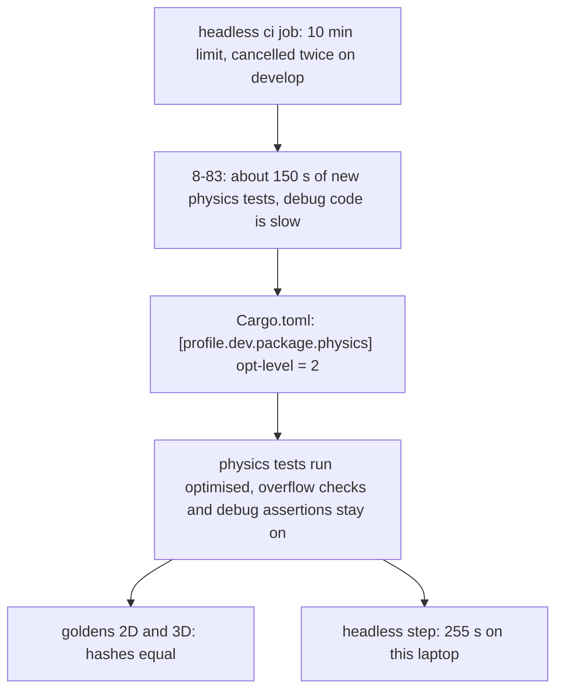

# Review 8-84: the physics crate is optimised in dev builds

Task: 8-84 (from 8-83). Class 1 (build profile in the root `Cargo.toml`, not a protected path). Ordinary card into `develop`. Owner go-ahead: "3. both" (option 2 now; a timeout raise only if still tight, as a governance task he declares).

## What was done

| item | result |
|---|---|
| change | one table in the root `Cargo.toml`: `[profile.dev.package.physics] opt-level = 2`, with a comment. No test, golden file, workflow or gate file touched |
| measured, `stability` + `golden3d` tests | 56.6 s before, 5.5 s after (same 57 tests, all pass) |
| measured, whole headless command (`cargo test --workspace --exclude 'adapter_*' --exclude 'app_*' --locked`) | 2948 passed, 0 failed, 255 s on this laptop after the change; the earlier figures (497 s at the release, 946 s on develop) were taken under load, so only the order of magnitude is claimed |
| goldens | `golden_check.py verify` with the optimised build: 3D 5 scenes equal, 2D 12 scenes equal, Windows x86-64 |

## Decisions

1. Only the `physics` package is optimised: it holds the heavy tests; other crates keep debug builds and their debug-only checks.
2. `opt-level` does not switch off `overflow-checks` or `debug-assertions`; both stay on in `dev` (the profile sets neither).
3. Float results do not depend on the level: Rust has no fast-math and no implicit FMA (digest section 5); the goldens being equal on Windows supports that, it does not prove Linux.

## Not verified

- Linux and the other hosted jobs (Miri, TSan, coverage, mutation, icount): first run is the release PR `ci`. Coverage and mutation tools build with their own flags; whether they are faster or slower is unknown.
- Whether 255 s on this laptop becomes a comfortable margin on the hosted runner (the limit is 600 s there). If it is still tight, the timeout raise is a governance task for the owner.
- The fix is unproven on the hosted runner until the first `ci` run; 255 s on a laptop against a 600 s limit is not a margin claim.
- `physics` only is optimised: non-generic code in `base` and `jobs` stays at level 0, so the speed-up is the measured one, not a general one.
- The `arm64` and `g1` jobs run the same test command and the `tsan` job builds physics with its own flags: all now see optimised physics; not run hosted.
- Debug-info or backtrace quality when a physics test fails (optimised code); not checked.
- Mermaid read by the author, not rendered.

## R1 to R8

| phase | result |
|---|---|
| R1 self | diff is one table; the first timing used `/usr/bin/time`, which this machine lacks, redone with `date` |
| R2 automated | local gates (see the PR) |
| R3 independent | one read-only review: no blocker, no major, 4 minor, 1 nit (Loops) |
| R4 QA | whole headless suite, both goldens |
| R5 architecture | build profile only |
| R6 security | none |
| R7 performance | the purpose; measured above |
| R8 product fit | the release PR can pass its time limits without a gate change |

## Loops

| loop | finding | handling |
|---|---|---|
| 1 | minor: speed-up partial (base, jobs stay level 0) | named under Not verified; the measured figure is the evidence |
| 1 | minor: 255 s is not a hosted margin | stated: unproven until the first hosted run |
| 1 | minor: arm64 and g1 jobs missing from Not verified | added |
| 1 | minor: TSan sees optimised physics | in Not verified (`tsan` listed with its own flags) |
| 1 | nit: empty Loops table | this table; the loop-1 edit was not seen by a second reviewer |
| 1 | note: no code or config reads found a dependence on the dev opt-level (mutation and coverage cover other crates, icount uses release, no `debug_assert` or timing asserts in physics tests) | recorded here |
