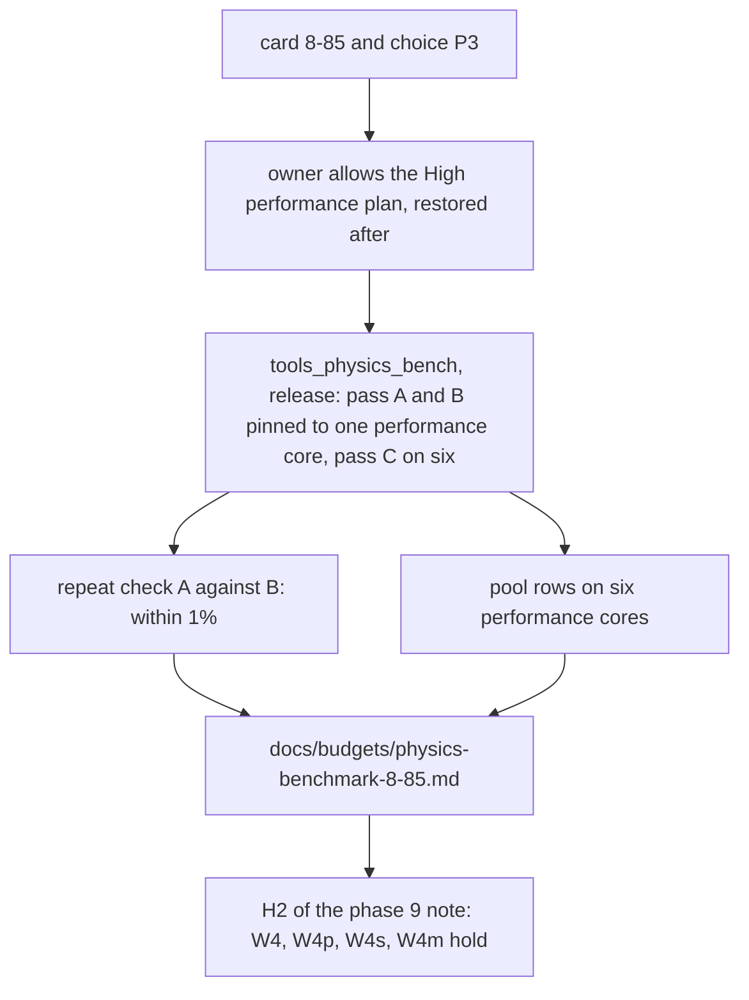

# Review 8-85: the 3D benchmark under the reference-machine protocol

Task: 8-85 (the card "3D benchmark on the reference machine under its protocol, pinned, High performance"). Class 1 (measurement, documentation only). Ordinary card into `develop`. Owner go-ahead: phase 9 choice P3 ("allow it on this laptop") and "Go on with your recommendation"; the switch of the power plan to High performance, and back, was asked and allowed.

## What was done

| item | result |
|---|---|
| runs | pass A (full report, pinned to logical CPU 0, 25 min), pass B (pinned, scaling rows shortened), pass C (full report, pinned to logical CPUs 0, 2, 4, 6, 8, 10); a second pass C and an unpinned pass were planned and not run (see Not verified) |
| result | W4 18.98 ms (budget 21), W4p 12.10 ms (13), W4s 1.288 ms (1.5), W4m 0.517 ms (0.6); every budget figure holds; A and B agree within 1% |
| system settings | the power plan was Balanced, set to High performance for the runs and set back to Balanced by hand after the batch was stopped (the batch's own restore step had not run); the active plan was read again after: Balanced |
| the page | `docs/budgets/physics-benchmark-8-85.md`: conditions, the four figures against 8-14, the pool rows on six performance cores, not verified, what it changes |

## Decisions

1. The single-thread rows are pinned to one performance core and the pool rows to six; the protocol asks for pinning for single-thread workloads and a stated thread count for the rest.
2. No gate or budget number is changed: the figures confirm the accepted budget. A tighter budget is the owner's call.
3. The raw reports are not stored in the repository (they are large); the page carries the figures that matter and the hashes agree with those of 8-14.

## Not verified

- Not an idle machine (Steam, the Task Manager, the graphics software and this session were open), a single pass C (so W4p has no repeat and the thinnest margin, 6.9%), and the mapping of logical CPUs to performance cores is the usual numbering, not read from the machine.
- The planned second pass C and the unpinned pass were stopped by the harness (low memory); they were not restarted without being asked.
- One machine, wall times only, Windows only; no instruction-count figures from this card (the gate has them: +1.86% on the hosted run of the release).
- Mermaid read by the author, not rendered.

## R1 to R8

| phase | result |
|---|---|
| R1 self | the first batch ran the pinned report in full twice: the pool rows on one core took 25 minutes per pass, so the batch was stopped and the pinned repeat shortened |
| R2 automated | the local gates (see the PR): documentation only |
| R3 independent | see Loops |
| R4 QA | the figures in the page checked against the raw outputs; hashes compared across passes and with 8-14 |
| R5 to R7 | no code; the power plan restored and read back |
| R8 product fit | the owner learns that the accepted 3D budget holds on the reference machine, and where its margin is thin (W4p) |

## Loops

| loop | finding | handling |
|---|---|---|
