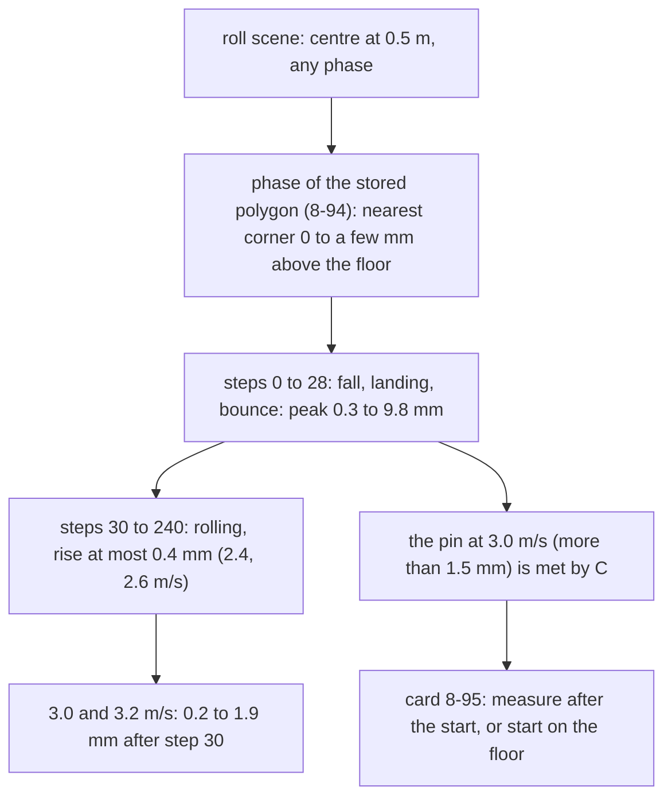

# Review 8-87: the "early hop" of a rolling prism is the start transient of the scene, not a hop of the rolling; the same holds for the 3.0 m/s hop pinned in card 8-76

Task: 8-87 (open point of 8-76). Class 1 (investigation); no code change. Outcome: **in `roll` of `d3_hull_contacts.rs` the highest rise of the centre over 240 steps happens in the first 30 steps (steps 0 to 28 in all 36 runs at 2.4 and 2.6 m/s; steps 4 to 26 at 3.0 and 3.2 m/s), and after step 30 the rise is at most 0.4 mm at 2.4 and 2.6 m/s (one run 1.24 mm) and 0.2 to 1.9 mm at 3.0 and 3.2 m/s. The scene starts the centre at 0.5 m whatever the phase of the stored polygon (`Hull::new`, card 8-94), so a prism whose nearest corner is not straight down starts a few millimetres above the floor, falls, lands and bounces: that is the "hop", and its size depends on the phase (8 sides at 2.4 m/s: 0.36 to 3.35 mm, at 2.6 m/s: 0.31 to 9.77 mm over the phases tried). So the 0.4 to 3.9 mm of 8-76 at 2.2 to 2.6 m/s is mostly a landing, not a defect of the rolling, and the pin at 3.0 m/s of `a_prism_rolls_without_a_hop_below_the_speed_a_corner_holds_it_and_hops_above` (rise over 1.5 mm) is met by the transient at the start of the run, not by a sustained hop, which after step 30 is 0.22, 0.84 and 1.11 mm for 8, 12 and 16 sides (below the 1.5 mm of the pin). No engine change; a test card (8-95) is opened.** Owner go-ahead: "8-87" (2026-11-26).

## What was found

| item | result |
|---|---|
| the scene | `roll`: a prism of radius 0.5 along z, centre at 0.5 m, linear speed v along x, spin -2v about z, 240 steps of 1/60 s, default solver, rise = highest centre height minus 0.5 m. Windows, release profile. Probes added temporarily to `d3_hull_contacts.rs` and reverted |
| the phase | `Hull::new` stores the polygon in the principal frame of its inertia; for a prism along z the x and y moments are equal, so the turn about z is set by rounding (8-94). Corner lists shifted by about 1e-6 m (`Hull::orientation()` read; the shift is the same for all corners and does not change the shape) gave stored turns of -3.6, -6.2, 1.8, -45.0 and 0.0 degrees for 8 sides, -10.3, -26.6, 1.8, 0.0, -5.3 for 12 sides, -45.0, -14.7, 2.7, 60.6 for 16 sides. The 8-sided polygon repeats at 45 degrees (so 0 and -45 are one phase), the 12-sided at 30, the 16-sided at 22.5. The body is placed at identity rotation, so the nearest corner is off the vertical by up to half a face angle (22.5, 15 and 11.25 degrees) and the centre starts up to R (1 - cos) above the position where the prism touches: up to 8.6, 5.7 and 2.4 mm. That height was computed from the angles, not printed |
| the rise by phase, 8 sides | 2.4 m/s: 3.35, 0.52, 2.82, 0.36 (and the repeats 3.30, 0.36); 2.6 m/s: 0.65, 0.71, 0.31, 9.77 (repeats 0.65, 9.77). 12 sides at 2.4: 0.65, 4.93, 0.93, 0.82, 2.17; at 2.6: 1.65, 2.42, 5.11, 3.04, 2.04. 16 sides at 2.4: 2.88, 1.10, 1.55, 0.99; at 2.6: 2.03, 1.55, 2.51, 4.42. Same stored turn gives the same rise to within 0.05 mm (3.35 and 3.30); neighbouring turns (1.8 and 0 degrees) differ by a factor of 8, so it is not a smooth function of the phase |
| when the peak is | 36 runs (3 prisms x 2 speeds x 6 shifts): the peak step is 0 to 28 in every one, and the highest centre after step 30 is 0.09 to 0.46 mm in 35 of them (one 1.24 mm: 16 sides at 2.6 m/s, shift 3). Examples (rise at step / rise after step 30): 8 sides 2.4, 3.35 mm at step 10 / 0.10; 8 sides 2.6, 9.77 at step 10 / 0.21; 12 sides 2.6, 5.11 at step 6 / 0.17 |
| the speeds of the pins, the default phase (what `prism(sides)` returns) | rise at its step / after step 30 / steps above 1 mm after step 30. At 2.0 m/s: 0.46 mm at step 0 / 0.06 / 0 (8 sides), 0.54 at 10 / 0.20 / 0 (12), 0.49 at 5 / 0.25 / 0 (16). At 3.0 m/s: 8.39 at 9 / 0.22 / 0 (8), 5.66 at 26 / 0.84 / 0 (12), 3.93 at 4 / 1.11 / 1 (16). At 3.2 m/s: 17.09 at 9 / 0.82 / 0, 3.65 at 12 / 1.03 / 2, 6.24 at 12 / 1.91 / 1 |
| solver levers (default phase) | speculative margin x0, x0.25, x0.5, x1, x2 at 2.4 and 2.6 m/s (8 sides at 2.4: -0.47, 2.87, 3.35, 3.35, 3.35; at 2.6: 4.99, 4.59, 5.07, 0.65, 0.65; 12 sides at 2.4: 4.45, 2.83, 4.13, 0.65, 0.65; 16 sides at 2.4: 1.79, 3.01, 2.88, 2.88, 2.88): the margin changes some cells by 5 to 8 times and in no consistent direction, and the effect is not separable from the phase (one phase only; the 12- and 16-side cells at 2.6 were not run). Push speed 0, x0.5, x2 and restitution threshold x10 and 0: equal to the default in all cells but two (push 0: 3.00 against 3.35, 2.82 against 2.88). Since the early rise is a landing, these were the wrong levers to ask about |
| change | none |

## Decisions

1. No engine change. What the card named an early hop has no sustained part to cure: the rolling after the first 30 steps rises at most 0.4 mm below 2.6 m/s.
2. The test of 8-76 (`a_prism_rolls_without_a_hop_below_the_speed_a_corner_holds_it_and_hops_above`) measures the start of the run: its 3.0 m/s assertion (more than 1.5 mm) holds through a landing and the sustained rise after step 30 is below the bound, so the test does not show a hop of the rolling. Card 8-95 (tests only, owner's pick) proposes to measure after the start and start on the floor; the numbers of 8-76 (hop 3.9 to 17 mm above 3.0 m/s) and the model comparison need the same reading again. Not changed here.
3. The early-hop comment of the test and of 8-76 ("erratic 0.4 to 3.9 mm") is superseded by this report.

## Not verified

- Whether a sustained hop exists above 3.0 m/s: after step 30 the rise is 0.2 to 1.9 mm at 3.0 and 3.2 m/s with up to 2 steps above 1 mm; the sustained part at higher speeds, other phases and longer runs was not looked at.
- The initial height of each phase was computed from the angles, not printed, and a run starting on the floor was not made; so that the transient is the whole of the early peak is shown by the peak step, not by removing the offset.
- The comparison with the rigid-polygon model of 8-76 (not kept): the model may start on the corner; the 9.77 mm at 2.6 m/s is above the model's 3.0 m/s value but is a start transient.
- Linux and ARM64; other solver levers; phases other than the shifted copies (up to 5 distinct per prism).
- The probes are not in the repository. Mermaid read by the author, not rendered.

## R1 to R8

| phase | result |
|---|---|
| R1 self | the first plan was to find the lever (margin, push speed, threshold) that lifts the prism early; the sweep over shifted copies showed a scatter by phase and the review's question of when the peak occurs showed the start |
| R2 automated | no code change |
| R3 independent | one read-only review, no blocker, four majors; the one about the start height and the step of the peak changed the result (Loops) |
| R4 QA | peak step and the rise after step 30 for 36 runs; 15 runs at the default phase over 5 speeds; frames and repeats read |
| R5 to R7 | none |
| R8 product fit | the open point is answered: no early hop to cure; the pinned hop of 8-76 needs a reading after the start (8-95) |

## Loops

| loop | finding | handling |
|---|---|---|
| 1 | major: the start height is a confound and the step of the peak not given | peak step printed for 36 runs and 15 runs: all peaks are in the first 30 steps; report rewritten around it |
| 1 | major: levers contradicted ('no lever' against the margin row); 'one phase of a model' leans benign; Decision 2 leaves a stale test comment | levers reworded (not separable from phase, wrong question); the model comparison left open; Decision 2 and 3 rewritten, card 8-95 |
| 1 | minor: phase counts, 'factor of ten', 'equal frames equal rises', cell counts, how the angle was read | corrected (distinct phases, 3.35 against 3.30, the lever counts) |
