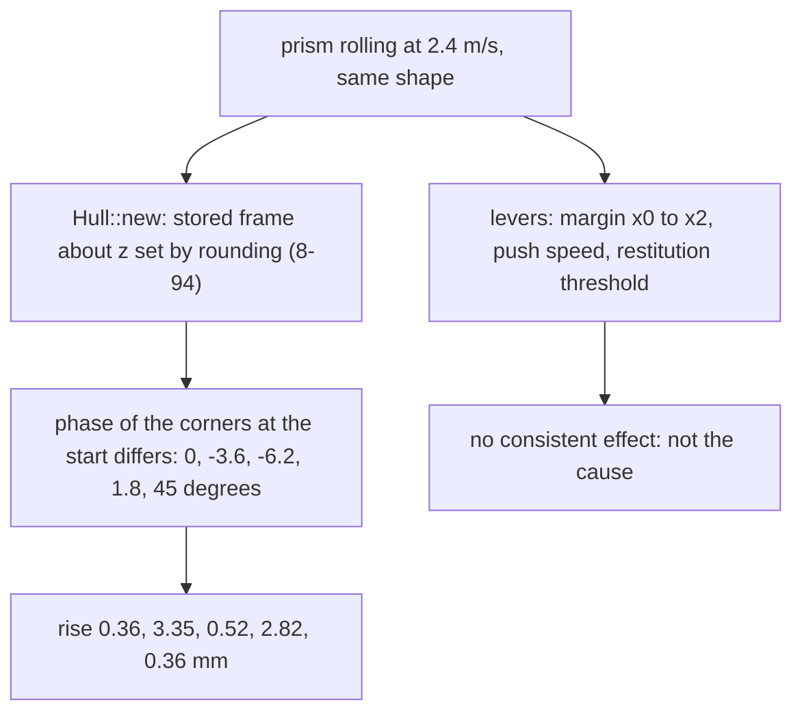

# Review 8-87: the early hop of a rolling prism (2.2 to 2.6 m/s) depends on the phase the hull is stored in, and no solver lever tried moves it

Task: 8-87 (open point of 8-76). Class 1 (investigation); no code change. Outcome: **for the same prism rolling at the same speed, the highest rise of the centre over 240 steps differs by up to a factor of ten with how `Hull::new` happened to store the polygon about z (8 sides at 2.4 m/s: 0.36 to 3.35 mm over five phases; at 2.6 m/s: 0.31 to 9.77 mm). The single values of card 8-76 and of the card text (8 sides at 2.4 m/s 3.35 mm) are one phase out of a scatter, so "the engine hops where a rigid polygon does not" compares one sample of the engine with a model started at one phase. The speculative margin does not move it in a consistent way, and neither does the push speed or the restitution threshold. No defect is shown and nothing is changed; the cause of the phase dependence is the stored frame of card 8-94.** Owner go-ahead: "8-87" (2026-11-26).

## What was found

| item | result |
|---|---|
| the scene | `roll` of `d3_hull_contacts.rs`: a prism of radius 0.5 along z, centre at 0.5 m, linear speed v along x, spin -2v about z, 240 steps of 1/60 s, default solver, the highest centre height minus 0.5 m. Windows, release profile |
| the phase | the prism is built from corners at angles 2 pi i / n and then stored by `Hull::new` in the principal frame of its inertia: for a prism along z the moments about x and y are equal, so the frame about z is set by rounding (card 8-94). `Hull::orientation()` read for corner lists shifted by k times 1e-6 m (k = 0 to 5; the world shape is the same): 8 sides -3.6, -6.2, 1.8, -45.0, -3.6, 0.0 degrees; 12 sides -10.3, -26.6, 1.8, 0.0, -5.3, -10.3; 16 sides -45.0, -45.0, -14.7, 2.7, -45.0, 60.6. The body is placed at identity rotation, so these are the phases of its corners at the start |
| the rise by phase, 8 sides | 2.3 m/s: 0.56, 0.76, 0.39, 0.25, 0.56, 0.25 mm; 2.4: 3.35, 0.52, 2.82, 0.36, 3.30, 0.36; 2.5: 4.70, 0.61, 3.96, 3.33, 4.66, 3.33; 2.6: 0.65, 0.71, 0.31, 9.77, 0.65, 9.77; 2.8: 2.95, 9.80, 3.33, 11.77, 2.95, 11.77. Equal frames give equal rises (-3.6 twice, and -45 and 0 which are the same position of an octagon), so the rise is a function of the phase, with no noise from the shift itself |
| 12 and 16 sides | 12 sides at 2.4: 0.65, 4.93, 0.93, 0.82, 2.17, 0.65; 2.6: 1.65, 2.42, 5.11, 3.04, 2.04, 1.65. 16 sides at 2.4: 2.88, 2.88, 1.10, 1.55, 2.88, 0.99; 2.6: 2.03, 2.03, 1.55, 2.51, 2.03, 4.42. The scatter is the same kind (a factor 3 to 10 at one speed) and the order over the speed is not monotone for any phase |
| speculative margin | factors 0, 0.25, 0.5, 1, 2 of the default 0.02 m at 2.4 and 2.6 m/s, phase of the default build: 8 sides at 2.4: -0.47 (no hop), 2.87, 3.35, 3.35, 3.35; at 2.6: 4.99, 4.59, 5.07, 0.65, 0.65; 12 sides at 2.4: 4.45, 2.83, 4.13, 0.65, 0.65; 16 sides at 2.4: 1.79, 3.01, 2.88, 2.88, 2.88. It changes a value at one corner of the grid and not in one direction: x0 removes the hop for 8 sides at 2.4 and raises it for 8 sides at 2.6 and 12 sides at 2.4 |
| push speed, restitution threshold | 0, x0.5, x2 of the push speed (3 m/s) and x10 and 0 of the restitution threshold (1 m/s): the rise is equal to the default in 11 of 12 cells and 0.35 to 0.06 mm lower in the 8-side and 16-side cells at 2.4 m/s with push 0 (3.00 against 3.35, 2.82 against 2.88). Not the lever |
| earlier tries (8-76) | sub-steps x2 and x4, one more relax pass, slop 0, stiffness x2 and x0.5 removed no early hop (as measured there; not re-run here) |
| change | none. The probes are not in the repository |

## Decisions

1. No engine change: the hop in 2.2 to 2.6 m/s has no systematic part that a lever tried here removes, its size is a function of the start phase, and the model it was compared to was one phase. Whether the engine is wrong at any phase is not shown.
2. The test of 8-76 (`a_prism_rolls_without_a_hop_below_the_speed_a_corner_holds_it_and_hops_above`, pins at 2.0 and 3.0 m/s only) stays; the speeds in 2.2 to 2.6 are left unpinned, as its comment says. Its 2.0 m/s and 3.0 m/s pins use one phase of each prism too (the one `Hull::new` returns); that they hold in the other phases was not checked here and belongs to card 8-94's test of one shape one simulation.
3. The comparison with the model of 8-76 would need the model at the same phases (it was a throwaway and is not in the repository); not done.

## Not verified

- Which phase, if any, matches the rigid-polygon model at 2.4 m/s (the model is not kept).
- Why the rise at one phase is 0.36 and at another 3.35 mm (the contact sequence over the first corner impacts was not traced); the dependence is shown by the numbers and by repeated frames giving repeated rises, not by a mechanism.
- Pushing the shift further (6 phases per prism are 6 of a continuum; the 12- and 16-sided rows repeat a frame in places, so there are 4 and 4 distinct phases).
- Other lever values (a finer step, a different gravity, friction, restitution of the body); Linux and ARM64; the sideways drift of 8-86 in the same runs (not read).
- The local gates: nothing was changed. Mermaid read by the author, not rendered.

## R1 to R8

| phase | result |
|---|---|
| R1 self | the first plan was to find what lifts the prism early (margin, push speed, threshold); the first sweep over shifted copies showed the scatter by phase, so the levers were run at the default phase and the result read against it |
| R2 automated | no code change |
| R3 independent | pending |
| R4 QA | repeated frames give repeated rises; 6 phases x 6 speeds x 3 prisms; 6 lever settings x 2 speeds x 3 prisms |
| R5 to R7 | none |
| R8 product fit | the card's open point is answered as far as the numbers go: the early hop is not one number and the model comparison needs a phase; the cure of the phase is card 8-94 |

## Loops

| loop | finding | handling |
|---|---|---|
| | pending | |
