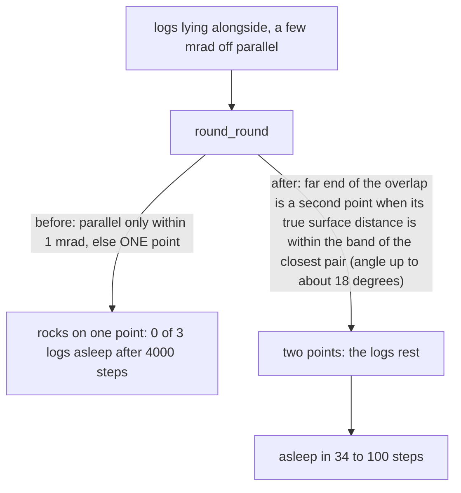

# Review 8-89: two capsules lying alongside each other keep both ends of their contact

Task: 8-89 (open point of 8-21, `reviews/8-21.md`). Class 2 (physics: narrowphase contact generation, determinism surface). Ordinary card into `develop`. Owner go-ahead: "8-89".

## What was done

| item | result |
|---|---|
| reproduced | three logs (capsules, two on a floor side by side, one in the groove), each turned 0.002 to 0.02 rad about the vertical axis from the next: with the old code none of the three is asleep after 4000 steps; exactly parallel, they sleep at step 31 |
| cause | `round_round` gave the second end of the overlap only when `sin^2` of the angle between the axes was at most 1e-6 (about 1 mrad); beyond it, the closest pair only: one point, the same pattern as 8-21 and 8-71 |
| change | `narrowphase.rs`: `far_end` gives the end of the overlap furthest from the closest point as a second contact when the axes are within `NEAR_PARALLEL_SINE_SQUARED` (0.1, about 18 degrees) and its surface distance is within `max(margin, 5 mm)` of the closest pair's separation. The normal stays that of the closest pair; the far point's separation is the true distance of the surfaces (`tube_contact`). The exactly parallel branch is unchanged (`overlap_pairs` was extracted from it) |
| measured after | the three logs asleep in 34 to 100 steps at turns 0.002 to 0.02; the mixed pile of 8-21 asleep at step 683 as with 8-21 alone; the golden hash of `mixed pile 3d` is the same value as with 8-21 alone (first difference at step 50, `64219ce1aaccd7eb`), so the golden update that 8-21 needs covers this card too; the other four 3D scenes and the 12 2D scenes equal |
| tests | `d3_capsule_logs.rs` (new; red on the old code: 0 of 3 asleep at turn 0.002), `leaning_*beside*` tests (2 points for lean 0 to 0.04, the margin edge 0.049 / 0.15), skew capsules (far point 0.0312, in either order), a short capsule across a long one at 34 degrees keeps one point |

## Evidence

- Red: `three_logs_a_few_milliradians_off_parallel_come_to_rest_and_sleep` failed on the old code (0 of 3 asleep), the two lean tests failed (1 point instead of 2), the wide-angle test fails without the angle bound (2 points). Green after.
- `physics` suite and `tools_physics_bench` suites pass (cross-platform feature on); clippy clean for both crates; fmt clean. The full local gates were **not run** (machine low on memory; card 8-88).

## Decisions

1. The far point's separation is the true distance of the surfaces. First version used the separation along the normal of the closest pair: for skew axes that equals the closest pair's everywhere (found by the reviewer), so the band test was empty.
2. The angle bound (0.1) is **empirical**: without it 9 of 90 pile bodies are asleep at step 1200 (also after the true-distance fix), with any bound from 0.0025 to 0.1 all sleep at 683. The reason was not found.
3. **A pinned observation changed**: in `collision_shapes_edge.rs` the row "capsule, 5 links, ratio 3, 2500 m/s" was refused by default and now steps (an extreme-speed row that tumbles chaotically; the file says its rows are observed, not monotone). It is replaced by ratio 10, refused before and after. The old ratio-3 observation is no longer pinned. Reported to the owner in the PR.
4. At a turn of 0.05 rad per log (about 8 degrees apart) the far end is past the margin: one point, and the logs are not asked to sleep there.

## Not verified

- Why a wider crossing with a far end inside the margin keeps the pile awake (the bound is a workaround). A candidate card.
- Argument order: the overlap is taken along the first capsule, so a swapped pair can pick a different end (tested for the skew case only; deterministic, not proven mirror-symmetric).
- Cost (an extra `sqrt` and a division per near-parallel pair), not measured; the instruction-count benchmark has no capsules.
- Linux/ARM64; margins above 0.1 and 0; the position drift of the logs after sleeping; the bound on scenes other than the two measured.
- Capsule against sphere stays one point (not tested separately, `far_end` returns none for a point).
- Mermaid read by the author, not rendered.

## R1 to R8

| phase | result |
|---|---|
| R1 self | the first version failed the support-function oracle by 1.2 mm (normal of the nearer overlap-end pair): the closest pair's normal is used |
| R2 automated | fmt, clippy, suites, both golden files |
| R3 independent | one read-only review: 2 major, 4 minor, 2 nits (Loops) |
| R4 QA | log scene before/after, bound sweep, pile sleep |
| R5 architecture | one private function extracted, two added, one constant; no public API change |
| R6 security | none |
| R7 performance | not measured |
| R8 product fit | stacks of capsules a few mrad off parallel now rest |

## Loops

| loop | finding | handling |
|---|---|---|
| 1 | major: the far separation along the closest pair's normal equals the closest one for skew axes (band test empty) | `tube_contact`: true surface distance; test with skew axes in either order |
| 1 | major: no test for skew, order, spheres | skew test in both orders added; sphere: `far_end` returns none for a point (not tested separately, stated) |
| 1 | minor: argument order | stated in Not verified |
| 1 | minor: stale golden | golden3d run: only `mixed pile 3d` differs, same value as 8-21 |
| 1 | minor: comment overclaims; the bound is a workaround | comment and Decision 2 reworded |
| 1 | minor: changed pinned row | Decision 3, PR |
| 1 | nit: redundant normal check | one check |
| 1 | nit: duplicated cross product | kept (cheap, private) |
| 1 | note: loop-1 changes not read by a second reviewer | stated |

## Correction (card 8-90)

Two statements of this review are corrected by card 8-90 (`reviews/8-90.md`): (1) the far end was the end of the overlap along the first capsule, so the contact depended on which capsule was given first (1 to 16 of 1500 near-parallel pairs had another number of points, separations differed by up to 18 mm); it is now measured along the bisector of the two axes. (2) The bound `NEAR_PARALLEL_SINE_SQUARED` was presented as what makes the mixed pile sleep; that held for one seed only, and over ten seeds no effect of the bound is detectable at 10 seeds (the pile is chaotic). The rest stands as written then.
