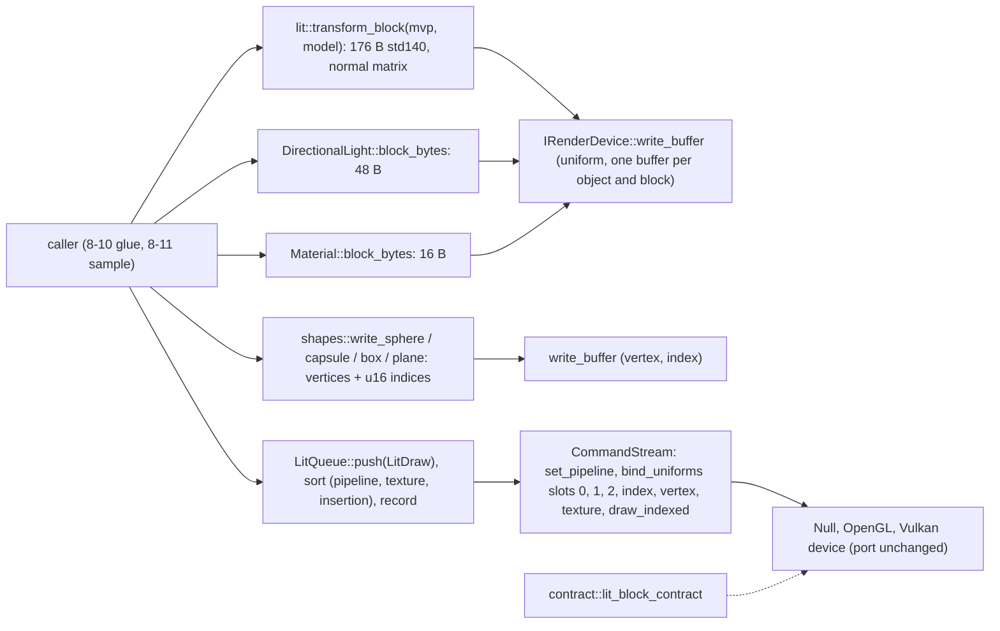

# Review 8-9: `render` lit mesh frontend

Task: 8-9. Class 2 (new public API in `render`; no port revision, no `unsafe`, no new dependency, no governance file). Ordinary card into `develop`. Loops: 1 fix loop (1 independent review). Open blocker/major at the end: 0 known; the fix of loop 1 was not reviewed again (see "Not verified").

Delivers: `render::lit` (transform, light and material uniform blocks in three slots, `LitQueue` ordered by pipeline, texture, insertion), `render::shapes` (sphere, capsule, box, plane with normals into caller slices), a new contract case `lit_block_contract`, a golden command stream of a lit scene on the Null device. README v1.71.

## Decisions

1. **No port revision.** The port already binds eight uniform slots and whole uniform buffers; three slots carry the blocks (0 transform, 1 light, 2 material). The stop rule of the card (a needed port revision is a report to the owner) did not trigger.
2. **One buffer per object and block, one shared light buffer**, because a stream cannot write buffer data between two draws.
3. **Normal matrix is the inverse transpose of the model's upper 3x3 and is not normalised**; the shader normalises. A model that cannot be inverted gives no transform block.
4. **`LitQueue` has a total order** (pipeline, texture, insertion index), so an unstable sort is deterministic and nothing allocates after `new` (as in the sprite batcher). It does not skip repeated binds.
5. **Generators write into caller slices** and return counts; they refuse non-positive or non-finite parameters, more than 65 536 vertices, too-small slices, and leave the slices untouched.
6. **The lit GLSL is not in this card.** The shader assets and their tool check live with the sample (8-11). A shader reading these blocks has not run on a device.

## Evidence

- Tests first. Red: the `lit` and `shapes` tests did not compile before the modules had their types (35 and 38 errors); the two contract tests with a broken device (one uniform slot, refused block sizes) failed with "did not panic" before `lit_block_contract` existed; the insertion tie-break test (loop 1) failed with the tie-break removed and passes with it. The integration tests in `tests/lit_scene.rs` pass at first run because they only combine code already unit-tested; they are a check of the whole path on the Null device, not red evidence.
- `cargo test -p render`: 186 unit tests, 13 + 1 + 2 + 3 + 4 integration tests, 0 failed. `cargo clippy -p render --all-targets -- -D warnings`, `cargo fmt -p render -- --check`: clean.
- Contract suite on real devices on the development machine: `the_gl_device_passes_the_render_contract_suite` and `the_vulkan_device_passes_the_render_contract_suite` pass with the new case (the sizes 176, 48 and 16 and three slots in one pass).
- Mutation: `cargo mutants -p render` on `lit.rs` and `shapes.rs`: 215 mutants, 207 caught, 8 unviable, 0 missed, after tests were added for five first-run survivors (capacity, minimum segments and rings, the angle step, one-sided plane extents). Run before the loop-1 test and doc edits.
- Allocation: encoding the blocks, pushing, sorting and recording a frame make zero allocator calls (counting allocator, `tests/lit_scene.rs`).
- Golden: `golden/lit_scene.txt` pins the stream of three sorted draws.
- Independent review (read-only, copy of the crate): tests, clippy and fmt clean; layout checked against std140; no overflow or panic found in 21 extreme-parameter cases of the generators; no hidden allocation in the queue.

## Not verified

The lit shader and a rendered lit image on a device (card 8-11); the second adapter-side behaviour of a shader reading the blocks. No Linux or ARM64 run. The loop-1 test and doc edits were not seen by a second reviewer, and the mutation run came before them (the new test only adds coverage of one line). Other crates were not re-run (`render` API only grew). The reviewer did not run the GL and Vulkan adapters, the author did (above). The Mermaid view was read by the author, not rendered; the wiki banner still says v1.64 (older than this change, as before).

## R1 to R8

| phase | result |
|---|---|
| R1 self | found and fixed: clippy nesting and casts in `shapes`, too-many-arguments in `write_capsule` (now a `Capsule` struct), long test function |
| R2 automated | tests, clippy, fmt, mutation (207 of 207 viable), contract on three devices |
| R3 independent | one read-only review; findings below |
| R4 QA | std140 offsets, refusals, winding and normals per shape, ordering, golden, allocation |
| R5 architecture | port, `Dim` and other crates unchanged; `render` depends on `base` only (`base::dmath` for trig) |
| R6 security | no `unsafe`, no new dependency, no secrets; generator sizes bounded by the 16-bit index limit, checked arithmetic |
| R7 performance | not measured (meshes are built once at load; per frame only block encoding and a sort of the draws) |
| R8 product fit | the owner reads the known limits: no shader yet, no bind skipping, normal matrix not normalised |

## Loops

| loop | finding | handling |
|---|---|---|
| 1 | major: the insertion tie-break of the queue key is not tested (removing it keeps all tests green; mutation did not flag it) | test with 150 draws of two equal keys; red with the tie-break removed, green with it |
| 1 | minor: light direction doc said "any non-zero length" | documented range (about 1e-19 to 1e19) |
| 1 | minor: normal matrix not normalised, not stated | documented in the code and the wiki |
| 1 | minor: capsule with both sizes `f32::MAX` gives infinite positions; model's bottom row not validated; NaN or negative colours pass through; eager allocation of a huge capacity aborts | not changed: absurd inputs, same pattern as the sprite batcher; noted here |
| 1 | nit: older "Primitive meshes" bullet read as future work | marked done in 8-9 |
| 1 | nit: banner "PROPOSAL v1.64"; plane uv convention (+Z is v=0) not documented | banner not touched (as before this card); uv left as is |
| 1 | minor: contract overrun check could be stricter than the port doc | the same check already exists in `buffer_contract` (write past the end), so no new strictness |
