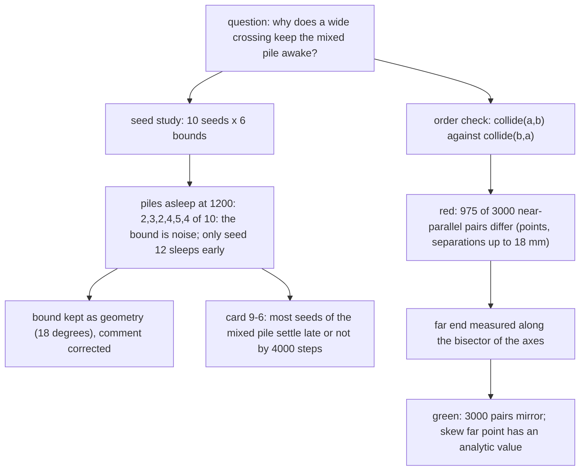

# Review 8-90: the far end of two capsules, order and bound

Task: 8-90 (open point of 8-89). Class 2 (physics narrowphase). Outcome: **one defect of 8-89 found and fixed (the far contact depended on the order of the two capsules); the "empirical bound" turned out to be no tuning at all (the pile result was one seed); one new open point (card 9-6).** Owner go-ahead: "8-90" (2026-11-26).

## What was done

| item | result |
|---|---|
| cause of "9 of 90 asleep without the bound" | none found, because there is none to find: with the seed of the scene (12) the unbounded far end leaves 9 asleep, but over seeds 1 to 10 the number of piles all asleep at step 1200 is 2, 3, 2, 4, 5 and 4 for no far end, bound 0.0025, 0.1, 0.6, 0.97 and none. With no far end at all, seeds 6 and 10 sleep and seed 12 does not matter for it. The pile is chaotic: a change of spacing of the far point from 0 to 0.02 to 0.05 to 0.1 m flips seed 12 asleep, awake, asleep (a probe, not kept) |
| the bound | kept at 0.1 as geometry: beyond about 18 degrees the end of the "overlap" of two segments is an arbitrary point of a crossing (at 80 to 90 degrees both ends of the overlap are within centimetres of the crossing). The comment of the constant now says what was measured instead of claiming a mechanism |
| order symmetry | red test written first: `two_capsules_alongside_in_either_order_give_the_same_contact` (3000 random near-parallel pairs, tilts to 0.05 and 0.3 rad): 975 differed, up to 18 mm in separation and 7 cm in place, 1 to 16 of 1500 with another number of points. With the far end off, 0 differ (so the far end of 8-89 caused it). Fix: the overlap is measured along the bisector of the two axes and the end farther from the centre of the closest pair is taken (`far_end`, `bisector`, `at_height`); now 0 of 3000 differ |
| pinned number changed | `the_far_point_of_two_skew_capsules_has_the_true_distance_of_the_surfaces` pinned 0.0312, the value of the old definition (end of the overlap along `a`). The new definition gives 0.0402; the test now computes it from the geometry (end cap of `a` (0,-1,0) against that of `b` (0.45,-cos 0.3,-sin 0.3), distance minus 0.5), independent of the code. This is a changed expectation, disclosed here |
| cost | release build, 2 million `collide` calls of two capsules, best of 7: alongside 80.4 to 86.1 ns (+7%), crossing 60.6 to 63.0 ns (+4%): about 5 ns more per near-parallel pair (a bisector, 4 dot products, 2 divisions). Measured on this laptop; the benchmark gate of CI (instruction counts) has not seen it |
| golden hash | `gates/golden/physics3d-replay.toml` still matches (5 scenes, Windows x86-64): no governance change |
| remaining asymmetry | with the far end off, 2 of 1500 pairs at tilts 0.3 and 1.5 had normals 1e-3 apart (axes crossing deep in each other, closest points a hair apart); the test allows 1e-3 for the normal and says why |

## Decisions

1. The bound stays; its comment no longer claims a mechanism.
2. The far end is symmetric by construction (bisector), not by ordering the arguments.
3. The mixed-pile test (seed 12, asleep by 1200) is unchanged and still passes; it is one seed (card 9-6).

## Not verified

- Linux and ARM64: the new test and the pile run only on Windows x86-64 here (hosted `ci` by hand is requested for the branch; ARM64 is not gated).
- The cost is a laptop microbenchmark of `collide`, not the instruction-count gate.
- The seed study ran on Windows only, 10 seeds, one step count (1200) plus a few longer runs; it shows the bound is not distinguishable from noise, not that it is useless.
- Hull and box contacts, and capsules at tilts above 0.3 rad (the far end does not apply there).
- Local gates (not run, memory, card 8-88); mutation, coverage, Miri. Mermaid read by the author, not rendered.

## R1 to R8

| phase | result |
|---|---|
| R1 self | the first guess (a mechanism for the pile) was dropped when the seed study showed noise |
| R2 automated | fmt, clippy `-D warnings`, physics suite, scenes3d suite, golden verify |
| R3 independent | one read-only review (Loops) |
| R4 QA | red test first; the analytic oracle for the skew far point |
| R5 architecture | none; the helpers are private |
| R6 security | none |
| R7 performance | +4 to +7% per capsule pair, see above |
| R8 product fit | an unfounded claim in the code is withdrawn; the real instability (card 9-6) is named |

## Loops

| loop | finding | handling |
|---|---|---|
| 1 | (filled after the review) | |
