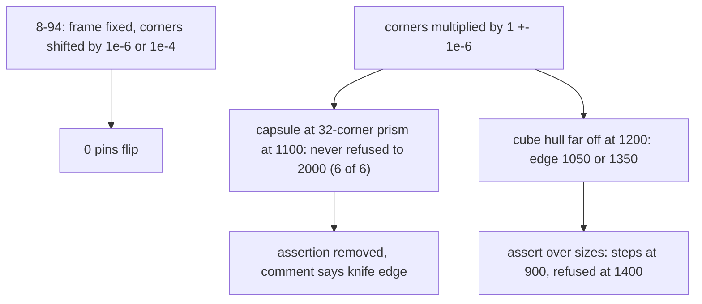

# Review 8-93: two speed-edge pins that flipped with the size of a hull's corners are repaired

Task: 8-93 (from 8-67). Class 1 (tests only: `collision_forms_edge.rs`, `collision_shapes_edge.rs`; no engine code). Owner go-ahead: "8-93" (2026-11-26). Outcome: **after card 8-94 fixed the frame of a prism, a shift of all the corners of every hull by up to 1e-4 m flips no pin of the three speed-edge files. A change of the size of the corners (multiplied by 1 +- 1e-6) flips two. The capsule at the 32-corner prism at 1100 m/s is not refused at all up to 2000 when scaled (6 of 6 draws), where it is refused from 900 as built: that assertion is removed and the cell has no pin (card 8-96). The cube hull far off the line has its edge at 1050 as built and at 1350 in some draws: its pin is rewritten over sizes (steps at 900, refused at 1500) and the claim that the hull is refused earlier than the box is dropped. After the repair the two files that were re-jittered pass all 64 runs (32 per file).**

## What was found and changed

| item | result |
|---|---|
| method | a temporary jitter in the hull builders of the three files (not kept): the same shift of all corners, or all corners multiplied by 1 + e, seeded (the draw is the seed). First sweep: sizes 1e-6 and 1e-4, 6 draws each (seeds 1 to 6) for the three files; the edge of the far-offset hull cell: seeds 1 to 12 at 1e-6, 1e-4 and 1e-3; release profile, Windows |
| shift | 0 failures in the 12 runs (6 at 1e-6, 6 at 1e-4) of each of the three files |
| scale, `collision_forms_edge` | `the_lowest_edges_between_forms...` failed in all 12 runs (6 at 1e-6, 6 at 1e-4), at `refused(Capsule, Prism16, 0, 1100)`: the capsule at the 32-corner prism is refused from 900 as built and is not refused up to 2000 with the corners multiplied by 1 +- 1e-6 (6 of 6 draws, each `s` for the whole scan 600 to 2000). The other three assertions of the test hold in every draw |
| scale, `collision_shapes_edge` | the pin `the hull is refused at 1200` (far offset 0.6, ratio 1000): the edge of the hull is 1050 as built, 1050 in 9 of 12 draws at 1e-6 and 1350 (the edge of the box) in the other 3; at 1e-4 2 of 12, at 1e-3 4 of 12 |
| `collision_angled_edge` | no pin flips under shift or scale (6 draws at each size in the first sweep, and 8 in the sweep after the repair) |
| change 1 | `the_lowest_edges_between_forms...` lost the capsule-at-32-corner-prism assertion (renamed `the_edges_between_forms_that_hold_over_variants_are_950_to_1250_at_ratio_1000`); the comment says why. The three that remain (irregular hull at a turned square prism 1300, sphere at the 24-corner prism 0.4 off 1100, irregular hull at itself 1400) hold in all 32 jittered runs of that file after the repair. The cell has no pin now (Backlog card 8-96) |
| change 2 | `at_a_far_offset_and_ratio_1000_the_hull_steps_at_900_and_is_refused_at_1400_whatever_its_size`: the box steps at 1200 (its edge 1350, unchanged); the hull steps at 900 and is refused at 1500 for eleven sizes (1 + k 1e-6 with k = -3 to 3, 1 +- 1e-4, 1 +- 1e-3). The edge was seen at 1050 and 1350 only, so 1500 is 150 above the highest. Red first: the old assertion over sizes ("refused at 1200") failed at scale 0.999999. The cube corners keep the old nested order (a helper `cube_corners` replaced a nested closure that clippy refused for its depth), so the unscaled build is the same as before |
| the loss | the claim "the hull is refused earlier than the box" no longer holds over sizes (edge 1050 or 1350); the test says so. The hull with the box's own corners is the same solid as the box and the contact points differ in order only |
| gates | see Verification |

## Verification

`local_gates.py --base origin/develop`: every step passes (fmt, Clippy with warnings denied, build, test, architecture, unsafe budget, wiki lint, digest, the tool tests); the physics crate tests pass in the release and the debug profile on Windows; the three files pass on Linux x86-64 (WSL2, release: 10, 11 and 12 tests). Not run locally: Miri, coverage, mutation, benchmarks.

## Decisions

1. An assertion that is false for a 1e-6 change of size is not a bound: it is removed (capsule at the 32-corner prism) or widened to what holds over sizes (cube hull). The scan page and the 8-67 report stay as written.
2. The jitter probe is not kept as a test: scaling the corners of hulls is not a user-visible variation, and a probe in the repository would pin the chaos it was written to find.
3. No other pin was changed; the pins of 8-51 (`collision_shapes_edge`) other than the cube-hull one and of 8-52 (`collision_angled_edge`) held in every draw of the first sweep (the other pins of `collision_shapes_edge` were not re-jittered after the repair).
4. The capsule-at-the-32-corner-prism cell is a Backlog card (8-96), not a pin.

## Not verified

- Variants other than uniform shift and scale (a rotation of the corner list, a different order of the corners).
- Sizes beyond 1e-3; draws are 6 to 12 per setting; the new far-offset test has a 150 m/s margin above the highest edge seen but only two edge values (1050, 1350) were observed; other platforms (Linux x86-64 was not run for these two files after the change); hosted `ci`.
- The pins of other files that use hulls (`d3_hull_contacts`, `d3_solver`, goldens): not jittered here.
- That 900 and 1400 are the right envelope for the cube hull at other sizes: the edge was seen at 1050 and 1350 only.
- Mermaid read by the author, not rendered. Miri, coverage, mutation, benchmarks not run locally.

## R1 to R8

| phase | result |
|---|---|
| R1 self | the card said three pins flip; after 8-94 only two of them did, for a change of size, not of a shift |
| R2 automated | clippy (excessive nesting found and fixed by a helper), rustfmt, the physics tests, the jittered runs |
| R3 independent | one read-only review, no blocker, two majors fixed (Loops) |
| R4 QA | red/green on the cube-hull pin; 64 jittered runs after the repair |
| R5 to R7 | none (tests only) |
| R8 product fit | the speed-edge pins now say what holds over a 1e-6 change of the hull |

## Loops

| loop | finding | handling |
|---|---|---|
| 1 | major: the corner order of the cube changed silently | old nested order restored; the unscaled build is as before |
| 1 | major: the report cited a missing section, inconsistent counts, a long headline | counts rewritten, headline split, a Verification section |
| 1 | minor: 50 m/s margin at 1400; the capsule cell without a pin; stale headers; test names | 1500; card 8-96; headers and names fixed |
