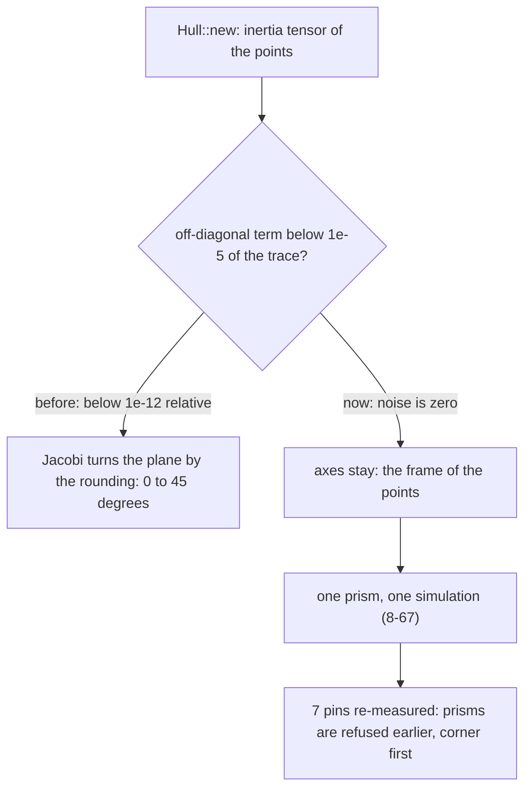

# Review 8-94: `Hull::new` keeps the frame of the points when two moments are equal

Task: 8-94 (from 8-67). Class 2 (physics hull construction; no `unsafe`, no protected path, the 3D golden unchanged). Owner go-ahead: "I approve, next 8-94" (2026-11-26), and "Re-measure and re-pin" for the pins that move (answer to the question of the session). Outcome: **a hull whose inertia tensor has two equal moments (a regular prism) used to be stored in a frame chosen by the rounding of the tensor, 0 to 45 degrees apart for the same shape (8-67); an off-diagonal term at the noise of the tensor is now treated as zero, so such a hull keeps the frame of its points. The new test passes (it failed before: a 4-sided prism came out turned by 45 degrees), and six pinned tests (seven rows below) that observe the speed edge of prisms scanned in the frame the rounding picked moved and were re-measured and re-pinned. The 3D golden hashes are unchanged (no golden scene holds a hull this moves). The thickness check of thin plates keeps its old tight tolerance, so the accept/refuse boundary of plates does not move.**

## What changed

| item | result |
|---|---|
| code | `hull.rs`: `JACOBI_EPSILON` (1e-12 of the pair) replaced by `JACOBI_NOISE` (1e-5 of the trace of the tensor) in `rotate_pair`, as a parameter of `principal`. The inertia tensor of the hull uses `JACOBI_NOISE`; the covariance of the spread of the points that measures the thinnest width (card 8-24, `MIN_THICKNESS`) uses `JACOBI_TIGHT` (1e-12, as before), because the review found that the new share would drop a real tilt of a thin plate and move the refuse/accept boundary. The rounding of the tensor is estimated at 1e-7 of the trace for points near the origin (not measured), the share is about a hundred times that; points far from the origin carry the rounding of their own coordinates and can exceed it |
| new test | `a_regular_prism_keeps_the_frame_of_its_points_whatever_the_rounding` (`d3_hull.rs`): prisms of 4, 6, 8, 12 and 16 sides, shifted by 0 to 7e-6 m, must have a stored turn under 1e-3 in every quaternion axis component. Red before the change ("4 sides, shift 0e-6: turned by (…, z: -0.383, w: 0.924)"), green after |
| the hull tests and the unit tests | all of `d3_hull.rs` and the 469 unit tests pass; the box turned any way still puts its corners back where they were; a new test turns a box with three different moments by 1e-5, 1e-4 and 1e-3 rad: corners put back and mass and moments equal to the box's within 1e-4 |
| golden | `golden_check.py verify` on the recorder output of Windows and of Linux x86-64 (WSL2) against `gates/golden/physics3d-replay.toml`: "equal, 5 scenes" on both; this says only that no golden scene holds a hull that this moves, not that the change is right |
| tests of the physics crate | release and debug, `--no-fail-fast`: only six tests failed (seven rows below; two rows are one test) before the re-pin; after it none fails on Windows (debug and release) and none on Linux x86-64 (WSL2, release, run before the last two edits of this report's loop; re-run on Windows after them) |
| gates | `local_gates.py --base origin/develop`: every step passes; not run locally: Miri, coverage, mutation, benchmarks, metrics |

## The pins that moved (scan: first refused speed, ratio 1000, steps of 50 m/s, friction 0.5 unless said)

| pin | before the change | now | the pin written |
|---|---|---|---|
| `collision_forms_edge`: the lowest edges, irregular hull at a square prism turned 45 degrees | 900, pinned refused at 1100 | 1150 | refused at 1300 (the other three cells unchanged: 900, 950, 1250) |
| `collision_forms_edge`: prism of 32 corners head-on at 2500, friction 0 and 0.5 | refused from 2050 (friction 0), 4100 (0.5) | 1600 and 3400 | refused at 2500 with friction 0, steps with 0.5 (unchanged assertions) |
| `collision_forms_edge`: prism of 24 corners head-on | not refused at any friction | refused from 1250 (friction 0), 2650 (0.5), 2750 (3) | now asserted like the 32-corner prism; the box is still never refused |
| `collision_forms_edge`: spin of 1000 about x or y | prism of 24 corners among the forms that are not refused | refused already at 2500 m/s with no spin at friction 0 (spin 50 refused) and from 200 to 950 with friction | the prism of 24 corners is taken out of that list (the spin says nothing where the hit alone refuses); capsule and box stay, unchanged |
| `collision_angled_edge`: the 12-sided hull off the line | steps at 4900 (0.2 off), refused at 2500 (0.6 off) | refused from 2650 head-on, 2350 (0.2 off), 2050 (0.4 off), 1700 (0.6 off) | steps at 2500 and refused at 3000 head-on; steps at 1500 and refused at 2000 at 0.6 off |
| `collision_angled_edge`: spin and the 12-sided hull | not refused at 500, refused at 700 | friction 0 refused at spin 0; friction 0.5, 1, 3 refused from 500, 600, 650 | friction 0: refused with no spin; friction 0.5, 1, 3: steps at spin 300, refused at 800 |
| `d3_hull_contacts`: the hop after the start | at 3.2 m/s 0.82 to 1.91 mm | at 3.2 m/s 0.27 to 2.01 mm; at 3.4 m/s 1.89 to 4.21 mm; 3.6 m/s the 8-sided prism 0.39 mm (not monotone) | 2.0 m/s under 0.5 mm (0.07 to 0.25 measured, unchanged assertion); 3.4 m/s over 1 mm (1.89 minimum) |

The headline of those pins changed with the frame: a prism with a corner facing the other body is refused earlier than the sampled frames were (24 corners head-on friction 0: from 1250, not "never"). The scan page (section 17 of `wiki/spikes/speed-bounds-scan.md`) gets one sentence for it.

## Decisions

0. The hop test is renamed `a_prism_rolls_flat_at_2_m_s_and_rises_by_more_than_a_millimetre_after_its_start_at_3_4_m_s` and its comment says that the rise is not monotone (8 sides at 3.6 m/s 0.39 mm) and not shown to be a sustained hop: it is a re-pin to the speed where all three prisms exceed 1 mm after the start, not the same claim re-measured. The spin claim for the 24-corner prism is removed, not replaced: that "spin about x or y does not refuse the 24-corner prism" is untested now (it could be kept at a hit speed below 1250 m/s; not done).

1. The tolerance is a share of the trace (1e-5), not of the pair: the pair of two nearly equal moments of a regular prism has an off-diagonal term at the noise, and a share of the pair is what let the rounding turn the axes by up to 45 degrees.
2. The seven pins are re-measured, not loosened: each claim that stopped being true is rewritten in the direction the scan shows (prisms are refused earlier), with the margin of one scan step or more; two assertions were taken out because the hit alone now refuses at that speed (the 24-corner prism in the spin list; the 24-corner prism "not head-on").
3. Cards 8-93 (pins over variants) and 8-66 (angles) are not changed: 8-93 remains a test card and is now less urgent.

## Not verified

- Hosted `ci` (both platforms): only local Windows and WSL2 runs were compared.
- A thin plate at the thickness limit: the tolerance of its check is unchanged by construction (`JACOBI_TIGHT`), no boundary test was run.
- Points far from the origin (rounding of their own coordinates above 1e-5 of the trace): the frame of a regular prism can still vary there; the new test covers points near the origin.
- The other 8-66 angles (2500 at 3.75 degrees and so on) were measured in the rounding-chosen frame and are not verified in the fixed one.
- That 1e-5 is the right size: a hull with a real off-diagonal term below 1e-5 of its trace keeps the frame of its points and the moments are those of its diagonal (an error of the same order, not measured on an asymmetric hull); the effect on hulls with a small real tilt was not scanned.
- Prisms along other axes, other regular polygons than the five tested, polyhedra with three equal moments (the cube: unchanged, its frame was already the identity).
- Miri, coverage, mutation, benchmarks; ARM64.
- Whether pins of 8-51, 8-52 and 8-58 not named above still sit well inside their edges: they pass, the margins were not re-scanned.
- Mermaid read by the author, not rendered.

## R1 to R8

| phase | result |
|---|---|
| R1 self | the first threshold idea (a share of the pair) was dropped for a share of the trace |
| R2 automated | local gates, release and debug physics tests, golden verify on two platforms |
| R3 independent | one read-only review, no blocker, two majors fixed (Loops) |
| R4 QA | red/green on the prism test; full crate before and after; scans of every moved cell |
| R5 architecture | one private function; the public `Hull::orientation()` and `origin()` contract is the same (the values for regular prisms are now the identity turn instead of rounding) |
| R6 security | none |
| R7 performance | none (a comparison in the setup of a hull, not per step) |
| R8 product fit | one shape gives one simulation; the speed-edge pins say what a corner-first prism does |

## Loops

| loop | finding | handling |
|---|---|---|
| 1 | major: the new share also changes the thickness check of thin plates | a separate tight tolerance for it (`JACOBI_TIGHT`), unchanged behaviour |
| 1 | major: the hop pin re-pinned to a speed where the claim holds | test renamed, comment and Decision 0 say what it is |
| 1 | minor: comment of the constant; stale header text; docs of Hull; golden in the headline; six tests not seven; a turned box not tested; the removed spin claim | fixed or named in Not verified |
