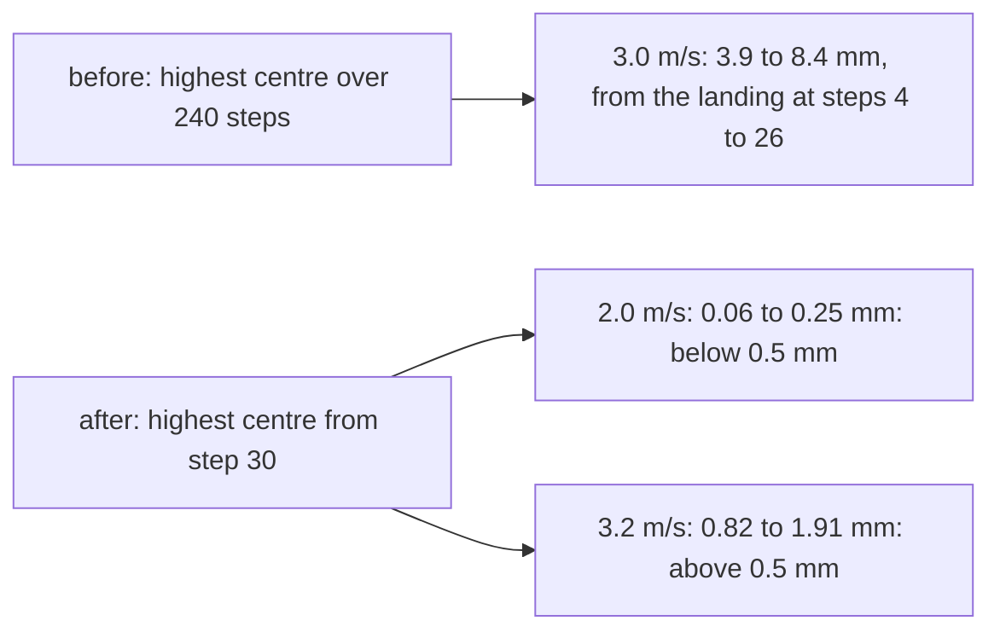

# Review 8-95: the hop test of the rolling prism measures after the start, not the landing

Task: 8-95 (from 8-87). Class 1 (tests only: `engine/physics/tests/d3_hull_contacts.rs`; no engine code). Owner go-ahead: "I approve. then 8-95" (2026-11-26). Outcome: **`a_prism_rolls_without_a_hop_below_the_speed_a_corner_holds_it_and_hops_above` read the highest centre over the whole run, so its 3.0 m/s assertion (more than 1.5 mm) was met by the prism landing in the first 30 steps (card 8-87). It now reads the highest centre from step 30 on (`highest_after_start`): at 2.0 m/s the rise must stay under 0.5 mm (0.06 to 0.25 mm measured) and at 3.2 m/s exceed 0.5 mm (0.82 to 1.91 mm measured). The 2.0 m/s bound is tighter in value (1 mm to 0.5 mm) but now covers steps 30 on only. The hop assertion is weaker in its numbers: 1.5 mm at 3.0 m/s became 0.5 mm at 3.2 m/s. That is a lowered bound, and it is lowered because the measured quantity changed (the old one contained the landing, the new one does not); at 3.0 m/s the sustained rise of the 8-sided prism is 0.22 mm, too close to the 2.0 m/s values (0.25 mm) to pin. The test does not show that the 3.2 m/s rise is a sustained hop.**

## What changed

| item | result |
|---|---|
| code | `Roll` gets `highest_after_start`, `START_STEPS = 30` (with its reason), the loop reads the step; the hop test uses `highest_after_start`; `HOP_SPEED` 3.2, `HOP_FREE_RISE` and `HOP_RISE` 0.5 mm; the doc comment is rewritten (it said "at least 3.9 mm at 3.0 m/s" and cited the throwaway model) |
| red | the test with the new measurement and the old bounds (3.0 m/s, 1.5 mm): FAILED, "8 sides at 3 m/s: 0.5002154 m" (a rise of 0.2 mm, debug profile). So the old pin was met by the start |
| green | the new bounds: the six tests of the file pass (debug); the values were measured in the release profile in 8-87; the debug run only shows pass (and the 0.2 mm of the red) |
| the other test of the file | `a_rolling_prism_keeps_both_points...` is unchanged (it reads the whole run up to 2.0 m/s: rise under 2 mm) |
| gates | `local_gates.py --base origin/develop`: every step passes (fmt, Clippy, build, test, architecture, unsafe budget, wiki lint, digest, tool tests); not run locally: Miri, coverage, mutation, benchmarks, metrics |

## Decisions

1. The assertion is moved to 3.2 m/s and 0.5 mm because the sustained rise at 3.0 m/s is 0.22, 0.84 and 1.11 mm for 8, 12 and 16 sides and an assertion over 0.5 mm there would fail for 8 sides. This lowers the bound (1.5 to 0.5 mm) and raises the speed; the owner reads this as a deliberate change: the old claim ("hops above 3.0 m/s, over 1.5 mm") was not true of the rolling. The window of the 2.0 m/s assertion no longer includes steps 0 to 29 (up to 0.54 mm there in 8-76); the whole-run test (rise under 2 mm up to 2.0 m/s) still covers them. The test name still says "hops above"; the comment says that a sustained hop was not shown (3.0 m/s gives 0.22 mm, under the 0.25 mm of 2.0 m/s for the 8-sided prism, while 3.2 m/s gives 0.82: a jump that may be phase-sensitive or a landing tail).
2. The pins are for the frame `Hull::new` returns (8-94); no variants are tested (card 8-93 and 8-94 are the cure).
3. The model comparison of 8-76 is not redone.

## Not verified

- The release profile after this change (8-87 measured it; the test runs in debug and passed).
- That the landing has decayed by step 30: the latest peak seen was step 28 (36 runs) and 26 (3.0 and 3.2 m/s), a margin of 2 to 4 steps; the step of the last rise above 1 mm after step 30 was not printed.
- Other platforms (the 2.0 m/s margin is 2x, the 3.2 m/s margin 1.6x; 8-67 shows that frames can change with rounding) and other phases.
- That the test fails without a sustained hop (a mutation was not run): the 3.2 m/s assertion fails when the rise is under 0.5 mm, shown by the 3.0 m/s red above for an 8-sided prism at 0.2 mm.
- Miri, coverage, mutation, benchmarks (not run locally). Mermaid read by the author, not rendered.

## R1 to R8

| phase | result |
|---|---|
| R1 self | the bound at 3.0 m/s was not usable (0.22 mm); the speed moved to 3.2 instead of lowering the bound further |
| R2 automated | the local gates, all pass |
| R3 independent | one read-only review, no blocker, two majors fixed (Loops) |
| R4 QA | red with the old bounds on the new measurement, green with the new ones |
| R5 to R7 | none (test only) |
| R8 product fit | the pin now states what the rolling does |

## Loops

| loop | finding | handling |
|---|---|---|
| 1 | major: 'nothing is loosened' untrue (1.5 to 0.5 mm, 3.0 to 3.2 m/s; the 2.0 m/s window shrank); test cannot show a sustained hop | wording corrected; comment says a sustained hop was not shown |
| 1 | minor: START_STEPS margin, stale 0.4 to 3.9 range, 'debug agrees', red only for 8 sides | comment and report fixed, items in Not verified |
