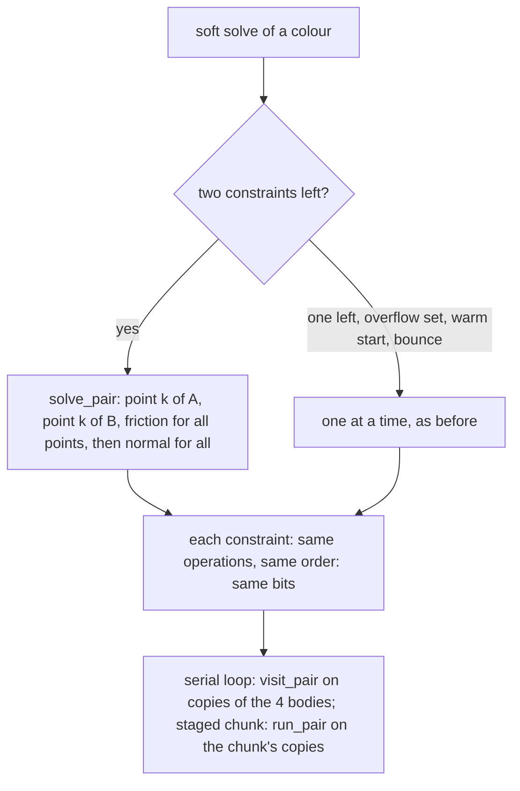

# Review 8-97: the soft solve takes two constraints at a time side by side: a step of the 1,015-box pyramid is 13% shorter, bit for bit the same

Task: 8-97 (spike with a go or no-go, from 8-22). Class 2 (hot-path performance, determinism). Owner go-ahead: "Go on with 8-97 to 8-99" (2026-11-27). **Go**: the engine gain is clear, and it is built as the code of the solver, not left as a spike.

In plain words: the solver handles one contact (a "constraint", up to four points) after the other, and each point depends on the one before it, so the processor mostly waits on one long chain of dependent arithmetic. Two contacts of one colour (a colour is a group of contacts that touch different bodies) do not depend on each other, so now the soft solve takes them two at a time and runs their points in turn, point 0 of one, point 0 of the other, point 1 of one, and so on. Each contact does exactly the same operations in the same order as before, so every result is bit for bit the same; the processor can now work on two chains at once. It is plain scalar code, no SIMD instructions.

Outcome (one laptop, release build, one thread, the binaries of `develop` and of this card run alternately, three rounds; every state hash equal in every row):

| scene and path | `develop` | this card | |
|---|---|---|---|
| 1,015 boxes, serial | 18.3 to 18.4 ms | 15.9 to 16.0 ms | 13% less, 1.15 times |
| 1,015 boxes, staged path on one thread | 19.6 to 20.3 ms | 17.5 to 18.3 ms | 10% less |
| 1,015 boxes, pool of 4 workers | 12.2 to 12.3 ms | 11.65 ms | 5% less |
| 91 boxes, serial | 1.26 to 1.35 ms | 1.07 to 1.14 ms | 12% to 15% less |
| mixed pile of 90 bodies, serial | 0.43 to 0.46 ms | 0.42 to 0.46 ms | none (the solver is 29% of that step) |

## What was done

| item | result |
|---|---|
| `constraint.rs` | `friction_at` and `normal_at`: the body of one point of the friction and the normal solve, moved out of the loops (the loops now call them; the same operations). `Side` (shape, impulses, two body copies of one constraint) and `solve_pair(first, second, sweep)`; `Pass::pair_sweep` says which pass can run in pairs (only the soft solve) |
| `mod.rs` | the serial loop (`sweep_constraints`) takes the colours one by one, two members at a time (`visit_pairs`, `visit_pair`: copies of the four bodies, solve, store back in order); a leftover and the overflow set go one at a time, the passes warm start and bounce are not changed |
| `stage.rs` | a chunk of the staged path runs its copies two at a time (`compute_pairs`, `run_two`, `run_pair`) for the soft solve |
| tests | `two_constraints_solved_side_by_side_equal_the_two_solved_one_after_the_other_bit_for_bit`: 400 random pairs (1 to 4 points each in every combination, random bodies and normals, bias on and off, a floor on one end in a fifth of them), every impulse and the velocity and spin of the four bodies compared bit for bit with the same two solved alone. Written first: red (`solve_pair` and `Side` did not exist: it did not compile), then green. The existing tests are the engine-level proof: the staged path against the serial reference, the order inside a colour, 1 to 6 workers, the 3D golden |
| docs | the module comment of the solver, `wiki/architecture/phase8-3d-v0.md` (paragraph on the parallel solve) |

## Evidence

- **Bit for bit.** The state hash of every row of the table above is the same for `develop` and for this card (large pyramid `3c574c63a98d9002`, 91 boxes `5c567e5034517b69`, mixed pile `4937dce3d94486b5`). The 3D golden is equal on Windows and on Linux (WSL2 Ubuntu, x86-64) with `cross-platform-determinism`, the whole physics suite passes on both platforms with the feature on and off, and the bench crate tests (pool against serial) pass on both.
- **Mutation by hand** of the new test: removing the second constraint's friction, solving only the common points and giving the first constraint's normal one point: all three fail the test. Of the two paths: not solving the odd constraint of a colour in the serial loop fails two existing tests, in the staged path one.
- **Clippy** with warnings denied is clean for the physics crate (tests too); `rustfmt` clean.

## How the gain was found, and what did not work

- A spike with a switch (a pair path and the old path in one binary, time of ten steps taken alternately) gave 1.20 to 1.22 times on the whole step, bit for bit. That first number was only a spike; the engine code was then written clean and **it was first slower again**: 3% gain. The cause took six builds to find: the clean code took the two constraints of a pair apart with `get_disjoint_mut` (the standard call for two mutable elements of a slice), and with it both the old and the new path were about 15% slower than with `split_at_mut` (the same work, the same bits). I do not know why (code layout or the compiler's choice of what to inline; not looked into, this is an observation and not an explanation). A `PERF:` comment in `visit_pair` names the benchmark and the observation so that nobody "simplifies" it back.
- Variations on how a pair is written (an index loop with checks, an iterator in lockstep, tuples of references or a struct) change the time by up to 5%; the plain index loop with checks (`Side::friction_at(index)`) was the fastest of the forms that satisfy the Clippy limits of the crate.
- `#[inline(always)]` on the per-point functions gave another 4% (1.20 against 1.16 times) but the crate's lints refuse it without a waiver (`clippy::inline_always`), so it is not used: no waiver was added to get green.
- **Four at a time** (the card's question "two against four") was slower than two (1.17 against 1.20 times, in the same binary, with a generic loop): not kept.
- The binaries of two builds were compared; to rule out code layout alone (loop and function alignment) as the reason for a few percent, one comparison with `--align-all-functions=6` on both was run on the clean (slow-form) code: equal to the unaligned runs, so layout alone did not explain the 15%.

## Decisions

1. **Go, built into the solver for the serial loop and the staged path alike, no option and no switch**: results do not change, so there is nothing to choose; a switch would only keep the slower path alive.
2. **Only the soft solve** (solve and relax passes): warm start (7% of a step) and bounce are not paired. Measured share of a step in 8-22: solve and relax 68%; the whole step gets 13% shorter, which is 19% of that 68%: the solve itself is about 1.24 times faster.
3. **The pool gains only 5%**: with 4 workers the serial parts of a step (preparing constraints, the search for pairs, the narrowphase) set the time; that is card 8-98's question.

## Not verified

- One laptop (Windows, Balanced power plan, an editor and an agent session open), one thread; 9 blocks of 10 steps, minimum and median. No second machine, no ARM64. The gain depends on the processor's ability to overlap two chains (out-of-order depth); on another processor it may be smaller or larger.
- The time of the 15% effect of `get_disjoint_mut` is an observation on this build; the compiler version (1.94.1) was not varied, and the cause is not known.
- The mixed pile and the other scenes with few contacts per step were timed only for the three rows above; scenes with joints (which stay serial) were not timed.
- The hosted `ci`, Miri (no `unsafe` added), coverage and mutation by the tools; the local gates are in the PR text. Mermaid read by the author, not rendered.
- Larger scenes than 1,015 boxes (memory effects may matter more there).

## R1 to R8

| phase | result |
|---|---|
| R1 self | the first clean version gave no gain and was measured against the spike before anything was claimed; the cause (the slice split call) was found and written as a `PERF:` comment |
| R2 automated | Clippy with warnings denied, rustfmt, the physics suite on Windows and Linux (feature on and off), the bench crate tests, the 3D golden on both platforms |
| R3 independent | pending |
| R4 QA | randomised bit-for-bit test, three hand mutations, two mutations of the engine paths, alternating A/B of the two binaries |
| R5 architecture | no new dependency, no `unsafe`, no allocation (the staged buffers are the same), function sizes and nesting inside the crate limits |
| R6 security | none |
| R7 performance | the table above |
| R8 product fit | the card's question has an answer: go, 13% on the large pyramid, bit for bit |

## Loops

| loop | finding | handling |
|---|---|---|
| | pending | |
