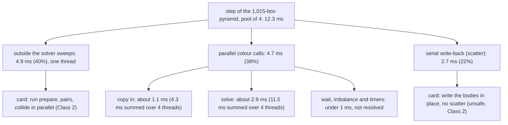

# Review 8-98: on the large pyramid a pool of 4 spends 40% of the step in serial work outside the solver, 22% in the serial write-back, and 38% in the parallel colour calls (about 24% of the step is solving); the chunk size is a lever of about 5% at most

Task: 8-98 (from 8-22 and 8-14). Class 1 here (measurement and a report; no engine code). The fixes it points to are Class 2 (unsafe or concurrency) and are not made. Owner go-ahead: "Go on with 8-97 to 8-99" (2026-11-27).

In plain words: a pool of 4 workers makes the 1,015-box pyramid 1.4 times faster than one thread, not 4 times. This card asked where the other time goes. **A step of 12.3 ms splits into 4.9 ms that no worker helps with (finding pairs, the contact tests, preparing, and the rest), 2.7 ms in which one thread copies the results of each colour back into the bodies, and 4.7 ms in the parallel colour calls, of which about 2.9 ms is the solving itself and about 1.1 ms the copying in of the bodies (4 threads at once).** The copies the staged path makes of the bodies cost about 2 ms of a single thread. Changing the size of a chunk helps by 5% at most.

## What was measured

Method: two throwaway probes, not in the repository and not kept in it (the timers are described below; a copy of the patch is in the author's scratchpad, which a reader cannot reach). Release build, Windows, one laptop (20 hardware threads), the scene built with sleeping off and 60 steps run to leave the landing. "Serial" is the unstaged path (no scheduler); "staged" is the path with chunks, copies and scatter (in 3D the `simd` flag only switches staging on, there is no lane code). Timings (first table): 9 blocks of 10 steps, minimum and median. Profile (second table): clock reads around the pool call, the scatter and, inside each chunk, the copy-in and the solve, summed over 50 steps and divided by 50. The profile adds about 9,400 clock reads a step (about 0.2 ms, 2%); the chunk timers are inside the sums of copy-in and solve. The "outside the solver sweeps" figure is not timed: it is the step minus the pool call minus the scatter, and it came out between 4.8 and 4.9 ms in the four configurations of the table (and 4.89 ms in a fifth profile run, pool of 4 with chunks of 8: step 12.20, pool call 4.75, scatter 2.56), which fits the 4.7 to 4.8 ms that 8-22 reported on the serial build (prepare 1.0, pairs 1.2, contact tests 2.1 and the rest; not re-measured on the staged build).

### Step time, 1,015 boxes (ms; minimum and median of 9 blocks)

| configuration | minimum | median |
|---|---|---|
| serial, scalar (the reference) | 15.92 | 16.16 |
| staged, on the calling thread (no pool) | 17.54 | 18.61 |
| pool of 1, chunks of 4 to 128 | 17.83 to 18.18 | 18.1 to 18.7 |
| pool of 2, chunks of 4 to 64 | 12.95 to 13.21 | 13.1 to 13.4 |
| pool of 4, chunks of 4 to 16 | 11.22 to 11.39 | 11.4 to 11.6 |
| pool of 4, chunk 64 | 12.18 | 12.48 |
| pool of 4, chunk 32 (the default), later run | 11.7 to 12.05 | 11.8 to 12.15 |
| pool of 4, chunk 128 | 13.45 | 13.61 |
| pool of 8, chunks of 4 to 16 | 11.44 to 11.95 | 11.5 to 12.1 |
| pool of 8, chunk 32 / 64 / 128 | 13.18 / 14.97 / 16.06 | 13.5 / 15.4 / 17.4 |

With the best chunk (8) a pool of 4 is 1.42 times faster than serial (15.92 to 11.22 ms, minima), an efficiency of 0.35; with the default chunk of 32 it is 1.32 to 1.36 times (11.7 to 12.05 ms). Against a pool of 1, which has the same staging cost, it is 1.6 times faster (17.85 to 11.22, efficiency 0.40). 8 workers are no better than 4 at best and worse with big chunks, where there are fewer chunks than workers in the small colours.

### Where a step goes (ms a step; 50 steps, instrumented)

| | pool 1 | pool 2 | pool 4 | no pool (staged) |
|---|---|---|---|---|
| step | 19.30 | 13.77 | 12.27 | 18.55 |
| pool call (wall), 208 colour calls a step | 13.10 | 7.11 | 4.72 | 12.40 |
| of it, copy-in, summed over threads | 2.45 | 2.69 | 4.34 | 2.02 |
| of it, solve, summed over threads | 10.44 | 10.58 | 11.51 | 10.22 |
| scatter (serial write-back) | 1.33 | 1.84 | 2.65 | 1.37 |
| rest (step minus the two above) | 4.87 | 4.82 | 4.90 | 4.78 |

Per step: 208 colour calls, 90,090 constraints solved in them (433 a call), 2,912 chunks of 32 (11,336 of 8).

## What was found

| item | result |
|---|---|
| the serial rest | 4.8 to 4.9 ms in every configuration: it does not change with workers. With 4 workers it is 40% of the step and is the floor: with the solve and the scatter free, the step would still take about 4.9 ms |
| the scatter | 1.3 ms on one thread, 2.65 ms at 4 workers (22% of the step). It is one thread storing bodies that other cores just wrote; that cache-traffic reason is a hypothesis, no counters were taken |
| the copies | the staged path on one thread costs 1.6 to 2.5 ms a step more than serial (17.54 against 15.92 minimum, 18.61 against 16.16 median); the profile measures the copy-in at 2.0 ms and the scatter at 1.4 ms on one thread, and the staged path does not do the solve in the same way as serial, so the gap is not the copy-in alone. At 4 workers the copy-in is 4.3 ms summed over the threads against 2.5 for one (+77%), probably because the bodies it reads were written by other cores (not measured). The solve itself slows by 10% (10.4 to 11.5 summed ms) |
| fork-join and imbalance | the pool call is 4.72 ms against 3.96 ms if the 15.85 summed thread-ms were shared perfectly over 4 threads: a residual of about 0.8 ms (3.7 µs per colour call, 6% of the step). It holds fork-join, imbalance, the chunk-claim cost and the timers together, and is smaller than the 1 ms by which the profile and the timing runs differ (see Not verified): read it as under about 1 ms, not resolved |
| the pool call itself | scales 1.84 at 2 workers and 2.78 at 4 (efficiency 0.92 and 0.69, from a call of 13.1 ms on one): good to 2 workers, losing at 4 |
| the chunk size | a small lever, at most about 5%, on the large scene: chunks of 8 to 32 span 0.55 ms (4.9%) in both runs (first 11.22 to 11.77 ms, second 11.5 to 12.05 ms); 32, the default, was the slowest or level in all three comparisons. Large chunks are worse (64: 12.18 ms, 128: 13.45 ms), and with 8 workers chunk 32 is 13.18 ms against 11.46 at chunk 8 (fewer chunks than a pool needs is a likely reason, not tested). On the 91-box pyramid chunks of 8 were 0.05 to 0.17 ms (3% to 12%) faster than 32 in two rounds (minima 1.36 and 1.27 against 1.52 and 1.44; in the second round the medians nearly tie, 1.47 against 1.52); the mixed pile is the same at 0.57 to 0.62 ms |
| bits | nothing changed: the engine code is as on `develop` (the probe was removed) |

## Decisions

1. No code change here. The levers are, in the order of size (all estimates, none built):
   - **The serial rest, 4.9 ms**: running preparing, the pair search and the contact tests in parallel could save about 2.5 ms of it with 4 workers (the 2.1 ms of contact tests and the 1.2 of pairs, 3.3 ms, are independent per pair, but their results must be merged in the canonical order; the merge cost is not counted). Class 2 (concurrency); the determinism checks (D1) apply.
   - **The scatter, 2.65 ms, and the copies**: writing the bodies in place, without a copy-in and a scatter, removes the scatter (2.65 ms) and most of the copy-in (4.3 summed ms, about 1.1 ms of wall time at 4 workers). The colours touch pairwise different bodies, but the type system cannot see that, so it needs `unsafe` (or a different data layout): Class 2, with a budget and a SAFETY argument.
   - **Chunk size**: not worth a card for the large scene; a default of 8 instead of 32 is a candidate for small scenes (5% to 11% of 1.4 ms) and may be bit-identical (the cut does not change the result by design), which was not checked.
2. Three Backlog cards are opened for these points: 8-104 (the serial rest in parallel), 8-105 (bodies written in place), 8-106 (default chunk of 8 for small scenes).
3. 8 workers instead of 4 do not help on this laptop (20 hardware threads, which the author believes mix performance and efficiency cores: not checked); the pool size to benchmark remains 4.

## Not verified

- The profile ran once for each configuration; its pool-of-1 step (19.30 ms) is 1.1 to 1.5 ms above the minima of the timing table (17.83 to 18.18) and 0.6 to 1.2 ms above its medians, and the no-pool step (18.55) equals the median of that table, so the profile carries noise of about 1 ms or the timers cost more than the estimated 0.2 ms.
- Only one laptop, Windows; the machine was not idle (an editor and an agent session open). Timings between the first and second run of the same configuration differ by up to 4%.
- The 4.9 ms "rest" is inferred (step minus the other two), not timed, and the split of it into prepare, pairs, contact tests and the rest is the one of 8-22 on the serial build, not re-measured on the pooled build.
- The cost of the clock reads is estimated (about 2%), not measured separately.
- The causes named as likely (cache traffic for the scatter and the copy-in, too few chunks for 8 workers, core mix) are not measured: no counters were taken. The staged path was compared with the unstaged serial path, which differ in more than the copies.
- No bit-identity check was needed (no code change), and none was made for a chunk size of 8.
- The effect of any of the three levers: no prototype was built. A parallel step of the pairs and a scatter in place may cost more than the estimates (cache traffic grew when the scatter went to 4 threads' data).
- Linux, ARM64 and a second machine; the other scenes were timed only for the chunk size.
- Mermaid read by the author, not rendered.

## R1 to R8

| phase | result |
|---|---|
| R1 self | the probe was removed before the report; the diff is this file only |
| R2 automated | no code change: nothing to build; wiki lint and the local gates in the PR |
| R3 independent | one read-only review, no blocker, five majors fixed (Loops) |
| R4 QA | timings repeated (two runs of the large pyramid, two rounds of chunk sizes); the profile ran once per configuration and differs from the timing table by up to 1.5 ms (see Not verified) |
| R5 to R7 | none (no code) |
| R8 product fit | the open point of 8-22 is answered with measured shares and three follow-up cards; the choice of which to build is the owner's |

## Loops

| loop | finding | handling |
|---|---|---|
| 1 | major: pool efficiency 0.77 not derivable | recomputed: 0.92 at 2 workers, 0.69 at 4 |
| 1 | major: 'real parallel solving 4.7 ms' mixed wall and summed time | wording and mermaid give wall time (copy-in about 1.1, solve about 2.9) next to the summed figures |
| 1 | major: profile not tied to the timing table, fork-join residual below the noise | stated in Not verified; residual given as under 1 ms, not resolved |
| 1 | major: 1.4x mixed chunk and path; chunk 'not a lever' too strong | speed-up given for chunk 8 and 32 and against pool of 1; chunk wording and the missing rows added |
| 1 | major: Loops empty while the text pointed to it | filled; cards 8-104, 8-105, 8-106 named in Decisions |
| 1 | minor: 0.07 ms, copies arithmetic, causes as findings, 4.5 sum, 3 ms ceiling, five configurations, patch location | corrected or reworded; the reviewer's 'SIMD versus scalar' point does not apply (3D has no lane code, the `simd` flag only switches staging on), stated in Method |
